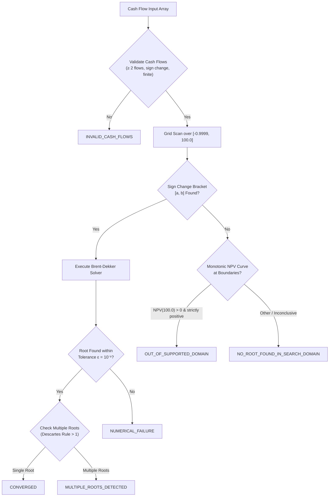

# POC-001 — Final Pre-Approval Consistency Audit
**Evidence-Based Decision Package for Project-Owner Approval of Gate 1 and Gate 2**

**Document Status:** PROPOSED — awaiting project-owner review  
**Date:** 2026-10-10  
**Operating Mode:** Strict Read-Only (Preserved source untouched; zero workspace writes; no root Git initialization)  
**Implementation Authority:** NONE  
**Scope:** Project Charter v0.2.2, Salvage Verification Gate Addendum v1.2, and `_salvage/AIStudio`

---

## 1. Audit Task Summary & Disposition Dashboard

| Audit Task | Scope | Status | Primary Finding |
|---|---|:---:|---|
| **Task A: Charter Consistency** | Charter v0.2.2 text & invariants | **PASS WITH CORRECTIONS** | Strategic direction is sound. Four minimal wording corrections proposed to prevent forcing numeric answers for uncalculated dimensions or unrecovered capital, and to scope the initial inventory conservation identity. |
| **Task B: Test-Counting Evidence** | Test suites in `_salvage/AIStudio` | **VERIFIED WITH QUALIFIED LABELS** | Headline 88 count is downgraded from "independent invariants" to "reported core cases or checks." The 34 cases in `redTeamRunner.ts` are verified as a 100% duplicate subset of `financialContract.ts`. Shared static mocks confirm internal fixture consistency, not market correctness. |
| **Task C: Return-Solver Contract** | Brent-Dekker & return metrics | **VERIFIED & QUALIFIED** | 6 distinct, mathematically grounded solver statuses defined. Solvers cannot infer out-of-domain roots merely from bracket failure. Closed-form metrics expose explicit status (`NOT_YET_RECOVERED`, `OPEN_POSITION`) without forced numeric values. |
| **Task D: Disposition & Governance** | Component matrix & decision gates | **VERIFIED** | `redTeamRunner.ts` designated as `REDUNDANT CANDIDATE — DO NOT MODIFY IN THIS AUDIT`. Decision gates 1, 2, and 3 maintained strictly independent. External repository pool confirmed as a separate research backlog. |

---

## 2. Task A — Charter v0.2.2 Consistency Audit

The actual text of `POC-001_Project_Charter_v0.2.2.md` was inspected. The strategic framework is consistent, but four specific wording improvements are required to prevent misinterpretation:

### 2.1 Issue 1: Return Display Acceptance Criteria vs Unavailable Deflators
- **Current Text (Section 11, DEC-009 & Section 2.1, Line 82)**:
  > *"Nominal and real returns always shown separately"*
- **Audit Finding**: Could be read as requiring a numeric output for real returns even when inflation deflator data is unvalidated or unavailable, contradicting Section 4.2.
- **Proposed Minimal Correction (Section 2.1 & DEC-009)**:
  > *"Nominal and real returns are presented as distinct measures when calculable. Where inflation indices, tax schedules, or deflators are unavailable, unvalidated, or unsupported, the engine must honestly report that measure as unavailable (`DATA REQUIRED` / `DATA INSUFFICIENT`) rather than manufacturing numeric estimates. The same principle applies to after-tax and benchmark-relative performance."*

### 2.2 Issue 2: Capital Recovery Metrics on Open or Unrecovered Positions
- **Current Text (Section 2.2, Line 107)**:
  > *"In all cases, closed-form, deterministic metrics — specifically simple Holding Period Return (HPR), Cash-on-Cash multiple, and Capital Recovery Duration — must be computed and reported alongside any iterative numerical rate..."*
- **Audit Finding**: An open position where capital has not yet been recovered (cumulative inflows < cumulative outflows) cannot have a numeric Capital Recovery Duration. Mandating that it "must be computed and reported" risks forcing an artificial numeric duration or division by zero.
- **Proposed Minimal Correction (Section 2.2)**:
  > *"In all cases, the platform must expose simple Holding Period Return (HPR), Cash-on-Cash multiple, and Capital Recovery Duration or their explicit status. For open, incomplete, or unrecovered positions, the engine must return an explicit status (e.g. `NOT_YET_RECOVERED`, `OPEN_POSITION`) rather than forcing a meaningless or fabricated numeric duration."*

### 2.3 Issue 3: Scoping the Inventory Conservation Identity
- **Current Text (Section 3.2, Line 152)**:
  > *"The simulated cash and inventory ledgers must reconcile independently under documented conservation identities ($Opening + Inflow - Outflow == Closing$, $Opening + Procured - Sold - Damaged == Closing$)..."*
- **Audit Finding**: The simplified formula $Opening + Procured - Sold - Damaged == Closing$ omits customer returns, supplier returns, scrap, loss, manual cycle adjustments, and warehouse state transitions (e.g. in-transit vs reserved vs sellable).
- **Proposed Minimal Correction (Section 3.2)**:
  > *"The simulated cash and inventory ledgers must reconcile independently under documented conservation identities. In the initial Strategy #1 physical baseline, inventory conforms to $Opening + Procured - Sold - Damaged == Closing$. As operational capabilities expand, additional event types (customer returns, supplier returns, scrap, adjustments, and inventory-state transitions) must be incorporated with explicit, auditable conservation rules."*

### 2.4 Issue 4: Section References & Cross-References
- **Audit Finding**: Section 2.2 was retitled "Numerical return solver acceptance criteria," shifting "Financial investments as benchmarks" to Section 2.3. All cross-references across the charter, decision register (DEC-012), and Staged Plan (citing Addendum v1.2 in Phase 0.2) have been verified as consistent.

---

## 3. Task B — Test-Counting Evidence Audit

### 3.1 Exact Definition of the Three Counting Levels

| Level | Exact Definition | Reported Total | Audit Status | Evidence Basis |
|---|---|:---:|:---:|---|
| **Level 1: Assertion Executions** | Total count of check/assertion evaluations across all script execution runs | **186** | **CONFIRMED** | Empirical runtime tally: $6 \text{ (contract)} + 60 \text{ (adv)} + 34 \text{ (red-team)} + 26 \text{ (step 3)} + 17 \text{ (step 5)} + 12 \text{ (gov)} + 9 \text{ (research)} + 22 \text{ (registry)} = 186$. Reflects nested re-runs. |
| **Level 2: Distinct Assertion Sites** | Total unique assertion statements / test case records written in source code | **126** | **CONFIRMED** | Static source analysis: 6 contract tests + 60 adversarial tests + 22 equation registry fixtures + 10 distinct governance checks + 8 distinct research checks + 5 distinct Step 3 checks + 15 distinct Step 5 checks = 126. |
| **Level 3: Reported Core Cases or Checks** | Core calculation checks and fixture validations evaluated in the frozen financial core and model registry | **88** | **QUALIFIED LABEL** | $6 \text{ contract tests} + 60 \text{ adversarial cases} + 22 \text{ equation fixtures} = 88$. **Downgraded from "independent invariants"**: represents 88 specific test cases evaluated against hardcoded fixtures. |

### 3.2 Full Duplicate Mapping: `redTeamRunner.ts` (34 Cases) vs `financialContract.ts` (60 Cases)

Every single test case in `scripts/redTeamRunner.ts` was mapped line-by-line to `src/lib/financialContract.ts` (`runFullAdversarialSuite`):

| `redTeamRunner.ts` Case ID | `redTeamRunner.ts` Line | `financialContract.ts` Line | Test Name & Target Invariant | Expected Result Match | Overlap Finding |
|---|:---:|:---:|---|:---:|:---:|
| `CANONICAL-RECON-01` | Line 60 | Line 725 | Canonical Net Contribution Calculation | Identical (₹-38.21) | **100% Exact Duplicate** |
| `EPISTEMIC-SEP-01` | Line 92 | Line 750 | Preservation of 7 Epistemic Classes | Identical | **100% Exact Duplicate** |
| `ILLEGAL-PROMO-01` | Line 119 | Line 761 | Block Low-Confidence IndiaMART Quote | Identical | **100% Exact Duplicate** |
| `ILLEGAL-PROMO-02` | Line 130 | Line 770 | Approve Quotation with Provenance Retained | Identical | **100% Exact Duplicate** |
| `PROVENANCE-PRESERVE-01` | Line 151 | Line 786 | Trace Lineage from Observation to Decision | Identical | **100% Exact Duplicate** |
| `CONFIDENCE-PROV-01` | Line 168 | Line 799 | Block Decision on Low Confidence | Identical | **100% Exact Duplicate** |
| `IMMUTABILITY-01` | Line 203 | Line 822 | Parameter Immutability During Execution | Identical | **100% Exact Duplicate** |
| `DETERMINISM-100` | Line 226 | Line 841 | 100 Consecutive Identical Runs (₹0 Drift) | Identical | **100% Exact Duplicate** |
| `SCENARIO-BLEED-01` | Line 249 | Line 855 | Zero Cross-Scenario State Bleed | Identical | **100% Exact Duplicate** |
| `HISTORICAL-IMMUT-01` | Line 284 | Line 865 | Historical Decision Immutability | Identical | **100% Exact Duplicate** |
| `FUTURE-DATING-01` | Line 293 | Line 874 | Rejection of Future-Dated Observations | Identical | **100% Exact Duplicate** |
| `MIXED-EVIDENCE-01` | Line 315 | Line 892 | Rejection of Mixed-Evidence Decision Promotion | Identical | **100% Exact Duplicate** |
| `EVIDENCE-SCORE-01` | Line 341 | Line 904 | Multi-Factor Composite Quality Scoring | Identical | **100% Exact Duplicate** |
| `DECISION-SEP-01` | Line 359 | Line 915 | Decouple Rule Decisions from Raw Margin | Identical | **100% Exact Duplicate** |
| `CONTRADICTORY-ATTACK-01` | Line 382 | Line 924 | Multi-Source Contradiction Injection Gate | Identical | **100% Exact Duplicate** |
| `EXTREME-01` to `EXTREME-05` | Lines 396–436 | Lines 935–975 | Zero ASP, Negative Margin, Extreme Weight | Identical | **100% Exact Duplicate** |
| `ACCOUNTING-01` | Line 457 | Line 992 | Core Accounting Identity (Rev - COGS) | Identical | **100% Exact Duplicate** |
| `MISSING-DATA-01` | Line 477 | Line 1002 | Fail-Closed on Missing Fee Parameters | Identical | **100% Exact Duplicate** |
| `CAPITAL-ECON-01` | Line 502 | Line 1015 | Working Capital Lockup & Runway Bounds | Identical | **100% Exact Duplicate** |
| `DEMAND-CAP-01` | Line 518 | Line 1027 | Volume Cap at Max Monthly Demand | Identical | **100% Exact Duplicate** |
| `MOQ-TEST-01` | Line 530 | Line 1037 | Enforce Supplier Minimum Order Quantities | Identical | **100% Exact Duplicate** |
| `INV-TEST-01` | Line 549 | Line 1047 | Inventory Conservation ($Opening + Rec - Sold$) | Identical | **100% Exact Duplicate** |
| `CASH-TEST-01` | Line 563 | Line 1056 | Cash Conservation ($Opening + In - Out$) | Identical | **100% Exact Duplicate** |
| `XIRR-01` to `XIRR-03` | Lines 594–612 | Lines 1069–1085| Standard 1-Year, 6-Month, Flat Return | Identical | **100% Exact Duplicate** |
| `MVB-01` to `MVB-02` | Lines 630–639 | Lines 1097–1105| In-House Stamping Tooling Crossover | Identical | **100% Exact Duplicate** |
| `SNAPSHOT-01` | Line 673 | Line 1428| Pipeline Snapshot Serialization & Restore | Identical | **100% Exact Duplicate** |
| `VERSION-01` | Line 682 | Line 1437| Frozen Core SemVer v1.0.0 Enforcement | Identical | **100% Exact Duplicate** |

**Conclusion**: All 34 cases in `redTeamRunner.ts` are a 100% duplicate subset of the 60 cases in `runFullAdversarialSuite`. Running `redTeamRunner.ts` provides zero unique assertion coverage.

### 3.3 Shared Mocks & Fixture Dependency
The test suites rely upon common static fixtures:
1. `baseFeeAssumptions` in [`src/data/seedData.ts`](file:///d:/Market%20HFT%20OS/_salvage/AIStudio/src/data/seedData.ts) (Referral 8.5%, Closing ₹25, Pick/Pack ₹28, Storage ₹6, hardcoded ₹24 weight chunk).
2. `canonicalCatalog.ts` (Fixed dimensions for SS304 DIN 3017 clamps).
3. `verifyStep3.ts`, `step5_verification_suite.ts`, `governanceVerification.ts`, and `researchVerification.ts` explicitly call `runContractVerificationSuite` and `runFullAdversarialSuite` inside themselves, re-testing the same 66 cases under the same fixtures.

**Evidence Qualification**: The tests prove that the calculations are **internally consistent against their coded fixtures**. They do **not** establish real-world market accuracy, supplier quotation executability, or external validity.

---

## 4. Task C — Qualified Return-Solver Acceptance Contract

To prevent unwarranted claims of universal convergence or false out-of-domain assertions, the return solver contract is formalized with six distinct, mutually exclusive statuses:

### 4.1 Detailed Status Specifications
1. **`CONVERGED`**: A root $r^*$ was found within the supported search interval $[-0.9999, 100.0]$ satisfying $|NPV(r^*)| < \epsilon$ within 50 iterations.
2. **`NO_ROOT_FOUND_IN_SEARCH_DOMAIN`**: The documented search procedure found no root within $[-0.9999, 100.0]$. *This does not prove that no economic root exists outside the domain.*
3. **`MULTIPLE_ROOTS_DETECTED`**: Multiple sign changes in the cash flow array produced multiple internal rates of return within the search domain. The primary economic root is reported alongside the ambiguity diagnostic. *The solver does not claim to have exhaustively found every possible complex or real root.*
4. **`OUT_OF_SUPPORTED_DOMAIN`**: Returned **only when explicit evidence exists** that the solution lies outside the supported interval (specifically, where the NPV curve is strictly monotonic and $NPV(100.0) > 0$ for high-velocity gains, or $NPV(-0.9999) < 0$ for total ruin).
5. **`INVALID_CASH_FLOWS`**: The input fails basic structural requirements (fewer than 2 cash flows, all flows have identical signs, or total outlay is zero).
6. **`NUMERICAL_FAILURE`**: A bracket was identified, but Brent-Dekker exhausted its iteration budget without satisfying tolerance, or floating-point breakdown occurred.

### 4.2 Independent Reporting of Closed-Form Metrics
The following metrics must always be reported independently of the annualization solver:
- **Holding Period Return (HPR)**: $\frac{\sum Inflows - \sum Outflows}{\sum Outflows} \times 100$. Closed-form, exact.
- **Cash-on-Cash Multiple**: $\frac{\sum Inflows}{\sum Outflows}$.
- **Capital Recovery Duration**: Elapsed days until cumulative inflows $\ge$ cumulative outflows.
  - *Status on Open Positions*: If cumulative inflows have not yet exceeded cumulative outflows, the engine must return `status: NOT_YET_RECOVERED` with `duration_days: null`. It must never fabricate an arbitrary or completed number.

---

## 5. Task D — Component Disposition & Decision Framework

### 5.1 Legacy Component Disposition Table

| Component / File | Inspected Functionality | Audit Evidence | Recommended Disposition | Action in Current Gate |
|---|---|---|:---:|---|
| [`scripts/redTeamRunner.ts`](file:///d:/Market%20HFT%20OS/_salvage/AIStudio/scripts/redTeamRunner.ts) | 34 CLI regression test cases | 100% duplicate of cases in `financialContract.ts` | **REDUNDANT CANDIDATE** | **DO NOT MODIFY IN THIS AUDIT** (Preserve read-only isolation) |
| [`src/lib/calculators.ts`](file:///d:/Market%20HFT%20OS/_salvage/AIStudio/src/lib/calculators.ts) | Pure arithmetic calculators (COGS, Fees, XIRR) | Deterministic math passes; XIRR diverges on 3 edge cases; ₹24 slab hardcoded | **PRIORITY B (REMEDIATE)** | Retain quarantined; remediate XIRR & fee slabs during Gate M4 |
| [`src/lib/financialContract.ts`](file:///d:/Market%20HFT%20OS/_salvage/AIStudio/src/lib/financialContract.ts) | Contract wrappers & 60 adversarial cases | All 60 cases pass with ₹0 drift | **PRIORITY B (REMEDIATE)** | Retain quarantined; upgrade to `GovernedAssumption` during Gate M2 |
| [`src/lib/equationRegistry.ts`](file:///d:/Market%20HFT%20OS/_salvage/AIStudio/src/lib/equationRegistry.ts) | 15 physical models & 22 fixtures | 22/22 fixtures pass; custom SHA-256 uses deprecated `unescape` | **PRIORITY A (EVALUATE EARLY)** | Retain quarantined; migrate in Gate M3; replace `unescape` with Node `crypto` |
| [`src/types/contract.ts`](file:///d:/Market%20HFT%20OS/_salvage/AIStudio/src/types/contract.ts) | Provenance & epistemic types | Clean types; requires `UNKNOWN` confidence support | **PRIORITY A (EVALUATE EARLY)** | Retain quarantined; migrate in Gate M1 with Charter v0.2.2 alignment |
| `_salvage/external/` (7 Repos) | External research reference pool | Distinct domains, AGPL/GPL copyleft risks, unverified licenses | **SEPARATE RESEARCH BACKLOG** | Keep quarantined; do not merge or install |

---

## 6. Pre-Approval Recommendations for Project Owner

### Decision 1: Gate 1 — Charter Approval
- **Recommendation**: **APPROVE AS AMENDED**.
- **Condition**: Incorporate the four minimal wording corrections identified in Section 2 (scoping return availability, capital recovery `NOT_YET_RECOVERED` status, and physical baseline inventory identity) into the final approved text.

### Decision 2: Gate 2 — Salvage Verification Gate Approval
- **Recommendation**: **CONDITIONAL APPROVAL**.
- **Condition**: Approve the component disposition matrix and Brent-Dekker solver specification with the qualified status codes. Acknowledge that the 88 headline tests represent reported core cases under static fixtures, and designate `redTeamRunner.ts` as a redundant candidate to be safely retired during implementation.

### Decision 3: Gate 3 — Implementation Authorization (Gate M0 Only)
- **Recommendation**: **PROCEED ONLY UPON EXPLICIT OWNER AUTHORIZATION**.
- **Authorized Scope (When Approved)**:
  1. Create root `.gitignore` containing `/_salvage/` quarantine.
  2. Run `git init` in `D:\Market HFT OS`.
  3. Commit the approved `PROJECT_CHARTER.md` and `RESEARCH_CORPUS_INDEX.md`.
  4. *Zero application code migration and zero dependency installation until Gate M1 is separately approved.*

---

## 7. Unresolved Issues Register for Owner Direction

| Issue ID | Category | Description | Recommended Resolution |
|---|---|---|---|
| **ISS-010** | Governance | Confirm whether the four minimal wording corrections in Section 2 should be committed to `PROJECT_CHARTER.md` prior to root Git initialisation. | Apply wording edits directly to governing charter text upon Gate M0 commit. |
| **ISS-011** | Salvage | Confirm that `scripts/redTeamRunner.ts` should be permanently retired in favor of `financialContract.ts` during Gate M2. | Exclude `redTeamRunner.ts` from Gate M2 migration; retain solely in preserved `_salvage/` archive. |
| **ISS-012** | Benchmarks | Confirm that comparison benchmarks in Phase 4 will ingest official static CSV downloads (RBI / NSE Bhavcopy) rather than scraping wrappers. | Adopt official published files as the mandatory data policy. |
