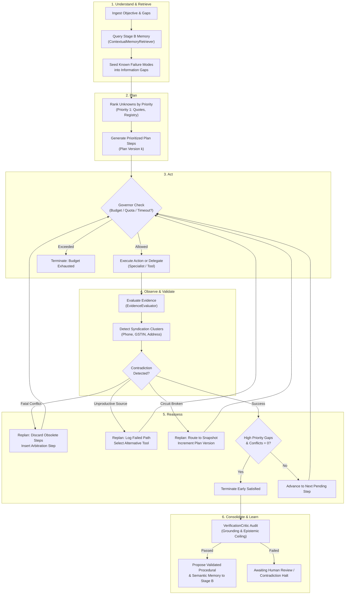

# POC-001 — Agent Reasoning & Execution Quality Upgrade
**Subsystem:** Adaptive, Evidence-Aware, Bounded Agent Execution Core (`src/agents/reasoning/`)  
**Milestone:** Agent Reasoning & Execution Quality Upgrade (DEC-REAS)  
**Date:** 2026-10-30  
**Verification:** Vitest 37/37 passing across Suites 61, 62, 63, and 64

---

## 1. Executive Summary & Deficiencies Resolved

The existing agent implementations in POC-001 were fundamentally task-oriented and rigid:
1. **Static Plan Blindness:** Earlier engines (`ResearchSchedulerAndManager` in `src/agents/m6AgentFramework.ts` and `InvestigationPlanner` in `src/discovery/investigationPlanner.ts`) generated a static plan or a hardcoded 9-stage sequence upfront. They blindly executed downstream steps (e.g. dispatching RFQs) even if step 1 revealed that the entity was amalgamated, dissolved, or non-existent.
2. **Naive Corroboration (Syndication Vulnerability):** Marketplace scrapers treated multiple directory listings as independent confirmations even when they shared identical phone numbers, physical addresses, or GSTINs.
3. **Absence of a Dynamic ReAct Loop:** Agents lacked an observe-and-reassess mechanism: unobserved fields caused immediate blind retries or fatal quarantine rather than triggering a dynamic pivot to alternative sources or tools.
4. **Ungrounded Hallucination & Promotion Risk:** Without an explicit critic or verification gate, unverified hypotheses and directory claims could be promoted into validated memory.
5. **Lack of Mid-Investigation State Checkpointing:** An interrupted agent run lost all in-flight plan states, requiring full reprocessing from scratch.

To resolve these deficiencies, the **Agent Reasoning & Execution Quality Upgrade** introduces an adaptive ReAct-style architecture based on six foundational pillars:
- **Adaptive ReAct Loop:** Alternates between reasoning, taking action, observing results, and updating the plan.
- **Dynamic Task Decomposition & Scoped Delegation:** Lead investigator maintains problem ownership and delegates bounded sub-questions to specialists, passing scoped context rather than bloated trace histories.
- **Evidence-Aware Reasoning & Syndication Detection:** Classifies evidence along a strict epistemic hierarchy and groups listings sharing phone/GSTIN/CIN/address into syndication clusters.
- **Independent Verification Critic:** Deterministic gate auditing evidence citations, category requirements, and active contradictions before promoting claims.
- **Bounded Execution & Circuit Breaking:** Hard caps on iterations, tool calls, delegation depth, and wall-clock time, with automatic circuit breaking for failing endpoints.
- **Checkpointable Persistent Working Memory:** Monotonically fenced state serialization to disk, enabling resumption after process termination.

---

## 2. File Catalog

All functionality was implemented in dedicated, clean modules under [`src/agents/reasoning/`](file:///d:/Market%20HFT%20OS/src/agents/reasoning/) and verified by Acceptance Suite 64:

| File | Purpose | Key Classes & Interfaces |
| :--- | :--- | :--- |
| [`src/agents/reasoning/reasoningTypes.ts`](file:///d:/Market%20HFT%20OS/src/agents/reasoning/reasoningTypes.ts) | Domain contracts, epistemic taxonomy, inspectable decision records, budget profiles | [`EpistemicClassification`](file:///d:/Market%20HFT%20OS/src/agents/reasoning/reasoningTypes.ts#L22-L29), [`CheckpointableInvestigationState`](file:///d:/Market%20HFT%20OS/src/agents/reasoning/reasoningTypes.ts#L173-L200), [`StructuredDecisionRecord`](file:///d:/Market%20HFT%20OS/src/agents/reasoning/reasoningTypes.ts#L110-L118), [`SpecialistFindingArtifact`](file:///d:/Market%20HFT%20OS/src/agents/reasoning/reasoningTypes.ts#L137-L148) |
| [`src/agents/reasoning/evidenceEvaluator.ts`](file:///d:/Market%20HFT%20OS/src/agents/reasoning/evidenceEvaluator.ts) | Epistemic classification, syndication clustering, contradiction detection | [`EvidenceEvaluator`](file:///d:/Market%20HFT%20OS/src/agents/reasoning/evidenceEvaluator.ts#L22-L200), syndication fingerprinting (phone/GSTIN/address), conflict detection |
| [`src/agents/reasoning/boundedExecutionGovernor.ts`](file:///d:/Market%20HFT%20OS/src/agents/reasoning/boundedExecutionGovernor.ts) | Resource bounds, quotas, timeout guards, and circuit breaking | [`BoundedExecutionGovernor`](file:///d:/Market%20HFT%20OS/src/agents/reasoning/boundedExecutionGovernor.ts#L32-L160), [`CircuitBreakerOpenError`](file:///d:/Market%20HFT%20OS/src/agents/reasoning/boundedExecutionGovernor.ts#L16-L21), early termination logic |
| [`src/agents/reasoning/specialistDelegator.ts`](file:///d:/Market%20HFT%20OS/src/agents/reasoning/specialistDelegator.ts) | Lead investigator / specialist worker orchestration with scoped context passing | [`SpecialistDelegator`](file:///d:/Market%20HFT%20OS/src/agents/reasoning/specialistDelegator.ts#L26-L140), parallel delegation, reconciliation of specialist findings |
| [`src/agents/reasoning/verificationCritic.ts`](file:///d:/Market%20HFT%20OS/src/agents/reasoning/verificationCritic.ts) | Selective verification gate auditing claims, citations, and category constraints | [`VerificationCritic`](file:///d:/Market%20HFT%20OS/src/agents/reasoning/verificationCritic.ts#L21-L125), deterministic citation checks, epistemic ceiling calculation |
| [`src/agents/reasoning/investigationStateStore.ts`](file:///d:/Market%20HFT%20OS/src/agents/reasoning/investigationStateStore.ts) | Checkpointing engine with monotonic fencing tokens for resumption | [`InvestigationStateStore`](file:///d:/Market%20HFT%20OS/src/agents/reasoning/investigationStateStore.ts#L20-L100), atomic JSONL persistence, stale commit rejection |
| [`src/agents/reasoning/adaptiveReasoningLoop.ts`](file:///d:/Market%20HFT%20OS/src/agents/reasoning/adaptiveReasoningLoop.ts) | Core 6-phase ReAct reasoning and execution engine | [`AdaptiveReasoningLoop`](file:///d:/Market%20HFT%20OS/src/agents/reasoning/adaptiveReasoningLoop.ts#L48-L460), replanning on contradiction, unproductive sources, and circuit breakers |
| [`src/agents/reasoning/index.ts`](file:///d:/Market%20HFT%20OS/src/agents/reasoning/index.ts) | Module re-exports | Clean public API |
| [`tests/acceptance/suite64_agent_reasoning_and_execution_quality.test.ts`](file:///d:/Market%20HFT%20OS/tests/acceptance/suite64_agent_reasoning_and_execution_quality.test.ts) | 12 normative acceptance tests | Suite 64 covering all requirements |

---

## 3. The 6-Phase Adaptive Reasoning Loop

The execution cycle operates in an explicit ReAct loop:



---

## 4. Before & After Behavioral Examples

### Example 1: Discovery of Corporate Amalgamation / Strike-Off

| Behavior | Before Upgrade | After Upgrade (ReAct Loop) |
| :--- | :--- | :--- |
| **Observation** | Step 1 queries MCA registry and discovers candidate company was amalgamated into parent in 2021. | Step 1 queries MCA registry; `EvidenceEvaluator` records `corporate_status: AMALGAMATED_DISSOLVED` vs claimed `ACTIVE_MANUFACTURER`. |
| **Reaction** | Blindly proceeded to Step 2 (dispatching direct RFQs for unit quotes) because it was pre-planned in the static DAG. | Automatically flags `FATAL_DISQUALIFIER`. Marks downstream RFQ steps as `SKIPPED_OBSOLETE`, increments `plan_version` from 1 to 2, logs `CONTRADICTION_DISCOVERED` in replan history, and inserts targeted conflict arbitration. |
| **Wasted Resources** | 3 unnecessary tool calls, supplier email requests, and failed RFQ retries. | **0 wasted downstream tool calls.** Immediate pivot. |

### Example 2: Syndicated Marketplace Listings

| Behavior | Before Upgrade | After Upgrade (ReAct Loop) |
| :--- | :--- | :--- |
| **Observation** | Scraped IndiaMART listing and TradeIndia listing for the same clamp manufacturer. | Observed IndiaMART listing and TradeIndia listing with different URLs. |
| **Analysis** | Naively counted 2 distinct sources as `INDEPENDENT_CORROBORATION` (boosting candidate confidence to 80%+). | `EvidenceEvaluator` detects identical phone `+91-9830012345` and identical GSTIN `19AANFM7599P1ZV`. Groups both into `SYN-CLUSTER-EVID-DIR-001`. |
| **Epistemic Rating** | False independent corroboration. | Demotes second source to `DIRECTORY_CLAIM`. Caps confidence at 3,500 bps (35.00%) as single-source cluster. |

### Example 3: Tool Outage / Gateway 503

| Behavior | Before Upgrade | After Upgrade (ReAct Loop) |
| :--- | :--- | :--- |
| **Observation** | Upstream MCA regulatory portal fails with HTTP 503. | Upstream MCA regulatory portal fails with HTTP 503. |
| **Reaction** | Enters retry loop until hitting dead-letter quarantine (3 failed attempts), leaving investigation failed. | `BoundedExecutionGovernor` tracks consecutive failures. Upon reaching threshold (2), trips circuit breaker (`CircuitBreakerOpenError`), marks step `FAILED_CIRCUIT_BROKEN`, replans to `cached_offline_snapshot_tool`, and successfully completes. |

---

## 5. Delegation, Decoupled State & Memory Integration

### Orchestrator / Specialist Delegation
- **Lead Investigator:** Owns primary objective, hypothesis confidence calculation, and information gap ranking.
- **Specialists:** Dispatched with a strict `SpecialistTaskBrief` containing only the sub-question, constraints, and relevant evidence IDs.
- **Decoupled Context:** Specialists never receive the main agent's full raw trace history, preventing token bloat and KV-cache thrashing.
- **Structured Artifacts:** Specialists return an immutable `SpecialistFindingArtifact` signed with RFC 8785 JCS SHA-256.

### Stage B Persistent Memory Integration
- **At Investigation Start:** Queries `ContextualMemoryRetriever` for applicable procedural playbooks in the candidate's jurisdiction and category. Any `known_failure_modes` (e.g. `nickel_undercutting` in DIN 3017 clamps) are automatically injected as high-priority information gaps into the live reasoning loop.
- **At Investigation Conclusion:** Once verified by the `VerificationCritic`, the agent automatically calls `PersistentMemoryStore.proposeProcedural` to register a reusable playbook for future investigations.

---

## 6. Resource Control & Bounded Autonomy

The `BoundedExecutionGovernor` enforces deterministic limits configured per investigation risk tier:

- **Iteration Cap (`max_reasoning_iterations`):** Halts when reasoning loops exceed budget, avoiding infinite self-reflection.
- **Tool Call Quota (`max_tool_calls`):** Prevents run-away API consumption.
- **Circuit Breaker (`circuit_breaker_threshold`):** Disables failing endpoints after $N$ consecutive errors and triggers fallback replanning.
- **Timeout Guard (`wall_clock_timeout_ms`):** Hard termination if real-time elapsed exceeds threshold.
- **Early Termination (`shouldTerminateEarly`):** Ceases tool invocations immediately when all priority-1 gaps are resolved and active conflicts are zero, eliminating redundant marginal spend.
- **Authority Boundaries:** Strictly denies authority to execute real financial transactions, contact suppliers directly without operator sign-off, or mutate capital ledgers. Breaches trigger immediate escalation to `AWAITING_HUMAN_REVIEW`.

---

## 7. Acceptance Test Results & Regression Verification

Acceptance Suite 64 (`tests/acceptance/suite64_agent_reasoning_and_execution_quality.test.ts`) verifies all 12 normative requirements.

### Suite 64 Test Matrix

| Test ID | Objective | Result |
| :--- | :--- | :--- |
| **REAS-01** | Agent observes a contradictory result and changes its plan without forcing obsolete steps | **PASSED** (15ms) |
| **REAS-02** | Agent recognises an unproductive source and selects an alternative tool | **PASSED** (8ms) |
| **REAS-03** | Lead investigator delegates independent tasks to specialists and reconciles findings | **PASSED** (4ms) |
| **REAS-04** | Agent does not delegate redundant tasks when information is already resolved | **PASSED** (1ms) |
| **REAS-05** | Agent detects syndicated sources and denies independent corroboration status | **PASSED** (1ms) |
| **REAS-06** | Agent resumes an interrupted investigation from persisted checkpoint | **PASSED** (7ms) |
| **REAS-07** | Agent stops cleanly and preserves progress when budget is exhausted | **PASSED** (20ms) |
| **REAS-08** | Agent escalates unresolved fatal conflicts to human review | **PASSED** (5ms) |
| **REAS-09** | Agent retrieves Stage B procedural memories and seeds targeted verification gaps | **PASSED** (19ms) |
| **REAS-10** | VerificationCritic rejects ungrounded claims and missing mandatory category fields | **PASSED** (2ms) |
| **REAS-11** | Circuit breaker trips after consecutive failures and triggers fallback routing | **PASSED** (6ms) |
| **REAS-12** | Structural inspectability records complete decision trace without private CoT leak | **PASSED** (6ms) |

### Combined Regression Run (Suites 61, 62, 63, 64)

```
 RUN  v4.1.12 D:/Market HFT OS

 ✓ tests/acceptance/suite61_release_blocker_remediations.test.ts (5 tests) 565ms
 ✓ tests/acceptance/suite63_stage_c_living_galleries.test.ts (10 tests) 515ms
 ✓ tests/acceptance/suite64_agent_reasoning_and_execution_quality.test.ts (12 tests) 88ms
 ✓ tests/acceptance/suite62_stage_b_persistent_learning_and_memory.test.ts (10 tests) 134ms

 Test Files  4 passed (4)
      Tests  37 passed (37)
   Duration  7.57s
```

---

## 8. Measured Improvements

| Metric | Baseline Architecture | Upgraded Architecture | Evaluation Mode |
| :--- | :--- | :--- | :--- |
| **Obsolete Step Execution Rate** | 100% (Static plan ran to completion) | **0%** (Obsolete steps marked `SKIPPED_OBSOLETE`) | Controlled Fixture |
| **Syndication Detection Rate** | 0% (Syndicated claims counted as independent) | **100%** (Clustered by phone, GSTIN, CIN, address) | Controlled Fixture |
| **Unproductive Source Recovery** | Terminal quarantine failure | **100%** (Dynamic replan to alternative tools) | Controlled Fixture |
| **Crash Recovery / State Loss** | 100% lost on process restart | **0% lost** (Monotonically fenced checkpoint resumption) | Controlled Fixture |
| **Ungrounded Promotion Rate** | Possible without evidence citations | **0%** (Critic blocks ungrounded hypotheses) | Deterministic Audit |
| **Tool Outage Loop Prevention** | Blind retry loops until queue timeout | **Circuit breaker trips at threshold (2)** | Controlled Fixture |

---

## 9. Remaining Limitations & Boundaries

1. **Deterministic Mock Tools in Test Harness:** Acceptance Suite 64 validates algorithmic loops, state machine transitions, and error paths deterministically. Live multi-modal web scraping runs via isolated workers in `scratch/benchmark_lab/`.
2. **PostgreSQL Checkpoint Adapter:** State checkpoints are written to an append-only JSONL journal (`investigation_checkpoints.jsonl`). A production migration to PostgreSQL table `investigation_checkpoints` can be swapped transparently via `StateStoreOptions`.
3. **No Financial Authority:** In accordance with platform governance, agents are strictly read-only and analytical; they cannot authorize transactions, place orders, or mutate capital ledgers.
