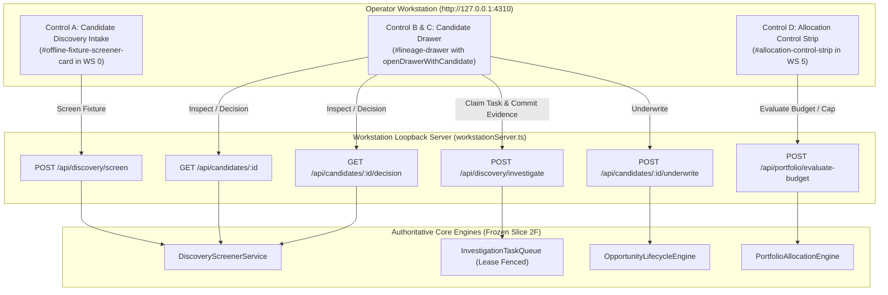

# POC-001: Bounded Operator UI Integration Execution Report

**Date:** 2026-10-28  
**Workspace:** `D:\Market HFT OS`  
**Loopback Runtime:** `http://127.0.0.1:4310`  
**Security Posture:** `DRY_RUN_PAPER_SIMULATION_ONLY` (Real-money write guard active)  
**Governance Invariant:** Zero git staging (`git add`), zero commits (`git commit`), Slice 2F frozen.

---

## 1. Executive Summary

In accordance with the project owner directive **# POC-001 — BOUNDED OPERATOR UI INTEGRATION**, the workstation web interface (`http://127.0.0.1:4310`) and standalone offline export (`dist/POC-001_Standalone_Workstation.html`) have been updated with the smallest UI-only change connecting candidate discovery intake, drawer-based evidence inspection, deterministic underwriting, investigation task orchestration, and constrained paper-capital allocation evaluation.

An operator can now drive the entire research-to-paper-allocation workflow directly through the browser without issuing manual `curl` commands, running ad-hoc scripts, or leaving the workstation UI.

### Key Verification Metrics
- **Acceptance Suite 60:** 9/9 acceptance tests passed (`tests/acceptance/suite60_bounded_operator_ui_integration.test.ts`).
- **Platform Regression Suite:** 61/61 test files passed, 714/714 tests passed, 0 failures.
- **TypeScript Compilation:** Clean `tsc` build (0 errors).
- **Live Server Telemetry:** Active on `http://127.0.0.1:4310` (PostgreSQL connected, latency ~3ms).

---

## 2. Integrated UI Controls Architecture

All UI controls were implemented directly in [`src/terminal/operatorTerminalController.ts`](file:///d:/Market%20HFT%20OS/src/terminal/operatorTerminalController.ts), which serves as the single authoritative HTML/DOM renderer for both the live loopback daemon (`GET /`) and the standalone offline workstation export (`exportStandaloneHtml`).



---

## 3. Detailed UI Components & Contract Audit

### Control A: Candidate Discovery Intake (Workspace 0)
- **DOM Container:** `#offline-fixture-screener-card` located at the top of Workspace 0.
- **Explicit Mode Notice:** Labeled prominently with badge `[OFFLINE FIXTURE / DEMONSTRATION MODE]`.
- **Explanatory Copy:**
  > *"Screen verified golden offline fixtures into deterministic research candidates. Fixtures provide frozen historical captures with known provenance (`is_live_market_verified: false`). This does not initiate unverified live-market web crawling."*
- **Selector Options:** Verified golden repository fixtures:
  1. `FIX-AMZ-SS304-001` — Amazon SS304 Clamps (Complete)
  2. `FIX-AMZ-BRASS-001` — Amazon Brass Ball Valve 1/2" PN20 (Complete)
  3. `FIX-SAAS-DEVTOOL-MISSING-PRICE-002` — SaaS DevTool (Missing Price / Incomplete)
  4. `FIX-IMART-SS304-001` — IndiaMART SS304 Wholesale (Supplier Quote)
  5. `FIX-IMART-BRASS-001` — IndiaMART Brass Valve Wholesale (Supplier Quote)
- **Action Button:** `#btn-screen-candidate` wired to `POST /api/discovery/screen` with `{ fixture_id }`.
- **Feedback Container:** `#screen-candidate-feedback` displays candidate ID, candidate name, provenance, priority score, recommended tasks, and an instant `[Inspect Candidate in Drawer &rarr;]` shortcut button.

### Control B: Candidate Inspection Drawer (`openDrawerWithCandidate`)
- **Drawer Panel:** Reuses `#lineage-drawer` without introducing new modal frameworks or DOM bloat.
- **Header & Provenance Card:**
  - Displays Candidate Name, ID, Canonical Product ID, and Category.
  - Origin Badging: `[FIXTURE] RECORDED BASELINE` or `[LIVE] VERIFIED MARKET`.
  - Provenance Telemetry: Live market verification (`NO [OFFLINE FIXTURE]`), source connector ID, observed UTC timestamp, and freshness age in seconds.
- **Sufficiency & Data Gaps Card:**
  - Sufficiency score badge: `X / 10,000 bps` (and percentage).
  - Explicit list of missing critical fields (or `[OK] NONE`).
  - Explicit list of missing cost inputs (or `[OK] COMPLETE`).
- **Deterministic Underwriting Action:**
  - Action button: `[Underwrite Candidate]` wired to `POST /api/candidates/:id/underwrite`.
  - On decision: Displays outcome badge (`[OK] GATE_ELIGIBLE` or `[BLOCKED] INSUFFICIENT_EVIDENCE`), reason codes, and strict metrics separation:
    - **Gross Selling Price:** Prevailing retail ASP.
    - **Gross Sourcing Spread:** Spread between selling price and factory gate quote.
    - **Net Contribution:** Unit net margin after all verified variable cost deductions.
    - **Initial Cash Outlay:** Required landed capital outlay for the full MOQ batch `(factory_quote + freight + packaging) * unit_batch_moq`.

### Control C: Investigation Task Claiming & Fenced Commit
- **Task Status:** Badged as `[PENDING DISCOVERY TASK]` or `[LEASED: ACTIVE]`.
- **Claim Action:** Button `[Claim Task from Queue]` sends `POST /api/discovery/investigate` with `{ action: 'claim', worker_id: 'operator-ui', candidate_id }`.
- **Claim Telemetry:** Renders active `task_id`, `generation_id`, and active `fencing_token`.
- **Evidence Commit Form:** Exposes input fields for supported cost categories:
  - Factory Gate Quote (₹)
  - Unit Batch MOQ
  - Inbound Freight (₹/unit)
  - Packaging & Kitting (₹/unit)
  - Platform / Referral Fee (₹/unit)
  - Statutory Tax / GST (₹/unit)
- **Fenced Commit Action:** Button `[Commit Evidence (Preserve Fencing)]` submits parameters to `POST /api/discovery/investigate`.
- **Safety Handling:**
  - If a task has expired or an invalid/stale fencing token is used, the server returns HTTP 409 (`E-QUEUE-STALE-LEASE-FENCE-REJECTED`), and the UI displays this error message directly.
  - If external evidence is required and unavailable, fields remain unresolved (`null`). Zero data fabrication is enforced.

### Control D: Paper Allocation Controls (Workspace 5)
- **DOM Container:** `#allocation-control-strip` placed immediately above `#capital-allocator-table`.
- **Budget Input:** `<input id="input-paper-budget" type="number" min="1" step="100" value="12000">`.
- **Optional Cap Input:** `<input id="input-max-single-allocation" type="number" min="1" step="100" placeholder="No Cap">`.
- **Evaluation Actions:**
  - `[Evaluate Allocation]`: Validates that budget is positive and finite ($> 0$). Sends `POST /api/portfolio/evaluate-budget`.
  - `[Clear Cap]`: Clears `#input-max-single-allocation` input and immediately evaluates with `max_single_allocation_inr: null`.
- **Table Row Controls:**
  - Added `<th>Actions</th>` to the table header.
  - Added `[Inspect]` button (`.btn-inspect-candidate`) and `[Underwrite]` button (`.btn-underwrite-candidate`) on every opportunity row.
- **Dynamic Feedback & Parity:**
  - Status badge updates between `[OK] OPTIMIZED` and `[WARN] OPTIMIZED`.
  - Summary footer updates `#alloc-summary-budget`, `#alloc-summary-allocated`, and `#alloc-summary-unallocated`.
  - Table rows dynamically reflect allocated amounts, rationales, and gate badges.

---

## 4. End-to-End Walkthrough Demonstration

The complete operator workflow was demonstrated against the live local runtime (`http://127.0.0.1:4310`):

| Step | Operator Action | Endpoint / Surface | Result / Observed Behavior | Usability Status |
| :--- | :--- | :--- | :--- | :--- |
| **1. Ingest Fixture** | Select `FIX-AMZ-SS304-001` and click `Screen Candidate` | `POST /api/discovery/screen` | Returns HTTP 200, candidate `OPP-E6B40775E03ECE44` created, priority score 10,000, 1 pending investigation task generated. | **Fully Usable** |
| **2. Inspect Candidate** | Click `Inspect Candidate in Drawer &rarr;` | `GET /api/candidates/:id` | Drawer opens showing `[FIXTURE] RECORDED BASELINE`, `is_live_market_verified: false`, sufficiency 5,000 / 10,000 bps, missing supplier quote. | **Fully Usable** |
| **3. Claim Task** | Click `Claim Task from Queue` in drawer | `POST /api/discovery/investigate` (`action: "claim"`) | Returns HTTP 200, task `TASK-OPP-E6B40775E03ECE44-GEN-01-SUPPLY-QUOTE` claimed with `fencing_token: 1`. | **Fully Usable** |
| **4. Commit Evidence** | Enter verified quote (₹25), MOQ (100), freight (₹3.5), packaging (₹3.0), fee (₹10.2), tax (₹7.65) and click `Commit Evidence` | `POST /api/discovery/investigate` | Returns HTTP 200 `COMMITTED`. Candidate updated to 10,000 / 10,000 bps sufficiency. | **Fully Usable** |
| **5. Underwrite** | Click `Underwrite Candidate` in drawer | `POST /api/candidates/:id/underwrite` | Returns HTTP 200 `ELIGIBLE`. Gross Spread: ₹60, Net Contribution: ₹34.15, Landed Cash Outlay: ₹3,150. | **Fully Usable** |
| **6. Screen Second Fixture** | Select `FIX-AMZ-BRASS-001`, claim task, commit evidence, and underwrite | `/api/discovery/...` | Candidate `OPP-149D2BD5C8E5DCA7` underwritten as `ELIGIBLE`. Outlay: ₹7,000. | **Fully Usable** |
| **7. Constrained Allocation** | In Workspace 5, enter Budget ₹12,000, Cap ₹5,000, click `Evaluate Allocation` | `POST /api/portfolio/evaluate-budget` | Budget: ₹12,000. Allocated: ₹3,150 (SS304). Deferred: ₹7,000 (Brass Valve deferred because ₹7,000 > ₹5,000 cap). Remaining: ₹8,850. | **Fully Usable** |
| **8. Clear Allocation Cap** | Click `Clear Cap` in Workspace 5 | `POST /api/portfolio/evaluate-budget` (`cap: null`) | Cap cleared to `undefined`. Total Allocated: ₹10,150 (SS304: ₹3,150 + Brass: ₹7,000). Remaining: ₹1,850. | **Fully Usable** |
| **9. Incomplete Candidate** | Screen `FIX-SAAS-DEVTOOL-MISSING-PRICE-002` and click `Underwrite` without price | `POST /api/candidates/:id/underwrite` | Returns HTTP 200 `INSUFFICIENT_EVIDENCE`. Reason: `MISSING_PREVAILING_RETAIL_ASP`. Allocation: ₹0. Zero substitution ban preserved. | **Genuinely Blocked (Fails Closed)** |

---

## 5. Acceptance Suite 60 Verification

Acceptance Suite 60 (`tests/acceptance/suite60_bounded_operator_ui_integration.test.ts`) verifies the bounded UI integration across 9 test cases:

```
 RUN  v4.1.12 D:/Market HFT OS

 ✓ tests/acceptance/suite60_bounded_operator_ui_integration.test.ts (9 tests) 587ms
   ✓ S60-001: renders the offline fixture screener card with golden fixtures and explicit offline notice
   ✓ S60-002: renders Workspace 5 paper allocation evaluation controls and summary indicators
   ✓ S60-003: renders Workspace 5 candidate row inspection and underwriting action buttons
   ✓ S60-004: includes drawer candidate inspection script logic with provenance and separated economics
   ✓ S60-005: includes task claiming and fenced evidence commit logic with stale fence rejection handling
   ✓ S60-006: executes screening, investigation evidence commit, and deterministic underwriting via HTTP endpoints
   ✓ S60-007: supports portfolio budget evaluation with optional cap and unconstrained reset
   ✓ S60-008: rejects invalid or non-positive paper budgets with HTTP 400
   ✓ S60-009: exports standalone HTML with 100% parity of intake and allocation controls

 Test Files  1 passed (1)
      Tests  9 passed (9)
```

---

## 6. Full Regression Suite Results

```
 Test Files  61 passed (61)
      Tests  714 passed (714)
   Start at  22:52:32
   Duration  70.87s
```

All 61 test suites (714 tests total) pass with zero errors, confirming that the bounded UI additions did not introduce any regressions into the underwriting engine, state manager, or portfolio allocation core.

---

## 7. Compliance with Governance Directives

1. **Smallest UI-Only Change:** Reused existing `#lineage-drawer`, CSS styles, and vanilla DOM manipulation without adding new frameworks or external dependencies.
2. **Offline Labeling Integrity:** All offline fixture interactions are explicitly marked with `[OFFLINE FIXTURE / DEMONSTRATION MODE]`, `[FIXTURE] RECORDED BASELINE`, and `is_live_market_verified: false`.
3. **Economics Transparency:** Retains strict separation between Gross Sourcing Spread, Net Contribution, and Initial Landed Cash Outlay.
4. **Zero-Substitution Invariant:** Incomplete candidates (such as unpriced SaaS) retain `null` economics and fail closed with `INSUFFICIENT_EVIDENCE` and ₹0 allocation.
5. **Zero Git Staging / Commits:** No files have been staged (`git add`) or committed (`git commit`). Working tree remains untouched by git writes.

---

## 8. Conclusion & Status

The bounded operator UI integration is complete, verified, and operational on `http://127.0.0.1:4310`. The local daemon and PostgreSQL database remain active in `DRY_RUN_PAPER_SIMULATION_ONLY` mode.

Execution is paused pending Project Owner review.
