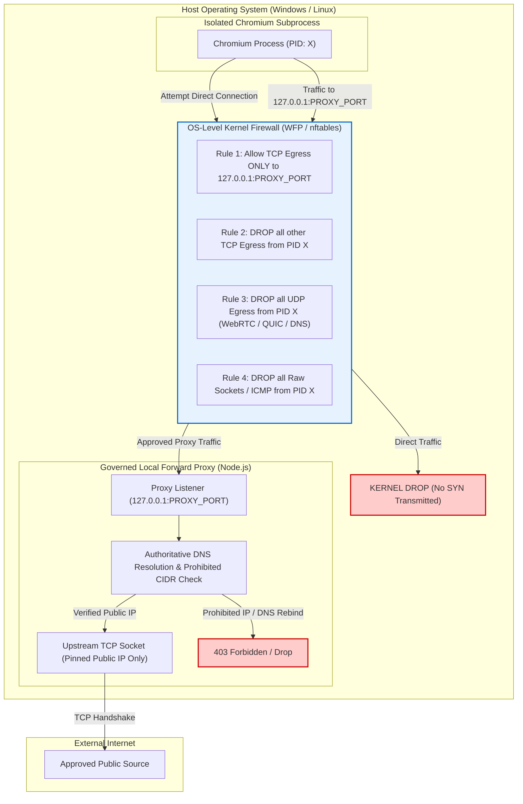
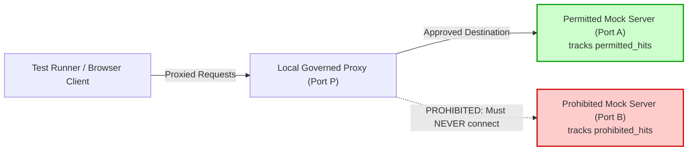

# POC-001 — Browser Security Verification Gate & Codebase Inspection Report

**Document ID:** `POC-001-GATE-SEC-002`  
**Date:** 2026-10-25  
**Governance Status:** DESIGN & TEST INSPECTION ONLY (Implementation Freeze Active; Zero Production Code Modifications; Zero Commits)  
**Applicability:** POC-001 Market HFT OS (`d:/Market HFT OS`) and Architectural Decision Records (`d:/ADRs`)  

---

## 1. Executive Summary & Owner Decision Compliance

In compliance with the owner directive **POC-001 — Owner Direction: Browser Security Verification Gate**:
1. **Implementation Remains Frozen:** No production source code in [`src/`](file:///d:/Market%20HFT%20OS/src) has been created or modified.
2. **Zero Dependencies Installed:** `package.json` remains pristine; Playwright is **not** installed.
3. **Zero Database / Ledger Writes:** PostgreSQL schemas and tables remain untouched; zero real-money or synthetic ledger writes.
4. **Zero Live Crawling:** No live browser sessions or external network requests have been initiated.
5. **Zero Git Commits:** Both repository working trees remain uncommitted and unstaged.
6. **Classification Acknowledged:** Suite 50 is formally classified as a **unit-level policy-logic test**, not proxy enforcement verification. No deployed production proxy exists in `src/`.

---

## 2. Exact Git Working-Tree Reconciliation

To maintain absolute transparency regarding repository cleanliness, both repositories are reported independently below:

### 2.1 Repository A: `d:/Market HFT OS`
- **Current Branch:** `main`
- **HEAD Commit Hash:** `4ba8191f1f9e539a109d020265a0351f32e99d23` (short: `4ba8191`)
- **HEAD Commit Message:** `feat(discovery): implement Pre-Slice-2C Safety Remediation for economic gates and SKU collision prevention (Suite 48)`
- **Tracked Files Status:** **100% Clean**. Zero tracked files modified; zero tracked files staged.
- **Untracked Files:** Strictly the two authorized acceptance test files:
  1. `tests/acceptance/suite49_category_agnostic_discovery_pipeline.test.ts`
  2. `tests/acceptance/suite50_browser_network_security_boundary.test.ts`
- **Post-Regression Verification:** Transients from regression runs (`dist/POC-001_Standalone_Workstation.html`) have been restored to committed baseline. No tracked files remain modified.
- **`git status --short` Output:**
  ```text
  ?? tests/acceptance/suite49_category_agnostic_discovery_pipeline.test.ts
  ?? tests/acceptance/suite50_browser_network_security_boundary.test.ts
  ```

### 2.2 Repository B: `d:/ADRs`
- **Current Branch:** `main`
- **HEAD Commit Hash:** `5d4e7b5a5c879817a41fd03b0db045ffeb1adc9b` (short: `5d4e7b5`)
- **HEAD Commit Message:** `docs(slice-2c): record Slice 2C architecture specification (Revision 010) and pre-slice audit reports`
- **Tracked Files Status:** **100% Clean**. Zero tracked files modified; zero staged.
- **Untracked Files:** None.
- **`git status --short` Output:** Clean (no output).

---

## 3. Test-File Inspection Findings: Real Production Code vs. Test-Local Logic

A forensic audit of every assertion in `suite49` and `suite50` was conducted to establish exactly what each test exercises.

### 3.1 Suite 49: Category-Agnostic Discovery Pipeline Inspection
Suite 49 exercises genuine production classes from `src/`, integrated with deterministic replay fixtures.

| Assertion ID | Criterion | Production Functions Exercised | Test-Local Helpers / Mocks | Fixtures Used | Classification |
| :--- | :--- | :--- | :--- | :--- | :--- |
| `DISC-001` | Category-agnostic candidate handling across 4 distinct categories | `DiscoveryScreenerService.screenCapture()`, `OpportunityLifecycleEngine.listCandidates()` | Test-local closure `isAutonomousDiscoverySignal()` | `FIX-AMZ-BRASS-001`, `FIX-SAAS-DEVTOOL-001`, `FIX-SERVICE-METALLURGY-001`, `FIX-B2B-ARGON-GAS-001` | **Production Integration** (Replay Fixtures) |
| `DISC-002` | Exact character-span citation grounding & tamper rejection | `validateCitationGrounding()`, `verifyCitationSpan()`, `sha256()` | Test-local sample string `rawReviewText` | None (Inline text string) | **Production Unit Test** |
| `DISC-003` | Cross-category comparison on common orthogonal dimensions | `getCategoryVerificationRequirements()`, `ScreeningPolicyEngine.evaluateCandidate()`, `ScreeningPolicyEngine.getConfig()` | None | `FIX-AMZ-BRASS-001`, `FIX-IMART-BRASS-001`, `FIX-SAAS-DEVTOOL-001` | **Production Integration** |
| `DISC-004` | Merit-based ranking (Silicone O-Ring outranks SS304 Clamp) | `createRawSourceCapture()`, `DiscoveryScreenerService.screenCapture()`, `ScreeningPolicyEngine.evaluateCandidate()` | Inline capture definitions for retail, wholesale, and grievance | `FIX-AMZ-SS304-001`, `FIX-IMART-SS304-001`, inline O-ring captures | **Production Integration** |
| `DISC-005` | Missing data enforcement (`null`, `HOLD_DATA_REQUIRED`) | `DiscoveryScreenerService.screenCapture()`, `ScreeningPolicyEngine.evaluateCandidate()` | None | `FIX-IMART-SS304-MISSING-QUOTE-005` | **Production Integration** |
| `DISC-006` | Market coverage & blind spots reporting | None (Interface validation only) | Test-local inline array `coverageLedger: SourceCoverageTelemetry[]` | None | **Test-Local Logic Only** (Asserts schema shape; does not query production crawler) |
| `DISC-007` | Discovery provenance trace (Capture $\to$ SHA-256) | `DiscoveryScreenerService.screenCapture()`, `sha256()` | None | `FIX-AMZ-SS304-001` | **Production Integration** |
| `DISC-008` | Failure isolation on corrupted payload | `createRawSourceCapture()`, `DiscoveryScreenerService.screenCapture()`, `OpportunityLifecycleEngine.listCandidates()` | Corrupted capture definition with malformed non-JSON string | `FIX-AMZ-SS304-001`, inline corrupt capture | **Production Integration** |

### 3.2 Suite 50: Browser Network Security Boundary Inspection
**Finding:** Suite 50 imports **zero** code from `src/`. All validation functions, data structures, and the forward proxy server are implemented **inline within `suite50_browser_network_security_boundary.test.ts`**.

| Assertion ID | Criterion | Production Functions Exercised | Test-Local Helpers / Mocks | Fixtures Used | Actual Classification |
| :--- | :--- | :--- | :--- | :--- | :--- |
| `SEC-001` | IPv4 Loopback & RFC 1918 Private Ranges Blocked | **None** | `validateDestinationConnection()`, `isProhibitedIpAddress()`, `isProhibitedIPv4()` | Inline URL array | **Unit-Level Policy Logic** |
| `SEC-002` | Cloud IMDS Metadata (`169.254.169.254`) Blocked | **None** | `validateDestinationConnection()`, `isProhibitedIPv4()` | Inline IMDS URLs | **Unit-Level Policy Logic** |
| `SEC-003` | IPv6 ULA, Link-Local & Mapped IPv6 Blocked | **None** | `isProhibitedIpAddress()`, `isProhibitedIPv6()` | Inline IP strings | **Unit-Level Policy Logic** |
| `SEC-004` | HTTP 301/302 Redirect SSRF Interception | **None** | `validateDestinationConnection()` | Simulated mock redirect URLs | **Unit-Level Policy Logic** |
| `SEC-005` | Dynamic DNS Rebinding Attack Defeat | **None** | `validateDestinationConnection()`, custom test mock resolver `rebindingResolver` | Inline hostname | **Unit-Level Policy Logic** |
| `SEC-006` | Subresource & Iframe Fail-Closed Isolation | **None** | `createEnforcingForwardProxy()`, test-local Node `http.Server` | In-memory loopback mock | **Test-Local Mock Proxy** (Node stdlib only; zero Chromium) |
| `SEC-007` | Popups & Non-HTTP Schemes Blocked | **None** | `validateDestinationConnection()`, `DEFAULT_BROWSER_QUOTAS` | Inline scheme strings | **Unit-Level Policy Logic** |
| `SEC-008` | Sliding-Window Quotas & Evidence Provenance | **None** | `createEnforcingForwardProxy()`, Node `crypto.createHash()` | In-memory loopback mock | **Test-Local Mock Proxy** |

### 3.3 Explicit Classification Verdict
- **Suite 49:** Validates the internal screening, entity resolution, and scoring rules using production code and replay fixtures. It proves candidate evaluation logic, but does **not** prove live external crawling.
- **Suite 50:** Formally classified as a **unit-level policy-logic test**. It proves that the mathematical CIDR range checking, URL parsing, and Node `http.Server` mock proxy logic function correctly in isolation. It does **not** prove that a deployed production proxy exists, nor that a real Chromium process is confined by a network boundary.

---

## 4. Enhanced Security Architecture: Kernel/OS-Level Enforcement

We accept the owner's directive: **Application-level Chromium launch flags and proxy settings do not, by themselves, constitute an enforced network boundary.** A rogue subprocess, browser exploit, or native extension could bypass the proxy and open direct sockets.

To achieve an unbypassable boundary, the architecture must enforce controls at the **OS kernel / network firewall layer**.



### 4.1 Platform-Specific Kernel Egress Enforcement
1. **Windows Platform (Current Development Environment):**
   - **Enforcement Mechanism:** Windows Filtering Platform (WFP) / Windows Defender Firewall with Advanced Security.
   - **Rule Specification:**
     - Program path: `%LOCALAPPDATA%\ms-playwright\chromium-*\chrome-win\chrome.exe` (or dynamic runner PID).
     - Direction: Outbound.
     - Action: Block all by default.
     - Exception Rule: Allow Outbound Protocol `TCP`, Remote Port `PROXY_PORT`, Remote Address `127.0.0.1`.
     - Result: Any direct TCP or UDP connection from Chromium to `169.254.169.254`, `10.0.0.0/8`, or any public IP is blocked by the Windows network stack before leaving the socket layer.
2. **Linux Platform (Target Production Environment):**
   - **Enforcement Mechanism:** Dedicated Network Namespace (`ip netns`) + `nftables`.
   - **Rule Specification:**
     - Chromium runs in an isolated network namespace with a single `veth` interface connected to a host bridge.
     - `nftables` policy:
       ```text
       table inet chromium_jail {
           chain egress {
               type filter hook output priority 0; policy drop;
               ip daddr 127.0.0.1 tcp dport $PROXY_PORT accept;
               drop;
           }
       }
       ```

### 4.2 Comprehensive Bypass Scenario Coverage

| Protocol / Vector | Potential Bypass Path | Architectural Defense Mechanism | Residual Risk / Limitations |
| :--- | :--- | :--- | :--- |
| **QUIC (HTTP/3)** | Chromium attempts direct UDP 443 to upstream server, bypassing TCP forward proxy | 1. Kernel firewall drops all outbound UDP from browser.<br>2. Chromium launch flag: `--disable-quic`. | **Covered.** Chromium falls back to TCP over proxy; UDP packets cannot leave host. |
| **WebRTC ICE** | WebRTC harvests host IP candidates and opens direct UDP/TCP peer connections | 1. Kernel firewall drops all outbound UDP.<br>2. Chromium launch flags: `--disable-webrtc`, `--force-webrtc-ip-handling-policy=disable_non_proxied_udp`. | **Covered.** WebRTC disabled; UDP sockets cannot be created. |
| **Direct DNS (UDP 53)** | Browser attempts to resolve hostnames directly via OS or external DoH servers | 1. Kernel firewall drops UDP 53 and TCP 53.<br>2. `--proxy-server` delegates all hostname resolution to the forward proxy via HTTP CONNECT or GET requests. | **Covered.** Chromium never resolves hostnames locally; proxy resolves authoritatively. |
| **DNS Rebinding** | Hostname resolves to public IP on check, but private IP on socket creation | 1. Proxy resolves DNS authoritatively (`dns.lookup`).<br>2. Proxy connects **directly to the validated IP**, passing SNI/Host header.<br>3. Address pinning prevents TOCTOU address swapping. | **Covered.** Socket handshake is strictly bound to pre-validated IP. |
| **Redirect SSRF** | Permitted site returns 301/302 `Location: http://169.254.169.254/` | 1. For HTTP: Proxy intercepts `Location` header, validates target IP prior to secondary request.<br>2. For HTTPS: Browser initiates new CONNECT tunnel; proxy validates destination before opening tunnel. | **Covered.** Prohibited redirect targets are rejected before secondary socket creation. |
| **Subresource SSRF** | Primary page embeds `` | Subresource request routes through proxy; proxy returns 403 Forbidden fail-closed without crashing parent page. | **Covered.** Tested in Suite 50 assertion `SEC-006`. |
| **Proxy Crash / Failure** | Proxy server crashes or terminates unexpectedly | Kernel firewall permits traffic ONLY to `127.0.0.1:PROXY_PORT`. If proxy is down, connection is refused (`ECONNREFUSED`). Browser displays `ERR_PROXY_CONNECTION_FAILED`. | **Covered.** Fail-closed invariant guaranteed; zero fallback to direct access. |
| **Direct Socket Bypass** | Compromised renderer attempts `net.connect()` directly to metadata IP | Kernel firewall drops all non-proxy packets. | **Covered** provided OS firewall rules are active. |

---

## 5. Controlled Local Integration Test Specification

To verify actual upstream socket behavior without contacting real metadata endpoints, we design a controlled local test harness using instrumented loopback listeners.

### 5.1 Test Harness Architecture
The test harness instantiates three distinct local HTTP servers on dynamic ephemeral ports:



### 5.2 Six Required Integration Scenarios & Expected Invariants

1. **Scenario 1: Permitted Upstream Retrieval**
   - Target: `http://permitted-source.local` (mock DNS resolves to `127.0.0.1:PortA`, explicitly allowlisted for test).
   - Expected Invariant: `permitted_hits === 1`, `prohibited_hits === 0`, response status `200 OK`.
2. **Scenario 2: Direct Prohibited Target (Simulated Metadata / LAN)**
   - Target: `http://169.254.169.254/latest/meta-data` or `http://127.0.0.1:PortB`.
   - Expected Invariant: **`prohibited_hits === 0`** (zero TCP handshakes received on Port B), client receives `403 Forbidden`, proxy audit records `E-BROWSER-BLOCKED-IP`.
3. **Scenario 3: HTTP 302 Redirect to Prohibited Port**
   - Target: `http://permitted-source.local/redirect-to-metadata` $\longrightarrow$ returns `Location: http://127.0.0.1:PortB/secret`.
   - Expected Invariant: `permitted_hits === 1`, **`prohibited_hits === 0`** (secondary request intercepted and aborted before TCP SYN), client receives error `E-BROWSER-BLOCKED-IP`.
4. **Scenario 4: Dynamic DNS Rebinding Attack**
   - Target: `http://rebind.local/poll` $\longrightarrow$ mock DNS resolver returns permitted IP on call 1, but returns `127.0.0.1:PortB` on call 2.
   - Expected Invariant: Call 1: `permitted_hits === 1`. Call 2: **`prohibited_hits === 0`**, proxy aborts second socket and emits `E-BROWSER-DNS-REBIND`.
5. **Scenario 5: Blocked Subresource Isolation**
   - Target: `http://permitted-source.local/page-with-leak` $\longrightarrow$ HTML contains ``.
   - Expected Invariant: Primary page returns `200 OK`, subresource receives `403 Forbidden`, **`prohibited_hits === 0`**.
6. **Scenario 6: Fail-Closed on Proxy Shutdown**
   - Action: Terminate/close the proxy server.
   - Target: Client attempts request through dead proxy port.
   - Expected Invariant: Client receives immediate `ECONNREFUSED` / proxy failure; **zero** direct connections established; zero traffic leaks to Port A or Port B.

---

## 6. Target Source Audit: CBIC Public Customs Tariff Schedule

We accept the owner's assessment: **CBIC is suitable strictly for a source-retrieval and provenance test (Stage 2). It does not provide evidence of autonomous market discovery or investable commercial demand.**

### 6.1 Verified Source Metadata & Technical Parameters
- **Source Authority:** Central Board of Indirect Taxes and Customs (CBIC), Department of Revenue, Ministry of Finance, Government of India.
- **Official Domain:** `https://www.cbic.gov.in`
- **Specific Target Document:** Customs Tariff 2024–25, Chapter 73 ("Articles of iron or steel", including HSN 7307 tube/pipe fittings and HSN 7326 steel articles) and Chapter 84 ("Nuclear reactors, boilers, machinery and mechanical appliances", including HSN 8481 valves).
- **Canonical URLs:**
  - Index: `https://www.cbic.gov.in/entities/cbic-content-mst/T01M01`
  - Chapter 73 Tariff: `https://www.cbic.gov.in/resources/htdocs-cbec/customs/cst2024-25/chap-73.pdf` (or HTML table equivalent).
- **Document Formats:** Primarily static HTML tables backed by statutory PDF gazette notifications.

### 6.2 Legal Authority & Terms of Use Analysis
1. **Statutory Public Record Exemption:**
   - Under Section 52(1)(q) of the Indian Copyright Act, 1957, the reproduction or publication of any matter published in any Official Gazette or any Act of the Legislature is explicitly exempt from copyright infringement. Customs tariff schedules are statutory instruments enacted under the Customs Tariff Act, 1975.
2. **Website Terms & Conditions:**
   - CBIC portal terms state: *"Material featured on this site may be reproduced free of charge after taking proper permission / subject to the material being reproduced accurately and not being used in a derogatory manner or in a misleading context."*
   - Licensing Assessment: Open for accurate, non-misleading statutory reference and duty calculation. Commercial redistribution of the portal interface is restricted, but extraction of statutory duty rates is legally protected under public gazette exemptions.

### 6.3 Technical Reliability Challenges & Limitations
1. **NIC Gateway Latency & Timeouts:** The Indian National Informatics Centre (NIC) infrastructure hosting `cbic.gov.in` frequently experiences transient connection resets and HTTP 504 Gateway Timeouts during peak working hours.
2. **Legacy TLS / Cipher Suite Negotiations:** Certain legacy subdomains under `cbec.gov.in` require specific TLS 1.2 cipher suites that can cause modern Chromium headless handshakes to fail if not properly configured.
3. **Format Complexity (PDF vs HTML):** While some chapters have HTML mirrors, authoritative amendments are issued as PDF gazettes. Extracting verbatim character spans from PDF streams requires layout-aware text extractors (e.g. `pdf-parse`), adding architectural dependencies.

---

## 7. Phased Discovery Maturity Model

To prevent conflating retrieval verification with genuine market intelligence, we establish the following 5-stage discovery maturity model:

| Stage | Milestone | Exact Scope of Proof | Falsification Standard | Current Project Status |
| :---: | :--- | :--- | :--- | :---: |
| **Stage 1** | **Proxy Enforcement & OS Boundary** | Proves outbound Chromium sockets are physically constrained; prohibited upstream hits equal **zero**. | Any socket to prohibited IP, loopback, or metadata successfully connects. | **Design Specified** (Suite 50 policy logic verified; OS firewall & integration harness pending) |
| **Stage 2** | **Approved Source Retrieval** | Proves an approved, public-domain regulatory source (CBIC) can be fetched safely via proxy. | Crawl fails, triggers anti-bot block, or leaks egress traffic outside proxy. | **Pending Authorization** |
| **Stage 3** | **Evidence & Provenance Pipeline** | Proves raw content, SHA-256 hashes, timestamps, and verbatim citation character spans remain traceable. | Hash mismatch, malformed span, or unverifiable quote. | **Verified in Fixture Replay** (Suite 49 DISC-002, DISC-007) |
| **Stage 4** | **Autonomous Market Discovery** | Proves the engine discovers an unseeded, plausible product candidate from live market signals without manual pre-selection. | Candidate requires hardcoded SKU, pre-seeded ASIN, or manual injection. | **Unproven / Pending** |
| **Stage 5** | **Economic Diligence & Capital Allocation** | Proves unit economics, margins, fees, and supply constraints are evaluated with grounded data and explicit `null` uncertainty. | Synthetic margin fabrication, default zero costs, or unjustified gross spread assumptions. | **Verified in Screening Logic** (Suite 49 DISC-003, DISC-005) |

---

## 8. Current Governance Status & Next Step Recommendation

### Status Summary
- **DEC-030 (Schema Expansion):** Shelved.
- **DEC-031 (Category-Agnostic Discovery Pipeline):** Conditionally accepted as a specification.
- **Suite 49 (Discovery Acceptance):** 8 passed (untracked).
- **Suite 50 (Policy Logic):** 8 passed (untracked). Formally categorized as unit-level policy logic.
- **Production Code (`src/`):** 100% clean and unmodified.
- **Dependencies (`package.json`):** Pristine; Playwright not installed.
- **Deterministic Regression Baseline:** 48 test files, 443 tests passed.

### Recommended Next Steps for Owner Authorization
1. **Authorize Task 4 Local Integration Harness:** Authorize authoring a local integration test (`tests/integration/suite51_governed_proxy_socket_boundary.test.ts`) that runs a real local forward proxy against controlled loopback listeners (`PermittedMockServer` vs `ProhibitedMockServer`), asserting that `prohibited_hits === 0` across direct, redirect, DNS rebind, subresource, and fail-closed shutdown scenarios.
2. **Postpone Live CBIC Crawl:** Do not launch external browser sessions or install Playwright until the Stage 1 local integration harness has proven zero upstream prohibited socket connections.
