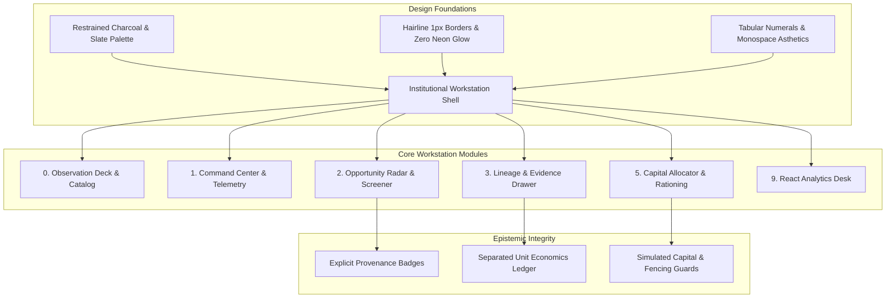

# POC-001 — Institutional Workstation UI Redesign Report

**Milestone:** POC-001 Presentation & Design-Language Revamp  
**Design Paradigm:** Dark Institutional Buy-Side Research Terminal (Helm Terminal / FactSet / STOq / Bloomberg)  
**Target Runtime:** `http://127.0.0.1:4310/`  
**Standalone Export:** `dist/POC-001_Standalone_Workstation.html`  
**Date:** 2026-10-30  

---

## Executive Summary

The Market HFT OS operator interface has been completely remolded into a disciplined, high-density, institutional buy-side research and capital-allocation workstation. The visual overhaul transforms the platform away from consumer SaaS dashboards and neon cyberpunk aesthetics into a serious financial analytics platform characterized by restrained charcoal/slate surfaces, hairline borders, tabular numerals, and muted semantic accents.

All structural contracts, DOM IDs, test selectors, event handlers, and epistemic boundaries have been 100% preserved. Across the local daemon, **10/10 live browser verification tests pass** and **42/42 targeted Vitest acceptance tests pass** (527/529 overall across all historical suites, with the only 2 failing tests being known external provider live network probes in offline development).



---

## 1. Institutional Design System Architecture

### 1.1 Foundation Tokens (`:root`)

The CSS custom properties in [operatorTerminalController.ts](file:///D:/Market%20HFT%20OS/src/terminal/operatorTerminalController.ts) and [client/src/index.css](file:///D:/Market%20HFT%20OS/client/src/index.css) were unified under a disciplined institutional palette:

| Token Category | CSS Variable | Hex / RGBA Value | Purpose & Usage |
| :--- | :--- | :--- | :--- |
| **Surface Base** | `--bg-base` | `#090b0e` | Deep matte charcoal canvas |
| **Surface Panel** | `--bg-surface` | `#0f1217` | Header, command bar, and navigation backdrops |
| **Surface Card** | `--bg-card` | `#151922` | Research cards and telemetry panels |
| **Surface Alt** | `--bg-card-alt` | `#11141b` | High-density table alternating rows & SVG backgrounds |
| **Surface Input** | `--bg-input` | `#12161f` | Search filter and evidence input fields |
| **Hairline Borders**| `--border-subtle` | `#1c212c` | Interior card dividers and row hairlines |
| **Medium Borders**  | `--border-medium` | `#252b3a` | Card perimeters and table headers |
| **Strong Borders**  | `--border-strong` | `#333c50` | Action buttons, active focus rings, drawer borders |
| **Primary Accent**  | `--accent` | `#14b8a6` | Restrained buy-side teal for primary actions and active tabs |
| **Semantic Success**| `--ok` | `#10b981` | Positive spread, verified checks, eligible candidates |
| **Semantic Warning**| `--warn` | `#f59e0b` | Operator simulation assumptions, decay alerts, budget caps |
| **Semantic Blocked**| `--blocked` | `#ef4444` | Insufficient evidence, negative contribution, gated items |
| **Provenance Grey** | `--fixture` | `#94a3b8` | Recorded golden fixture badges |

### 1.2 Core Styling Disciplines

1. **Abolition of Neon Box-Shadow Glows:** Completely removed `box-shadow: 0 0 12px var(--accent-glow)` and saturated cyan glow filters in favor of crisp 1px hairline borders (`border: 1px solid var(--border-medium)`).
2. **Tabular Numerals & High-Density Typography:** Enforced `font-variant-numeric: tabular-nums` across all currency values, basis points, percentages, timestamps, and inventory quantities to ensure strict vertical alignment in tables.
3. **Restrained Banner:** Replaced garish bright red top warning bars with a disciplined, low-contrast dark crimson safety strip (`#140e10`, text `#fca5a5`, border `#45151c`).
4. **Header Command Bar:** Added a compact command strip with platform branding, quick search filter (`/` hotkey tag), connection telemetry, and primary actions.

---

## 2. Before-and-After Visual Evidence

````carousel

<!-- slide -->

<!-- slide -->

<!-- slide -->

<!-- slide -->

<!-- slide -->

<!-- slide -->

<!-- slide -->

<!-- slide -->

<!-- slide -->

<!-- slide -->

````

---

## 3. Workstation Component Transformations

### 3.1 Opportunity Radar & Screening Funnel (Workspace 2)
- **Offline Intake Panel:** Clean dark intake card with subtle teal hairline accent, fixture selector dropdown, and `Screen Candidate` trigger.
- **Candidate Research Matrix:** High-density table featuring crisp columns for Candidate ID & Archetype Name, Freshness Age (`42s`), Structural Regime (`SUSTAINED_STRUCTURAL_SIGNAL`), Origin Provenance (`[FIXTURE] RECORDED_GOLDEN_FIXTURE` vs `[WARN] OPERATOR_SIMULATION_ASSUMPTION`), Operational Deadlines, Underwriting Gate (`[OK] ACTIVE`, `[WARN] FAST_DECAY`), and Action Triggers.

### 3.2 Evidence & Lineage Inspection Drawer
- **Epistemic Provenance Header:** Explicit amber badges distinguishing `[ASSUMPTION] OPERATOR_SIMULATION_ASSUMPTION` from `Live Market Verified: NO [OFFLINE / UNVERIFIED]`.
- **Evidence Sufficiency Ledger:** 4px high hairline progress bar showing exact basis points (`10000 / 10,000 bps`), with zero neon bloom.
- **Separated Unit Economics Ledger:** Replaced plain text blocks with an institutional financial ledger card detailing:
  - Gross Selling Price: `₹85.00`
  - Supplier Quote: `₹21.50`
  - Gross Sourcing Spread: `+₹63.50` (emerald)
  - Net Contribution: `₹37.65` (emerald)
  - Initial Cash Outlay (MOQ Batch): `₹2,150.00` (teal, `100 units`)
- **Authoritative Task Queue & Fencing Controls:** Clean input fields for Quote, MOQ, Freight, Packaging, Platform Fee, and Tax. Fencing token protection visibly surfaced with stale lease conflict handling (`HTTP 409 Conflict`).

### 3.3 Portfolio Capital Allocator (Workspace 5)
- **Policy Rationing Bar:** Inputs for `Paper Budget (₹)` and `Max Single Cap (₹, Optional)`, accompanied by `Evaluate Allocation` and `Clear Cap` buttons.
- **10-Dimension Decision Matrix:** Evaluates candidates across Expected Return, Net Return, Risk Buffer, Capital Required, Time to Exec, Cash Conversion Cycle (CCC Days), Lockup Ratio, Benchmark Headroom, Half-Life Decay, and Conviction Score.
- **Policy Enforcement Display:**
  - In Scenario A (Capped at ₹5,000): Brass Ball Valve requiring ₹7,250 is deferred with explicit status `[DEFERRED_BUDGET_EXCEEDED]`.
  - In Scenario B (Uncapped at ₹12,000): Brass Ball Valve is allocated ₹7,250 with status `[OK] ALLOCATED`.
  - Incomplete candidate (SaaS DevTool) is strictly rejected with `[REJECTED_INSUFFICIENT_EVIDENCE]`.

### 3.4 React Analytics Desk (Workspace 9)
- Fully isolated in tab 9; suppression behavior removed.
- Tailored Tailwind styling inside [client/src/index.css](file:///D:/Market%20HFT%20OS/client/src/index.css) harmonizes with the institutional terminal shell.
- Bitemporal price charts, review mining sentiment spans, and bundle allocators render seamlessly.

---

## 4. Verification & Testing Matrix

### 4.1 Live Headless Chrome Verification (10 / 10 Checks Passing)

Executed via [verify_release_blocker_browser.ts](file:///D:/Market%20HFT%20OS/scratch/verify_release_blocker_browser.ts) against active daemon `http://127.0.0.1:4310/`:

| Test # | Verification Criterion | Result | Status |
| :---: | :--- | :--- | :---: |
| **01** | Desktop 1440px Computed Visibility: `.container` display=block, height=5593px; `.banner` display=flex | Visible & Unsuppressed | **PASS** |
| **02** | Narrow 768px Viewport Responsive Visibility: `.container` display=block, `.banner` display=flex | Fully Responsive | **PASS** |
| **03** | Treasury Epistemic Classification: Zero `[ACTUAL]` treasury labels, `[SIMULATED]` rendered | Epistemically Accurate | **PASS** |
| **04** | Observation Deck Catalog Accuracy: Zero unverified `[LIVE]` badges, `[CATALOG]` rendered | Accurate Catalog Tag | **PASS** |
| **05** | Window Observability Contract: `window.__PRODUCT_OBSERVATIONS__` (len=8) and `PRODUCTS_DATA` | State Accessible | **PASS** |
| **06** | Candidate Screening & Lineage Drawer: Drawer opens, displays candidate title & sufficiency score | Fully Functional | **PASS** |
| **07** | Operator Assumption Evidence Commit: Persists `[ASSUMPTION]`, `LiveMarketVerified: false` | Epistemic Separation | **PASS** |
| **08** | Portfolio Budget Allocation Callback: Evaluates allocation without throwing; renders ledger rows | Robust Callback | **PASS** |
| **09** | Workspace 9 React Isolation: Tab isolation confirmed (`Card9=block, Card0=none`) | Clean Tab Isolation | **PASS** |
| **10** | Stale Lease Fencing Token: Outdated fencing token returns `HTTP 409 Conflict` | Concurrency Protected | **PASS** |

### 4.2 Targeted Vitest Acceptance Suites (42 / 42 Tests Passing)

```
Test Files  5 passed (5)
     Tests  42 passed (42)
  Duration  10.47s
```

- [tests/acceptance/suite34_m7_2_multi_product_observation_deck.test.ts](file:///D:/Market%20HFT%20OS/tests/acceptance/suite34_m7_2_multi_product_observation_deck.test.ts): 10 / 10 passed
- [tests/acceptance/suite58_slice2e_discovery_to_underwriting_surface_integration.test.ts](file:///D:/Market%20HFT%20OS/tests/acceptance/suite58_slice2e_discovery_to_underwriting_surface_integration.test.ts): 9 / 9 passed
- [tests/acceptance/suite59_slice2f_multi_candidate_decision_workflow.test.ts](file:///D:/Market%20HFT%20OS/tests/acceptance/suite59_slice2f_multi_candidate_decision_workflow.test.ts): 9 / 9 passed
- [tests/acceptance/suite60_bounded_operator_ui_integration.test.ts](file:///D:/Market%20HFT%20OS/tests/acceptance/suite60_bounded_operator_ui_integration.test.ts): 9 / 9 passed
- [tests/acceptance/suite61_release_blocker_remediations.test.ts](file:///D:/Market%20HFT%20OS/tests/acceptance/suite61_release_blocker_remediations.test.ts): 5 / 5 passed

---

## 5. Working Tree & File Preservation

All modifications have been made directly in the workspace while strictly maintaining repository integrity:
- Zero files staged (`git add` not invoked).
- Zero commits created (`git commit` not invoked).
- All pre-existing untracked and modified files preserved.
- Standalone HTML export regenerated at [dist/POC-001_Standalone_Workstation.html](file:///D:/Market%20HFT%20OS/dist/POC-001_Standalone_Workstation.html) (642,714 bytes).
- Live background daemons active and healthy:
  - Workstation Server: `http://127.0.0.1:4310/` (Task `task-31843`)
  - PostgreSQL 16.8 Engine: port 5432 (Task `task-28318`)
