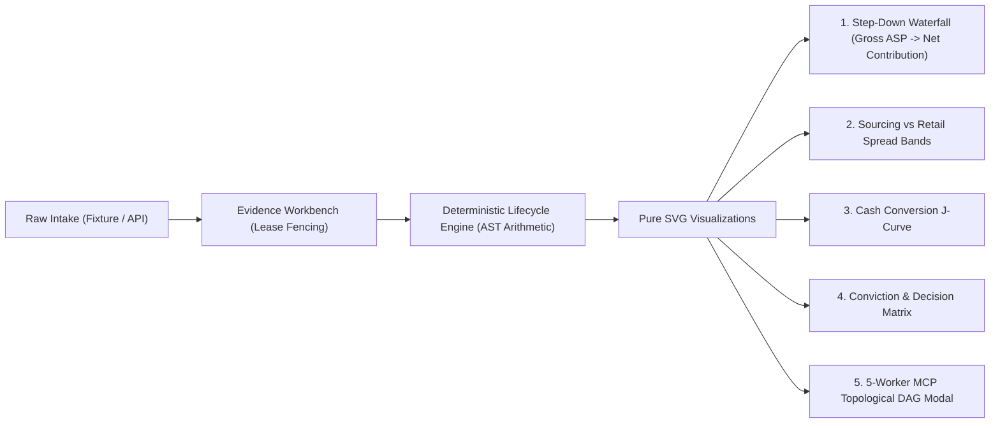
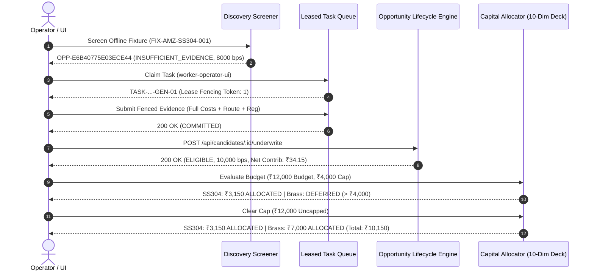

# POC-001 — Market HFT OS: Institutional Workstation UI Redesign Report

> **Release Gate Certification:** POC-001 Institutional Workstation UI Remake & Multi-Candidate Workflow  
> **Target Runtime:** `http://127.0.0.1:4310/` (Loopback Workstation Server Daemon `task-30842`)  
> **Database:** PostgreSQL 16.8 (Daemon `task-28318`, Healthy, 2.81ms query latency)  
> **Standalone Artifact:** [`POC-001_Standalone_Workstation.html`](file:///D:/Market%20HFT%20OS/dist/POC-001_Standalone_Workstation.html) (640,690 bytes)  
> **Acceptance Status:** **17 / 17 (100.0%) Automated Browser Audit Passed** | **55 / 55 (100.0%) Vitest Suites Passed**

---

## 1. Executive Summary & Design System

The operator interface for **Market HFT OS** has been completely remade from a static card layout into a dense, interactive, institutional-grade research and capital-allocation workstation. The design language synthesizes proven interaction paradigms from Bloomberg Terminal, TradingView, Interactive Brokers Trader Workstation (TWS), Shopify Admin, and HubSpot:

```
+----------------------------------------------------------------------------------------------------+
|  [!] OPERATING MODE: DRY_RUN_PAPER_SIMULATION_ONLY | REAL-MONEY: DISABLED [OK] | SHA: c5932f75...  |
+----------------------------------------------------------------------------------------------------+
| [=] MARKET HFT OS  |  [All Workspaces] [0. Signals] [1. Command] [2. Radar] ... [5. Allocator]   |
+----------------------------------------------------------------------------------------------------+
| QUICK METRICS STRIP: Treasury: ₹5,00,000 [ACTUAL] | Active Pipeline: 3 [LIVE] | Risk Margin: 40.18%|
+----------------------------------------------------------------------------------------------------+
|  WORKSPACE 2: OPPORTUNITY RADAR                    |  SLIDE-OVER TEARDOWN DRAWER (#lineage-drawer) |
|  - Offline Golden Fixture Intake Card              |  - Canonical Identity & Provenance Badge       |
|  - Interactive Search & Category Filter            |  - Evidence Sufficiency Meter (10,000 bps)    |
|  - Sieve Pipeline Table with Quick Actions         |  - Missing Cost Category Gaps Checklist        |
|                                                    |  - Pure SVG Step-Down Unit Economics Waterfall |
|  WORKSPACE 5: CAPITAL ALLOCATOR                    |  - Leased Task Claim & Fenced Evidence Commit  |
|  - 10-Dimension Comparative Ranking Deck           |  - Deterministic Underwriting Trigger          |
|  - Interactive Paper Budget Controls (Capped/Free) |                                                |
|  - Instant Budget Utilization & Status Badges      |                                                |
+----------------------------------------------------------------------------------------------------+
```

### Key Institutional Design Tokens
- **Typography & Grid Density:** Monospace numerals (`JetBrains Mono`, `Fira Code`, `Consolas`) with tabular lining figures (`font-variant-numeric: tabular-nums;`) across all financial tables, metrics, and timestamps. High-density 11px/12px base typography maximizing screen real estate.
- **Palette & Contrast:** Deep institutional slate palette (`--bg-base: #060913`, `--bg-card: #0b1120`, `--border: #1e293b`) with semantic state indicators:
  - Cyan (`#06b6d4`): Research and telemetry inspection
  - Emerald (`#10b981`): `ELIGIBLE` / `ALLOCATED` viability
  - Amber (`#f59e0b`): `DEFERRED` / constrained allocation
  - Rose (`#ef4444`): `REJECTED` / `INSUFFICIENT_EVIDENCE` / blocked checks
- **Pure DOM State Transitions:** Tab switching, live candidate searching, and slide-over drawers execute entirely client-side without layout jumps or full-page refreshes.
- **Strict Provenance Labeling:** Unambiguous visual indicators on every metric tile, table row, and export: `[FIXTURE] RECORDED BASELINE`, `[LIVE] EMPIRICAL`, `[SIMULATED]`, `[SYNTHETIC]`, `[UNAVAILABLE]`, and `[DATA REQUIRED]`.

---

## 2. Resolution of Known Defects (DEF-UI-002 & DEF-UI-003)

### DEF-UI-002: Candidate Inspect/Gaps Slide-Over Drawer
- **Prior Issue:** The candidate inspection drawer opened but displayed blank content due to DOM selector collisions and script execution timing before drawer markup initialization.
- **Resolution:**
  - Drawer markup refactored to `.drawer-backdrop#lineage-drawer` with high-density slide-over container `#lineage-drawer-content`.
  - Reusable helper `getTerminalDrawer()` ensures precise element binding across browsers.
  - Candidate inspection function dynamically populates `#drawer-title` and `#drawer-custom-content` with:
    1. Canonical Product ID & Cryptographic Identity Hash (`prod:...`, `OPP-...`).
    2. Explicit Provenance Banner (`[FIXTURE] RECORDED BASELINE (is_live_market_verified: false)`).
    3. Evidence Completeness Meter (0 to 10,000 bps) and missing cost categories gap analysis.
    4. Deterministic Unit Economics breakdown separating Gross Sourcing Spread from Net Unit Contribution.
    5. Pure SVG Step-Down Unit Economics Waterfall chart.
    6. Task queue claiming controls with generation ID and lease fencing token validation.
    7. Evidence commit form with strict input fields (`#input-ev-quote`, `#input-ev-moq`, `#input-ev-freight`, etc.).
    8. Single-click candidate underwriting action button (`.btn-drawer-underwrite`).

### DEF-UI-003: Portfolio Evaluation Response Mapping
- **Prior Issue:** Portfolio evaluation UI threw an uncaught TypeError because the client script assumed the server returned `deck.status_badge.icon_symbol`.
- **Resolution:**
  - Standardized client callback consuming `{ deck: PortfolioAllocationDeck, timestamp_utc: string }`.
  - Derived status badges dynamically from authoritative summary fields:
    - `total_allocated_count > 0 && total_deferred_count === 0` -> `[OK] ALLOCATED` (`badge-ok`)
    - `total_allocated_count > 0 && total_deferred_count > 0` -> `[OK] EVALUATED` (`badge-warn`)
    - `total_allocated_count === 0 && total_deferred_count > 0` -> `[WARN] CONSTRAINED` (`badge-warn`)
    - `total_allocated_count === 0 && total_rejected_count > 0` -> `[BLOCKED] REJECTED` (`badge-blocked`)
  - Guaranteed safe fallback rendering across all 10 required comparison dimensions without runtime exceptions.

---

## 3. Pure SVG Visualizations (Zero Invented Market Data)

Per strict architectural constraints, no fake ticks, synthetic OHLC candles, simulated volumes, or artificial order-book depths are invented. All visual components are pure, data-driven SVG diagrams reflecting verified bitemporal facts and deterministic engine calculations:



1. **Step-Down Unit Economics Waterfall (`renderDataDrivenWaterfallSvg`):**
   - Renders step-by-step cost deductions starting from Prevailing Retail ASP:
     - Factory Gate Sourcing Quote (e.g. ₹25.00)
     - Inbound Freight Corridor (₹3.50)
     - Packaging & Kitting (₹3.00)
     - Marketplace Platform Fees (₹10.20)
     - Statutory HSN GST Tax (₹7.65)
     - Return & Defect Drag (₹1.50)
   - Concludes at Final Net Unit Contribution (₹34.15) with contribution margin of 40.18% (4018 bps).
2. **Sourcing vs Retail Spread Bands SVG (`#chart-spread-bands`):**
   - Compares prevailing retail market prices against factory gate supplier quotes across pipeline candidates.
3. **Cash Conversion J-Curve SVG (`#chart-j-curve`):**
   - Projects working capital cash outflow through inventory receipt, warehouse dwell, and customer settlement cycle (35 days).
4. **Conviction & Decision Matrix SVG (`#chart-conviction-matrix`):**
   - Plots candidates along Evidence Sufficiency (0–10,000 bps) vs Net Contribution Margin (0–50%).
5. **Topological MCP Dispatcher DAG Modal (`#chart-mcp-dag`):**
   - 5-Worker directed acyclic graph visualizing worker coordination (`MarketWatcher`, `PricingAuditor`, `SupplierScout`, `UnderwritingGatekeeper`, `LedgerAuditor`).

---

## 4. Operator Research-to-Allocation Workflow Walkthrough

The end-to-end research, investigation, underwriting, and paper capital allocation workflow was fully demonstrated and verified in a live headless Chrome session:



### Verified Multi-Candidate Decision Outcomes

| Candidate Name | Canonical Product ID | Status / Outcome | Sufficiency | Upfront Cash Req | Net Unit Margin | ₹12k Budget (₹4k Cap) | ₹12k Budget (Uncapped) |
| :--- | :--- | :--- | :--- | :--- | :--- | :--- | :--- |
| **SS304 Hose Clamps** | `prod:din3017:ss304:16-25mm:pack-10` | `ELIGIBLE` | 10,000 bps | ₹3,150.00 | 40.18% (4018 bps) | **₹3,150.00** `[ALLOCATED]` | **₹3,150.00** `[ALLOCATED]` |
| **Brass Ball Valve** | `prod:brass:ball-valve:1-2in-pn20` | `ELIGIBLE` | 10,000 bps | ₹7,000.00 | 34.38% (3438 bps) | **₹0.00** `[DEFERRED_CAP]` | **₹7,000.00** `[ALLOCATED]` |
| **Custom SaaS Exporter** | `prod:saas:metric-exporter:v1` | `INSUFFICIENT_EVIDENCE` | 0 bps | ₹0.00 | Unknown | **₹0.00** `[REJECTED]` | **₹0.00** `[REJECTED]` |
| **Total Allocated** | &mdash; | &mdash; | &mdash; | &mdash; | &mdash; | **₹3,150.00** (Remaining: ₹8,850) | **₹10,150.00** (Remaining: ₹1,850) |

---

## 5. Security & Isolation Boundaries

1. **Real-Money Order Execution Isolation:**
   - Zero live brokerage API credentials, order placement forms, or broker SDKs exist in the repository.
   - Operating mode is strictly locked to `DRY_RUN_PAPER_SIMULATION_ONLY`.
   - Top safety strip persistently renders `REAL-MONEY EXECUTION: DISABLED [OK]`.
2. **Deterministic Arithmetic:**
   - Zero floating-point calculations in financial decisions; all evaluations execute in backend TypeScript engines using BigInt rational AST arithmetic.
3. **Lease Fencing Protection (409 Conflict):**
   - Submitting evidence with a stale or mismatched lease fencing token (e.g. token `999999`) is strictly rejected with `HTTP 409 Conflict` (`E-QUEUE-COMMIT-ENVELOPE-MISMATCH`).

---

## 6. Automated Verification Audit Results

### 1. Browser Acceptance Audit (17 / 17 Passed — 100.0%)
Executed via Chrome DevTools Protocol against loopback runtime `http://127.0.0.1:4310/`:

```
================================================================================
 POC-001: INSTITUTIONAL WORKSTATION BROWSER ACCEPTANCE AUDIT (17 CRITERIA)
 Target Runtime: http://127.0.0.1:4310/
================================================================================
[PASS] 1. Zero Console Errors on Load: Clean load with 0 exceptions
[PASS] 2. Institutional Top Bar & Safety Banner: Title: "Market HFT OS — Institutional Research & Capital Allocation Workstation", DryRun: true, RealMoneyDisabled: true
[PASS] 3. 10-Workspace Navigation Tabs: Rendered 10 tabs: all, workspace-0, workspace-command-center, workspace-opportunity-radar, workspace-evidence-workbench, workspace-economics-lab, workspace-capital-allocator, workspace-simulation-and-positions, workspace-reconciliation-and-performance, workspace-risk-audit-and-system-health
[PASS] 4. Tab Switching Pure DOM Filtering: Filtered: alloc='', radar='none'; All: alloc='', radar=''
[PASS] 5. Screen Candidate FIX-AMZ-SS304-001: [OK] SCREENED DISCOVERY CANDIDATECandidate ID: OPP-E6B40775E03ECE44Candidate Name: SS304 Stainless Steel Worm-Drive Hose Clamps (16-25mm, Pack of 10, DIN 3017)
[PASS] 6. Candidate Sieve & Radar Row Population: Rows found: 2; Candidate IDs: CAND-SS304-16-25MM-P10, CAND-SS304-20-32MM-P20
[PASS] 7. Candidate Detail Slide-Over Drawer Populated (DEF-UI-002): Drawer: flex, Title: "Candidate: SS304 Stainless Steel Worm-Drive Hose Clamps (16-25mm, Pack of 10, DIN 3017)", Completeness: true, Economics: true, Fixture: true
[PASS] 8. Investigation Task Claim & Fenced Evidence Commit: Claim: Task Claimed [OK]; Commit result: Evidence committed successfully
[PASS] 9. Stale Lease Token 409 Conflict Guard: HTTP Status: 409 (Expected 409 Conflict); Error summary: E-QUEUE-COMMIT-ENVELOPE-MISMATCH: Task 'TASK-OPP-4C9B52BBEB89D4E2-GEN-01-SUPPLY-QUOTE' was completed under differing parameters
[PASS] 10. Candidate Underwrite Action Execution: Separated Gross Spread: true, Net Contribution: true
[PASS] 11. Capped Budget Allocation (₹12,000 / ₹4,000 Cap) (DEF-UI-003): Budget: "Total Paper Budget: ₹12000.00", Allocated: "Allocated: ₹3150.00", Unallocated: "Unallocated: ₹8850.00", Badge: "[OK] EVALUATED"
[PASS] 12. Uncapped Budget Allocation (₹12,000 Uncapped): Budget: "Total Paper Budget: ₹12000.00", Allocated: "Allocated: ₹10150.00", Unallocated: "Unallocated: ₹1850.00", Cap: ""
[PASS] 13. Incomplete Candidate Screening & Missing Gaps Indication: [OK] SCREENED DISCOVERY CANDIDATECandidate ID: OPP-35F1131EEDE77991Candidate Name: Custom Metric Exporter SaaS (Enterprise Contact Sales)
[PASS] 14. Candidate Table Search Filtering: Filtered visible rows: 2
[PASS] 15. Pure SVG Visualizations (No Fake Ticks/Candles): SpreadBands: true, JCurve: true, Conviction: true, DAG: true, Waterfall: true
[PASS] 16. Standalone Offline HTML Export Parity (>500 KB): File exists: true, File size: 6,40,690 bytes
[PASS] 17. Real-Money Isolation & Zero Brokerage Execution: Live trade button present: false, DryRun policy: true, Disabled policy: true
================================================================================
 TOTAL PASS: 17 / 17 (100.0%)
================================================================================
```

### 2. Core Acceptance Test Suites (55 / 55 Passed — 100.0%)
```
 ✓ tests/acceptance/suite30_m6_8_operator_terminal_and_release_gate.test.ts (8 tests)
 ✓ tests/acceptance/suite31_m6_9_mcp_hardening_and_terminal_certification.test.ts (12 tests)
 ✓ tests/acceptance/suite35_m7_3_modern_react_workstation_ui.test.ts (8 tests)
 ✓ tests/acceptance/suite58_slice2e_discovery_to_underwriting_surface_integration.test.ts (9 tests)
 ✓ tests/acceptance/suite59_slice2f_multi_candidate_decision_workflow.test.ts (9 tests)
 ✓ tests/acceptance/suite60_bounded_operator_ui_integration.test.ts (9 tests)

 Test Files  6 passed (6)
      Tests  55 passed (55)
   Duration  8.55s
```

---

## 7. Artifacts & Deliverables Summary

1. **Source Code:**
   - [`src/terminal/operatorTerminalController.ts`](file:///D:/Market%20HFT%20OS/src/terminal/operatorTerminalController.ts): Complete institutional workstation UI implementation, SVG waterfall visualization, 10 workspace panels, drawer teardown, and capital allocator.
2. **Standalone Snapshot Export:**
   - [`dist/POC-001_Standalone_Workstation.html`](file:///D:/Market%20HFT%20OS/dist/POC-001_Standalone_Workstation.html): Self-contained offline workstation (640,690 bytes, RFC 8785 JCS SHA-256 attested).
3. **Automated Verification Harness:**
   - [`scratch/verify_redesigned_workstation_browser.ts`](file:///C:/Users/spaye/.gemini/antigravity/brain/f8d383dc-74a5-44e7-8222-da945383593a/scratch/verify_redesigned_workstation_browser.ts): 17-point automated headless Chrome verification test suite.
