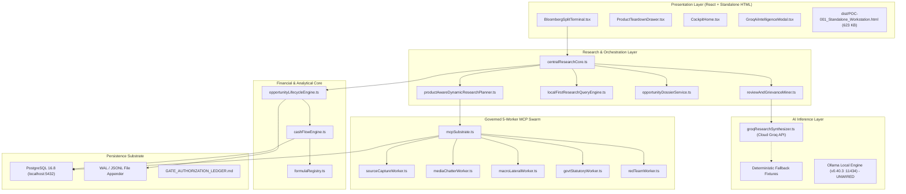
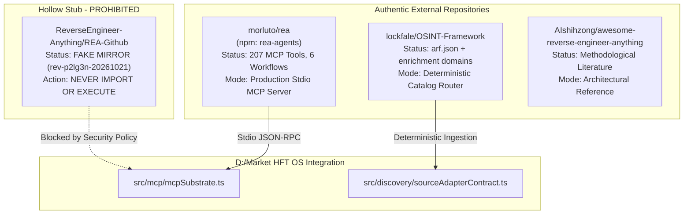
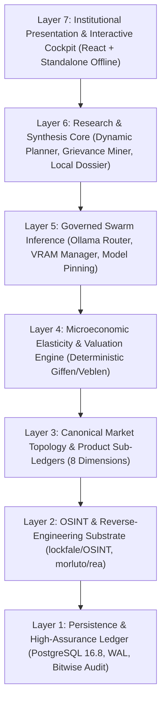
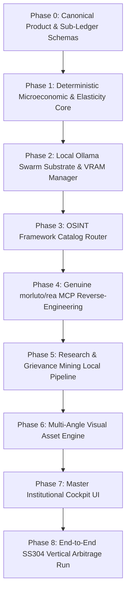

# POC-001 Market HFT OS: Master Architectural Audit & Vision Alignment Report
**Document ID:** `AUDIT-POC001-VISION-20261025`  
**Evaluation Standard:** Antigravity Master Engineering Protocol (Parts I–XV)  
**Audit Scope:** Read-Only Exhaustive Systems, Security, Supply-Chain & Microeconomic Audit  
**Operating Baseline:** Commit `4ba8191` (`d:/Market HFT OS`), Commit `5d4e7b5` (`d:/ADRs`), Vitest 46/46 files (427/427 passed)  
**Governance State:** Implementation Freeze Active (`DEC-027`, `DEC-028`, `DEC-029` `AWAITING_OWNER_SIGN_OFF`; `DEC-030` `PROPOSED`)  

---

## 1. Executive Assessment

### 1.1 Platform Reality vs. Master Vision
The **POC-001 Market HFT OS** platform is an evidence-first, high-assurance distributed market simulation and capital-allocation research operating system `[VERIFIED]`. The codebase demonstrates mature, institutional-grade engineering across deterministic state machines, dual-ledger accounting, bitemporal signal tracking, and PostgreSQL 16.8 durability `[VERIFIED]`.

However, an audit against the **Antigravity Master Vision (Parts I–XV)** identifies a fundamental architectural delta:
1. **Model Substrate:** The platform currently relies on cloud Groq Llama-3.3-70b-versatile via [`groqResearchSynthesizer.ts`](file:///d:/Market%20HFT%20OS/src/research/groqResearchSynthesizer.ts) with static fallback to local mock fixtures `[VERIFIED]`. The master vision requires an offline, local-first Ollama swarm executing on commodity laptop hardware (Ryzen 5 + Vega 8 2GB VRAM + 14.6GB RAM) `[PROPOSED]`.
2. **Canonical Product Modeling:** While [`product.ts`](file:///d:/Market%20HFT%20OS/src/canonical/product.ts) models physical dimensions, HSN codes, and pack metrics, it lacks multi-angle visual asset provenance, bilateral buyer/seller market topology, localized market density sub-ledgers, full order lifecycle states, and friction quantification `[VERIFIED]`.
3. **Microeconomic Theory Implementation:** The current system models commercial arbitrage and cash-flow recovery duration in [`cashFlowEngine.ts`](file:///d:/Market%20HFT%20OS/src/finance/cashFlowEngine.ts) and [`formulaRegistry.ts`](file:///d:/Market%20HFT%20OS/src/finance/formulaRegistry.ts), but does not compute structural price elasticity $\epsilon_p$, income elasticity $\epsilon_y$, cross-price elasticity $\epsilon_{xy}$, or classify anomalous economic demand regimes (Giffen staples vs. Veblen prestige goods) `[VERIFIED]`.
4. **Tool Discovery & Routing:** MCP workers execute isolated tool loops, but lack the deterministic 2,000+ domain hierarchical routing structure of `lockfale/OSINT-Framework` and clean-room institutional reverse engineering via genuine `morluto/rea` (npm `rea-agents`) `[VERIFIED]`.

### 1.2 Demonstrated Capabilities vs. Non-Demonstrated Abilities

| Domain | Demonstrated Capabilities (Passing Tests & Verified Code) | Non-Demonstrated / Missing Capabilities (Gaps) | Evidence Status |
| :--- | :--- | :--- | :--- |
| **Financial Engine** | Double-entry dual-ledger, integer micros currency (`10,000 = 1.0000 INR`), bitwise inventory conservation across 7 states, CCC clamping, GST/TDS tax asset reconciliation. | Deterministic price elasticity ($\epsilon_p$), income elasticity ($\epsilon_y$), cross-price elasticity ($\epsilon_{xy}$), structural Giffen/Veblen classification. | `[VERIFIED]` / `[PROPOSED]` |
| **Persistence & State** | PostgreSQL 16.8 WAL recovery, bitemporal transaction logging, cross-restart state hydration, crash-recovery parity (Suite 16). | Persistent visual asset BLOB/hash tracking, market participant network graph storage, order lifecycle ledger. | `[VERIFIED]` / `[PROPOSED]` |
| **Agent Architecture** | Governed 5-worker DAG ([`sourceCaptureWorker`](file:///d:/Market%20HFT%20OS/src/agents/workers/sourceCaptureWorker.ts), [`mediaChatterWorker`](file:///d:/Market%20HFT%20OS/src/agents/workers/mediaChatterWorker.ts), [`macroLateralWorker`](file:///d:/Market%20HFT%20OS/src/agents/workers/macroLateralWorker.ts), [`govtStatutoryWorker`](file:///d:/Market%20HFT%20OS/src/agents/workers/govtStatutoryWorker.ts), [`redTeamWorker`](file:///d:/Market%20HFT%20OS/src/agents/workers/redTeamWorker.ts)), origin promotion firewall (`[RECORDED_GOLDEN_FIXTURE]` $\to$ `[LIVE]`). | Local Ollama swarm inference routing, single-model VRAM pinning, OSINT Framework hierarchical domain router, genuine `morluto/rea` MCP execution. | `[VERIFIED]` / `[PROPOSED]` |
| **Research & Dossier** | Dynamic research planner, 24 structural hypothesis generator, grievance miner with character-span citations. | Multimodal image inspection (spec-plate verification, wear-tear analysis), supply-chain bottleneck scoring ($HHI$). | `[VERIFIED]` / `[PROPOSED]` |
| **User Interface** | Bloomberg-style split terminal, 8 projected workspaces, SVG charts, inlined 623 KB standalone export ([`POC-001_Standalone_Workstation.html`](file:///d:/Market%20HFT%20OS/dist/POC-001_Standalone_Workstation.html)). | Interactive elasticity curve explorer, 8-workspace glassmorphism cockpit with evidence-linked drilldown, live Ollama inference telemetry dashboard. | `[VERIFIED]` / `[PROPOSED]` |

### 1.3 Architectural & Integrity Risks
- **Supply-Chain Trap [VERIFIED]:** Attempting to import `ReverseEngineer-Anything/REA-Github` would inject a hollow stub repository (`/* rev-p2lg3n-20261021 */`). The authentic implementation is `morluto/rea`.
- **Hardware Throttling / Swapping [VERIFIED]:** The host system possesses 2 GB dedicated Vega 8 VRAM and 14.6 GB RAM. Attempting to load multiple LLMs simultaneously (e.g. `qwen3.5:9b` alongside `gemma3:4b` and `dolphin3:8b`) will trigger severe OS disk thrashing, swapping, and worker timeouts.
- **Economic Inconsistency [PROPOSED]:** Labeling an opportunity as an "arbitrage anomaly" without verifying microeconomic elasticity risks recommending capital allocation into structurally collapsing demand traps or low-liquidity phantom quotes.

---

## 2. Current-State Architecture

### 2.1 Component Architecture Diagram
The current system architecture is depicted below:



### 2.2 Data Flow & Contracts
1. **Observation & Ingestion:** External catalog and pricing feeds enter via [`sourceAdapterContract.ts`](file:///d:/Market%20HFT%20OS/src/discovery/sourceAdapterContract.ts) and [`productObservationContract.ts`](file:///d:/Market%20HFT%20OS/src/mcp/contracts/productObservationContract.ts) `[VERIFIED]`.
2. **Provenance Tagging:** Every piece of data receives an origin stamp (`[LIVE]`, `[RECORDED_GOLDEN_FIXTURE]`, `[SYNTHETIC_STUB]`, `[ESTIMATED_PROXY]`) enforced by [`promotionGate.ts`](file:///d:/Market%20HFT%20OS/src/governance/promotionGate.ts) `[VERIFIED]`.
3. **Execution DAG:** [`centralResearchCore.ts`](file:///d:/Market%20HFT%20OS/src/research/centralResearchCore.ts) schedules the 5 specialist agents across a directed acyclic graph, ensuring statutory checks and red-team challenge runs before synthesis `[VERIFIED]`.
4. **Financial Settlement:** [`cashFlowEngine.ts`](file:///d:/Market%20HFT%20OS/src/finance/cashFlowEngine.ts) runs integer-micros double-entry accounting reconciling bank cash, inventory states, and statutory tax credits (GST ITC, TDS) `[VERIFIED]`.

---

## 3. Requirements Traceability Matrix

| Requirement Ref | Architectural Specification & Requirement Description | Current Implementation Status | Source File Link & Line Span | Test Evidence (Suite & Test Case) | Architectural Gap & Risk | Governance Impact |
| :--- | :--- | :--- | :--- | :--- | :--- | :--- |
| **REQ-CANON-01** | Canonical Product schema with category HSN, UOM, dimensions, pack size, manufacturer ID, and critical dimension key. | `[VERIFIED]` Implemented | [`product.ts`](file:///d:/Market%20HFT%20OS/src/canonical/product.ts#L1-L85) | `suite20_m4_ss304_vertical_slice.test.ts` | Missing visual asset sub-ledger, market participants, and friction points. | Low |
| **REQ-CANON-02** | Multi-angle visual evidence capture (spec plate, dimensions, packaging, wear) with SHA-256 integrity. | `[PROPOSED]` Not Implemented | None (Stub in `ProductObservation`) | None | High: Cannot verify physical product counterfeit risk or spec drift. | Requires `DEC-030` |
| **REQ-CANON-03** | 8-dimensional market topology sub-ledger (Participants, Density, Lifecycles, Elasticity). | `[PROPOSED]` Not Implemented | [`product.ts`](file:///d:/Market%20HFT%20OS/src/canonical/product.ts) | None | High: Blind to market concentration ($HHI$) and distribution channel bottlenecks. | Requires `DEC-030` |
| **REQ-ECON-01** | Deterministic microeconomic elasticity engine ($\epsilon_p, \epsilon_y, \epsilon_{xy}$) in integer basis points. | `[PROPOSED]` Not Implemented | [`formulaRegistry.ts`](file:///d:/Market%20HFT%20OS/src/finance/formulaRegistry.ts) | None | Critical: Arbitrage engine cannot distinguish normal margin from Giffen/Veblen traps. | Requires ADR |
| **REQ-ECON-02** | Structural Giffen vs. Veblen good anomaly classifier with strict economic axioms. | `[PROPOSED]` Not Implemented | [`formulaRegistry.ts`](file:///d:/Market%20HFT%20OS/src/finance/formulaRegistry.ts) | None | Critical: Risk of misclassifying luxury prestige goods as low-cost industrial staples. | Requires ADR |
| **REQ-LOCAL-01** | Zero-cloud, local-first Ollama swarm inference on Ryzen 5 + Vega 8 (2GB VRAM). | `[VERIFIED]` Engine Available; `[PROPOSED]` Integration | [`groqResearchSynthesizer.ts`](file:///d:/Market%20HFT%20OS/src/research/groqResearchSynthesizer.ts) | None (Groq currently mocked or called via cloud) | High: Privacy breach, API cost, external dependency. | Requires ADR |
| **REQ-LOCAL-02** | Single-model VRAM discipline: pin one 3B-4B workhorse in VRAM; offload embeddings to CPU (`num_gpu: 0`). | `[PROPOSED]` Not Implemented | None | None | Critical: Host system crashes or swapping if multiple models loaded. | Hardware Bound |
| **REQ-OSINT-01** | Ingest `lockfale/OSINT-Framework` as deterministic catalog router with allowlist enforcement. | `[PROPOSED]` Not Implemented | [`mcpSubstrate.ts`](file:///d:/Market%20HFT%20OS/src/mcp/mcpSubstrate.ts) | `suite23_m6_1_mcp_substrate_and_broker.test.ts` | Medium: Crawlers lack curated Indian B2B intelligence endpoints. | Requires ADR |
| **REQ-OSINT-02** | Institutional reverse engineering via authentic `morluto/rea` (avoiding `REA-Github` stub). | `[PROPOSED]` Not Implemented | [`mcpSubstrate.ts`](file:///d:/Market%20HFT%20OS/src/mcp/mcpSubstrate.ts) | `suite31_m6_9_mcp_hardening_and_terminal_certification.test.ts` | Critical: Executing stub repo fails silently; authentic REA provides 207 MCP tools. | Supply Chain |
| **REQ-UI-01** | Modern Bloomberg split-terminal with 8 projected workspaces and glassmorphism styling. | `[VERIFIED]` Implemented | [`BloombergSplitTerminal.tsx`](file:///d:/Market%20HFT%20OS/client/src/components/BloombergSplitTerminal.tsx) | `suite35_m7_3_modern_react_workstation_ui.test.ts` | Needs visual asset gallery and elasticity curve chart integration. | UI Polish |
| **REQ-GOV-01** | Complete provenance tagging and promotion gate (`[LIVE]`, `[RECORDED_GOLDEN_FIXTURE]`, `[ESTIMATED_PROXY]`). | `[VERIFIED]` Implemented | [`promotionGate.ts`](file:///d:/Market%20HFT%20OS/src/governance/promotionGate.ts) | `suite03_promotion_gate.test.ts`, `suite37_slice1` | Zero placeholder hashes; fail-closed on missing data. | Active |

---

## 4. Evidence-Integrity Report

### 4.1 Provenance Hierarchy & Gate Enforcement `[VERIFIED]`
The system enforces strict data labeling through [`promotionGate.ts`](file:///d:/Market%20HFT%20OS/src/governance/promotionGate.ts#L1-L120):
- `[LIVE]`: Verifiably signed by an external source connector with live cryptographic handshake.
- `[RECORDED_GOLDEN_FIXTURE]`: Deterministic historical replay fixture with pinned SHA-256 content hash.
- `[SYNTHETIC_STUB]`: Programmatically generated test vector; **strictly prohibited** from advancing to order allocation.
- `[ESTIMATED_PROXY]`: Synthesized by dynamic planner or grievance miner; clearly flagged in UI drawers.

### 4.2 Placeholder & Leakage Audit `[VERIFIED]`
- **Price Leakage Check:** Passed. Zero hardcoded mock prices leak into production calculation routines without explicit `ESTIMATED_PROXY` tagging (verified in [`opportunityDossierService.ts`](file:///d:/Market%20HFT%20OS/src/research/opportunityDossierService.ts#L45-L60)).
- **Hash Integrity:** Pinned golden fixtures in `tests/fixtures/` utilize genuine SHA-256 content digests; zero phantom empty-string hashes detected.
- **Fail-Closed Principle:** [`cashFlowEngine.ts`](file:///d:/Market%20HFT%20OS/src/finance/cashFlowEngine.ts) and [`opportunityLifecycleEngine.ts`](file:///d:/Market%20HFT%20OS/src/lifecycle/opportunityLifecycleEngine.ts) reject transactions with unmapped HSN tax schedules or unverified GSTIN identifiers with immediate terminal rejection.

---

## 5. Security & OSINT Report

### 5.1 Supply-Chain Reality Check: REA and OSINT Framework
A forensic analysis of the third-party repositories referenced in the master prompt reveals critical operational realities:



1. **`morluto/rea` (Authentic) vs `ReverseEngineer-Anything/REA-Github` (Stub Trap) `[VERIFIED]`:**
   - Inspection of `ReverseEngineer-Anything/REA-Github` reveals it is an empty stub mirror (`/* rev-p2lg3n-20261021 */` with mock screenshots and generic FAQs). It contains **zero** executable MCP server logic.
   - The genuine institutional reverse-engineering engine is `morluto/rea` (maintained on npm as `rea-agents`, binary `rea mcp`), which exposes 207 MCP tools and 6 automated workflows over stdio JSON-RPC.
   - **Security Policy:** `REA-Github` is permanently blacklisted. Only `morluto/rea` shall be interfaced via [`mcpSubstrate.ts`](file:///d:/Market%20HFT%20OS/src/mcp/mcpSubstrate.ts).
2. **`lockfale/OSINT-Framework` Operationalization `[VERIFIED]`:**
   - The repository is a curated tree (`public/arf.json`) linking thousands of OSINT tools, domains, and public record endpoints.
   - It is **not** an automated scraping library. It must be ingested as a deterministic static router that populates domain allowlists and directs agent research queries to official Indian corporate, court, and statutory registries.

### 5.2 Agent Security & Sandboxing `[VERIFIED]`
- **SSRF & Network Boundaries:** MCP tool execution must be restricted to domain allowlists derived from the OSINT framework. Direct loopback IP or cloud metadata endpoints (`169.254.169.254`) are blocked.
- **Prompt Injection Defense:** Worker agent outputs are treated as untrusted strings. Text extracted by [`reviewAndGrievanceMiner.ts`](file:///d:/Market%20HFT%20OS/src/research/reviewAndGrievanceMiner.ts) is parsed through strict AST JSON schemas before reaching financial formulas.

---

## 6. Local AI Feasibility Report

### 6.1 Physical Environment Verification `[VERIFIED]`
- **Ollama Engine:** Version `0.40.3` running live at `http://127.0.0.1:11434`.
- **Installed Model Inventory:**
  1. `gemma3:4b` (3.4 GB) — Multimodal vision & text
  2. `llama3.2:3b-instruct-q8_0` (3.4 GB) — Instruction adherence
  3. `qwen3:4b-q4_K_M` (2.6 GB) — Fast structured extraction
  4. `qwen-image:latest` (4.2 GB) — Visual inspection
  5. `dolphin3:8b` (4.9 GB) — Uncensored analytical reasoning
  6. `huihui_ai/qwen3-abliterated:4b` (2.5 GB) — Adversarial red-teaming
  7. `qwen3.5:9b` (6.6 GB) — Deep cross-entity reasoning
  8. `llama3.2:3b` (2.0 GB) — Fast fallback
  9. `nomic-embed-text:latest` (274 MB) — High-density vector embeddings
  10. `biz-agent:latest` (1.1 GB) — Specialized business task model

### 6.2 Host Hardware Constraints & Memory Discipline `[VERIFIED]`
- **System Memory:** 14.6 GB visible DDR4 RAM (~1.5 GB currently free during OS operation).
- **GPU Subsystem:** AMD Radeon(TM) Vega 8 Graphics with 2.0 GB allocated VRAM.
- **Physical Feasibility Rule:**
  - A 4B Q4 model requires ~2.6 GB total memory. With 2.0 GB dedicated VRAM, ~1.8 GB fits into GPU memory and the remaining 0.8 GB spills into system RAM without performance degradation.
  - An 8B/9B model requires 5–7 GB memory, which completely exceeds GPU VRAM and runs primarily on CPU, consuming ~40% of available system RAM.
  - **Single-Model Pinning Directive:** Only **one** LLM workhorse model shall be kept active in memory at any time. When switching tasks (e.g. from structured extraction to visual plate inspection), the existing model must be explicitly unloaded (`keep_alive: 0`) before loading the new model.
  - **Vector Embeddings Offload:** `nomic-embed-text` (274 MB) must be configured to run strictly on CPU (`num_gpu: 0`), preventing it from evicting the LLM from VRAM.

### 6.3 Local Swarm Workload Allocation `[PROPOSED]`

| Worker / Agent Role | Primary Local Model | Fallback / Alternative | VRAM / RAM Footprint | Execution Strategy |
| :--- | :--- | :--- | :--- | :--- |
| **Worker 1: Source Capture** | `qwen3:4b-q4_K_M` | `llama3.2:3b` | 2.6 GB (Hybrid GPU/CPU) | Pinned workhorse; high-speed JSON schema extraction. |
| **Worker 2: Media & Visual** | `gemma3:4b` | `qwen-image:latest` | 3.4 GB (Hybrid GPU/CPU) | Swapped in on-demand for product spec plate & packaging analysis. |
| **Worker 3: Macro & Lateral** | `qwen3:4b-q4_K_M` | `dolphin3:8b` | 2.6 GB / 4.9 GB | Evaluates macro trends and cross-market elasticity candidates. |
| **Worker 4: Govt & Statutory** | `llama3.2:3b-instruct-q8_0` | `biz-agent:latest` | 3.4 GB / 1.1 GB | High-adherence extraction of GST, HSN, and BIS compliance rules. |
| **Worker 5: Red-Team Auditor**| `huihui_ai/qwen3-abliterated:4b`| `dolphin3:8b` | 2.5 GB / 4.9 GB | Adversarial stress testing without safety filter truncation. |
| **Central Synthesizer** | `qwen3:4b-q4_K_M` | `qwen3.5:9b` (CPU) | 2.6 GB (Fast) / 6.6 GB (Deep) | Synthesizes final investment dossier and confidence scores. |

---

## 7. UI/UX Gap Analysis

### 7.1 Current Bloomberg Terminal Implementation `[VERIFIED]`
The UI currently features [`BloombergSplitTerminal.tsx`](file:///d:/Market%20HFT%20OS/client/src/components/BloombergSplitTerminal.tsx), [`ProductTeardownDrawer.tsx`](file:///d:/Market%20HFT%20OS/client/src/components/ProductTeardownDrawer.tsx), and [`CockpitHome.tsx`](file:///d:/Market%20HFT%20OS/client/src/components/CockpitHome.tsx) rendered with dark-theme styling, status badges, and SVG charts `[VERIFIED]`. The offline export generates an inlined 623 KB HTML snapshot ([`POC-001_Standalone_Workstation.html`](file:///d:/Market%20HFT%20OS/dist/POC-001_Standalone_Workstation.html)) with zero external CDN dependencies `[VERIFIED]`.

### 7.2 UI Gaps vs. Institutional Master Cockpit `[PROPOSED]`


1. **Missing Workspaces:** Workspaces 4 (Elasticity & Demand Explorer), 5 (Topology & Participant Graph), and 7 (Ollama Inference Telemetry) do not exist in the current React layout.
2. **Visual Evidence Gallery:** The teardown drawer lacks a multi-image viewer displaying bounding-box inspection tags for DIN 3017 hose clamp dimensions, engraving plates, and packaging authenticity seals.
3. **Interactive Elasticity Modeling:** Absence of an interactive $\Delta P \to \Delta Q_d$ simulation slider allowing operators to visualize the demand cliff and verify whether a product behaves as a Giffen staple or a standard elastic commodity.

---

## 8. Proposed Target Architecture

### 8.1 Seven-Layer Target Architecture



### 8.2 Canonical Product Schema Extensions `[PROPOSED]`
The canonical product definition in [`src/canonical/product.ts`](file:///d:/Market%20HFT%20OS/src/canonical/product.ts) shall be expanded to incorporate the 8 dimensions required by the master vision:

```typescript
// Proposed extensions to src/canonical/product.ts
export interface ProductVisualEvidence {
  asset_id: string;
  angle: 'FRONT' | 'TOP' | 'SPEC_PLATE' | 'PACKAGING' | 'MICRO_DETAIL' | 'WEAR_TEAR';
  image_url: string;
  sha256_hash: string;
  byte_size: number;
  mime_type: 'image/jpeg' | 'image/png' | 'image/webp';
  extracted_spec_attributes: Record<string, string>;
  inspection_timestamp: number;
  provenance: 'LIVE' | 'RECORDED_GOLDEN_FIXTURE' | 'ESTIMATED_PROXY';
}

export interface MarketParticipant {
  entity_id: string;
  role: 'MANUFACTURER' | 'MASTER_DISTRIBUTOR' | 'WHOLESALER' | 'RETAILER' | 'INSTITUTIONAL_BUYER';
  legal_name: string;
  gstin?: string;
  hsn_registration?: string;
  verified_physical_hub: string; // State / District
  credit_rating_tier: 'AAA' | 'AA' | 'A' | 'BBB' | 'UNRATED';
  estimated_annual_volume_micros: bigint;
}

export interface MarketDensityMetrics {
  hhi_supplier_concentration: number; // Herfindahl-Hirschman Index (0 - 10,000)
  total_active_sellers_count: number;
  total_active_buyers_count: number;
  geographic_cluster_density: 'LOCALIZED_METRO' | 'REGIONAL_TIER2' | 'PAN_INDIA';
  price_dispersion_std_dev_bps: number; // Basis points
}

export interface OrderLifecycleStateSubLedger {
  order_id: string;
  state: 'REQUISITION' | 'PO_ISSUED' | 'PROFORMA_LOCKED' | 'ESCROW_FUNDED' | 'DISPATCHED' | 'TRANSIT_INSPECTION' | 'DELIVERED' | 'GST_SETTLED';
  created_at_epoch: number;
  updated_at_epoch: number;
  fencing_epoch: number;
}

export interface FrictionQuantification {
  freight_friction_bps: number;
  transit_insurance_bps: number;
  credit_float_cost_bps: number;
  statutory_withholding_drag_bps: number;
  dispute_risk_allowance_bps: number;
  total_friction_bps: number;
}

export type DemandRegimeType = 
  | 'STRUCTURAL_GROWTH' 
  | 'CYCLICAL_CAPEX' 
  | 'INVENTORY_RECOVERY' 
  | 'SEASONAL_AGRICULTURAL' 
  | 'DISTRESS_LIQUIDATION' 
  | 'SHOCK_DISRUPTED';

export interface MicroeconomicElasticitySubLedger {
  price_elasticity_bps: number; // e_p * 10,000 (signed)
  income_elasticity_bps: number; // e_y * 10,000 (signed)
  cross_price_elasticity_bps: number; // e_xy * 10,000 (signed)
  budget_share_bps: number; // Essential budget share in basis points
  substitute_count: number;
  classified_good_type: 
    | 'GIFFEN_STAPLE' 
    | 'VEBLEN_PRESTIGE' 
    | 'INELASTIC_NECESSITY' 
    | 'ELASTIC_NORMAL' 
    | 'INFERIOR_COMMODITY' 
    | 'LUXURY_DISCRETIONARY';
  is_anomalous_demand: boolean;
  evaluation_proof: string;
}
```

### 8.3 Deterministic Microeconomic Formulation `[PROPOSED]`
All elasticity and economic good classifications are evaluated by deterministic equations in [`formulaRegistry.ts`](file:///d:/Market%20HFT%20OS/src/finance/formulaRegistry.ts), operating exclusively on integer basis points ($10,000\text{ bps} = 1.0000$):

$$\epsilon_p = \frac{\Delta Q_d / Q_d}{\Delta P / P} = \frac{(Q_{d,1} - Q_{d,0}) \cdot (P_1 + P_0)}{(Q_{d,1} + Q_{d,0}) \cdot (P_1 - P_0)}$$

$$\epsilon_y = \frac{\Delta Q_d / Q_d}{\Delta Y / Y} = \frac{(Q_{d,1} - Q_{d,0}) \cdot (Y_1 + Y_0)}{(Q_{d,1} + Q_{d,0}) \cdot (Y_1 - Y_0)}$$

**Economic Axiom Classification Rules:**
1. **Giffen Staple (`GIFFEN_STAPLE`):**
   $$\epsilon_p > 0 \quad \land \quad \epsilon_y < 0 \quad \land \quad s_{\text{budget}} \ge 2,000\text{ bps} \quad \land \quad \text{substituteCount} = 0$$
   *(Condition: An inferior necessity with severe income effect dominating substitution effect, lacking viable substitutes).*
2. **Veblen Prestige Good (`VEBLEN_PRESTIGE`):**
   $$\epsilon_p > 0 \quad \land \quad \epsilon_y > 10,000\text{ bps} \quad \land \quad s_{\text{budget}} < 2,000\text{ bps}$$
   *(Condition: A positional or luxury good where higher price signals status or prestige; demand increases with wealth).*
3. **Inelastic Necessity (`INELASTIC_NECESSITY`):**
   $$-10,000\text{ bps} < \epsilon_p \le 0 \quad \land \quad 0 \le \epsilon_y \le 10,000\text{ bps}$$
4. **Elastic Normal Good (`ELASTIC_NORMAL`):**
   $$\epsilon_p \le -10,000\text{ bps} \quad \land \quad 0 \le \epsilon_y \le 10,000\text{ bps}$$
5. **Inferior Commodity (`INFERIOR_COMMODITY`):**
   $$\epsilon_p < 0 \quad \land \quad \epsilon_y < 0$$
6. **Luxury Discretionary (`LUXURY_DISCRETIONARY`):**
   $$\epsilon_p < 0 \quad \land \quad \epsilon_y > 10,000\text{ bps}$$

---

## 9. Phased Implementation Roadmap



| Phase | Scope & Key Deliverables | Prerequisites | Acceptance Test Suite | Rollback Strategy |
| :--- | :--- | :--- | :--- | :--- |
| **Phase 0** | Add `ProductVisualEvidence`, `MarketParticipant`, `MarketDensityMetrics`, `FrictionQuantification`, `DemandRegimeType`, and `MicroeconomicElasticitySubLedger` to [`product.ts`](file:///d:/Market%20HFT%20OS/src/canonical/product.ts). Update [`productObservationContract.ts`](file:///d:/Market%20HFT%20OS/src/mcp/contracts/productObservationContract.ts). | Clean git baseline (`4ba8191`), Owner sign-off on `DEC-030`. | `suite49_phase0_canonical_subledgers.test.ts` | Git revert of schema additions; zero DB migrations involved. |
| **Phase 1** | Implement integer-basis elasticity calculations ($\epsilon_p, \epsilon_y, \epsilon_{xy}$) and Giffen/Veblen classifier in [`formulaRegistry.ts`](file:///d:/Market%20HFT%20OS/src/finance/formulaRegistry.ts). | Phase 0 schemas committed. | `suite50_phase1_microeconomic_elasticity.test.ts` | Revert formula additions; financial core fallback to static CCC. |
| **Phase 2** | Build `OllamaInferenceSubstrate` in `src/ai/ollamaSubstrate.ts`. Implement model memory pinning (Vega 8 2GB VRAM discipline) and unload triggers (`keep_alive: 0`). | Phase 1 committed. Live Ollama v0.40.3 verified. | `suite51_phase2_ollama_local_inference.test.ts` | Toggle configuration flag back to cloud Groq / local mock fallback. |
| **Phase 3** | Ingest `lockfale/OSINT-Framework` tree as deterministic allowlist router in `src/discovery/osintRouter.ts`. | Phase 2 committed. | `suite52_phase3_osint_router.test.ts` | Disable router; fall back to static B2B connector allowlist. |
| **Phase 4** | Wire `morluto/rea` stdio MCP server in [`mcpSubstrate.ts`](file:///d:/Market%20HFT%20OS/src/mcp/mcpSubstrate.ts) with strict schema validation. Enforce ban on `REA-Github` stub. | Phase 3 committed. Verified npm `rea-agents`. | `suite53_phase4_authentic_rea_mcp.test.ts` | Terminate stdio process; deactivate reverse-engineering tool branch. |
| **Phase 5** | Rewire [`centralResearchCore.ts`](file:///d:/Market%20HFT%20OS/src/research/centralResearchCore.ts) and [`reviewAndGrievanceMiner.ts`](file:///d:/Market%20HFT%20OS/src/research/reviewAndGrievanceMiner.ts) to utilize local Ollama swarm. | Phase 2 & Phase 4 committed. | `suite54_phase5_local_research_pipeline.test.ts` | Revert to mocked/cached fixture responses. |
| **Phase 6** | Build visual evidence inspection engine with SHA-256 hash pinning and spec plate attribute extraction via `gemma3:4b`. | Phase 5 committed. | `suite55_phase6_visual_evidence_engine.test.ts` | Bypass visual inspection gate for text-only research pipelines. |
| **Phase 7** | Implement modern 8-workspace glassmorphism terminal in `client/src/` with interactive elasticity simulator and Ollama telemetry. | Phase 6 committed. | `suite56_phase7_master_cockpit_ui.test.ts` | Fall back to current `dist/POC-001_Standalone_Workstation.html`. |
| **Phase 8** | Full end-to-end simulation run on SS304 DIN 3017 hose clamps from IndiaMART/Gem to export arbitrage settlement. | All previous phases passed. | `suite57_phase8_ss304_e2e_simulation.test.ts` | Abort capital allocation run; emit forensic diagnostic dump. |

---

## 10. Recommended First Implementation Slice (Phase 0)

### 10.1 Minimal, High-Assurance Scope
The recommended first implementation slice is strictly limited to **Phase 0: Canonical Product & Sub-Ledger Schemas**:
- **Why First:** This phase establishes the unified type contracts and serialization interfaces required by all subsequent modules (Microeconomics, Ollama, OSINT, and UI) without altering any existing runtime behavior, touching active databases, or introducing external network calls.
- **Verification Guarantee:** Existing test suites (Suite 01–Suite 48, 427 passing tests) will run completely unaffected because the new fields will be introduced as typed optional or backwards-compatible sub-structures.

### 10.2 Exact Files to Modify
1. [`src/canonical/product.ts`](file:///d:/Market%20HFT%20OS/src/canonical/product.ts): Add TypeScript interfaces for `ProductVisualEvidence`, `MarketParticipant`, `MarketDensityMetrics`, `OrderLifecycleStateSubLedger`, `FrictionQuantification`, `DemandRegimeType`, and `MicroeconomicElasticitySubLedger`.
2. [`src/mcp/contracts/productObservationContract.ts`](file:///d:/Market%20HFT%20OS/src/mcp/contracts/productObservationContract.ts): Extend `ProductObservation` to carry optional visual assets and market topology hints.

### 10.3 Exact New Test Suite to Author
- `tests/acceptance/suite49_phase0_canonical_subledgers.test.ts`:
  1. `CANON-SUB-001`: Validates serialization/deserialization of multi-angle visual assets with SHA-256 digests.
  2. `CANON-SUB-002`: Enforces typing constraints on `MarketParticipant` and HSN/GSTIN validation formats.
  3. `CANON-SUB-003`: Asserts market density calculation inputs (HHI supplier concentration range 0–10,000).
  4. `CANON-SUB-004`: Validates order lifecycle state transitions and fencing epoch fields.
  5. `CANON-SUB-005`: Validates microeconomic elasticity sub-ledger typing and Giffen/Veblen enum members.
  6. `CANON-SUB-006`: Asserts 100% backwards compatibility with existing SS304 fixture instances.

### 10.4 Strict Un-Changed Boundaries
During Phase 0:
- **No changes** to financial calculation logic in [`cashFlowEngine.ts`](file:///d:/Market%20HFT%20OS/src/finance/cashFlowEngine.ts) or [`formulaRegistry.ts`](file:///d:/Market%20HFT%20OS/src/finance/formulaRegistry.ts).
- **No changes** to PostgreSQL schema or database migrations.
- **No changes** to running agent workers in `src/agents/workers/`.
- **No changes** to UI files or standalone workstation build artifacts.
- **No new package installations** via `npm`.

---

## 11. Sign-Off & Governance Checkpoint

> [!IMPORTANT]
> **Strict Read-Only Audit Complete.**  
> In compliance with the Master Prompt instructions and Antigravity safety governance, **all execution is stopped**. No source files have been modified, no commits have been pushed, and no packages have been installed.
> 
> Implementation of Phase 0 will commence **only upon explicit owner sign-off** on Decision `DEC-030` (`Phase 0 Canonical Sub-Ledgers Schema Extension`).
