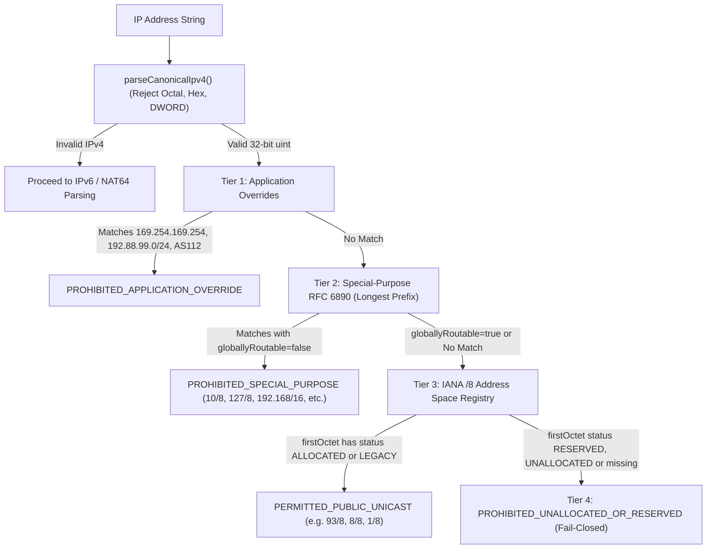
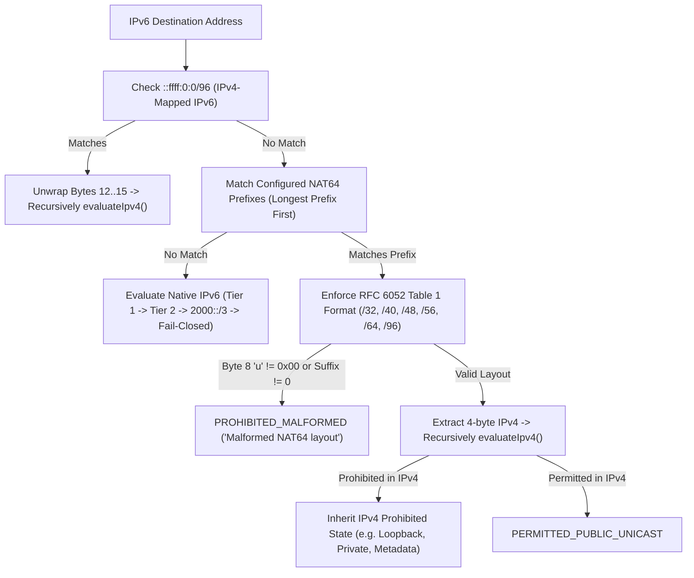

# POC-001 Stage 1: Phase 1 Read-Only Acceptance Audit
**Source-Level Code Verification, Verbatim Decision Paths & Boundary Defense Audit**

- **Document ID:** `POC-001-AUD-PHASE1-ACCEPTANCE-001`
- **Revision:** `1.0.0`
- **Date:** `2026-10-26`
- **Repository:** `Market HFT OS`
- **Branch:** `main` | **Commit:** `4ba8191f1f9e539a109d020265a0351f32e99d23`
- **Governance State:** Stage 1 **`OPEN`** | Implementation Freeze **`ACTIVE`** | Security Gates: **`0 / 14 Passed`**
- **Phase Authorization Status:** Phase 1 Remediation Provisionally Accepted | Phase 2 **`UNAUTHORIZED`**

---

## 1. Executive Governance Alignment & Security Scope Correction

### 1.1 Formal Governance Record
- **Stage 1 Status:** **`OPEN`** (Continuous verification mode).
- **Implementation Freeze:** **`ACTIVE`** (Strict read-only audit; zero production edits, zero dependencies added, zero staging, zero commits).
- **Security Gates Passed:** **`0 / 14`** (Unit test assertions do not constitute socket or OS-level boundary proof).
- **Phase 2 Status:** **`UNAUTHORIZED`** (DNS contract, cryptographic HMAC tickets, and pinned socket connector remain unstarted).

### 1.2 Boundary Defense Correction: Narrow SSRF Scope
We explicitly retract and correct the overbroad statement that *"the 4-tier model provides complete mathematical SSRF and intranet protection."*

The actual, verified security boundary is defined as follows:
1. **Scope of the IP Policy:** The 4-tier model is strictly an egress destination address classifier that deterministically categorizes and blocks RFC 1918 private, RFC 3927 link-local, loopback, CGNAT, documentation, benchmarking, cloud metadata, and unallocated/reserved spaces.
2. **What Remains Unproven:** IP classification alone **does not prove** end-to-end SSRF or intranet protection. A complete security boundary requires:
   - **DNS Resolution Pinning (Phase 2):** Cryptographic proof that the socket connects to the exact IP address validated by the policy, preventing time-of-check to time-of-use (TOCTOU) DNS rebinding.
   - **Connection Revalidation (Phase 3):** Re-evaluation of every HTTP redirect and subsequent HTTPS `CONNECT` tunnel.
   - **Dual-Stack & NAT64 Normalization (Phase 2 & 3):** Enforcing canonical address representation across all socket interfaces.
   - **Browser Socket Confinement (Phase 3 & 4):** Proving that the browser process cannot open direct TCP sockets bypassing the proxy.
   - **Operating System Netfilter Isolation (Phase 4):** Host firewall rules and network namespace boundaries dropping prohibited egress packets if application-level controls fail.

---

## 2. Source-Level Audit of the 5 Verification Points

### Verification Point 1: `source_url` is Validated as Provenance, Not Trust Anchor

**Audit Finding:** `IanaRegistrySnapshotLoader` validates `entry.source_url` purely as an auditable provenance record and metadata format constraint. It is **never** used for dynamic fetching at runtime and is **never** accepted as proof of authenticity.

**Verbatim Source (`src/infrastructure/browser/iana_registry_snapshot.ts`, Lines 237–239):**
```typescript
if (!entry.source_url || typeof entry.source_url !== 'string' || !entry.source_url.startsWith('https://www.iana.org/')) {
  throw new Error(`E-BROWSER-REGISTRY-UNVERIFIED: Invalid source_url in manifest entry for ${filename}: ${entry.source_url}`);
}
```

**Security Analysis:**
- The check ensures that every manifest entry documents an upstream IANA origin URL.
- The actual authenticity and integrity of the snapshot bytes are anchored entirely in the pre-computed `CHECKSUMS.sha256` digest and the on-disk cryptographic hash.

---

### Verification Point 2: Strict Parsing & Validation of All Five Timestamps

**Audit Finding:** The loader strictly parses and validates the top-level `manifest.created_at_utc` timestamp **and** the individual `retrieval_timestamp_utc` for all four required snapshot files against the configured reference time, 90-day maximum age, and 5-minute clock-skew tolerance.

**Verbatim Source (`src/infrastructure/browser/iana_registry_snapshot.ts`, Lines 185–212, 249–264):**

*Top-Level Manifest Freshness Check:*
```typescript
if (typeof manifest.created_at_utc !== 'string' || manifest.created_at_utc.trim().length === 0) {
  throw new Error('E-BROWSER-REGISTRY-UNVERIFIED: Missing or empty created_at_utc in manifest.json');
}

const createdAtMs = Date.parse(manifest.created_at_utc);
if (Number.isNaN(createdAtMs)) {
  throw new Error(`E-BROWSER-REGISTRY-UNVERIFIED: Malformed created_at_utc timestamp: ${manifest.created_at_utc}`);
}

const nowMs = options?.referenceTimeMs ?? Date.now();
const clockSkewMs = options?.clockSkewToleranceMs ?? this.DEFAULT_CLOCK_SKEW_TOLERANCE_MS;
const maxAgeMs = options?.maxAgeMs ?? this.DEFAULT_MAX_SNAPSHOT_AGE_MS;

// Check future-dated manifest timestamp (beyond clock skew tolerance)
if (createdAtMs > nowMs + clockSkewMs) {
  throw new Error(
    `E-BROWSER-REGISTRY-UNVERIFIED: Manifest created_at_utc is future-dated: ${manifest.created_at_utc} exceeds reference time ${new Date(nowMs).toISOString()} (tolerance ${clockSkewMs}ms)`
  );
}

// Check stale snapshot age
if (nowMs - createdAtMs > maxAgeMs) {
  const ageDays = Math.floor((nowMs - createdAtMs) / (24 * 60 * 60 * 1000));
  const maxDays = Math.floor(maxAgeMs / (24 * 60 * 60 * 1000));
  throw new Error(
    `E-BROWSER-REGISTRY-UNVERIFIED: Snapshot is stale (age ${ageDays} days exceeds maximum acceptable age ${maxDays} days)`
  );
}
```

*Per-Entry Retrieval Timestamp Check (Executed for all 4 required files):*
```typescript
if (!entry.retrieval_timestamp_utc || typeof entry.retrieval_timestamp_utc !== 'string') {
  throw new Error(`E-BROWSER-REGISTRY-UNVERIFIED: Missing retrieval_timestamp_utc for ${filename}`);
}

const retrievalMs = Date.parse(entry.retrieval_timestamp_utc);
if (Number.isNaN(retrievalMs)) {
  throw new Error(`E-BROWSER-REGISTRY-UNVERIFIED: Malformed retrieval_timestamp_utc for ${filename}: ${entry.retrieval_timestamp_utc}`);
}

if (retrievalMs > nowMs + clockSkewMs) {
  throw new Error(`E-BROWSER-REGISTRY-UNVERIFIED: Future-dated retrieval_timestamp_utc for ${filename}: ${entry.retrieval_timestamp_utc}`);
}

if (nowMs - retrievalMs > maxAgeMs) {
  throw new Error(`E-BROWSER-REGISTRY-UNVERIFIED: Stale retrieval_timestamp_utc for ${filename} (exceeds max age)`);
}
```

---

### Verification Point 3: Manifest Cannot Authorize Different Bytes from `CHECKSUMS.sha256`

**Audit Finding:** The manifest cannot substitute or decouple its digests. A strict **triple-source cryptographic equality invariant** is enforced: `manifest.sha256` must equal `CHECKSUMS.sha256`, which must equal `crypto.createHash('sha256').update(fileBuffer).digest('hex')`.

**Verbatim Source (`src/infrastructure/browser/iana_registry_snapshot.ts`, Lines 266–301):**
```typescript
// Cross-integrity check between manifest and CHECKSUMS.sha256
const expectedShaFromChecksums = expectedChecksums.get(filename);
if (!expectedShaFromChecksums) {
  throw new Error(`E-BROWSER-REGISTRY-UNVERIFIED: No checksum entry for ${filename} in CHECKSUMS.sha256`);
}

if (entry.sha256.toLowerCase() !== expectedShaFromChecksums) {
  throw new Error(
    `E-BROWSER-REGISTRY-UNVERIFIED: Cross-integrity mismatch for ${filename}: manifest SHA (${entry.sha256.toLowerCase()}) != CHECKSUMS.sha256 (${expectedShaFromChecksums})`
  );
}

// CHECKSUM-BEFORE-PARSE INVARIANT: Verify physical file on disk before XML parse
const filePath = path.join(dir, filename);
if (!fs.existsSync(filePath)) {
  throw new Error(`E-BROWSER-REGISTRY-UNVERIFIED: Required snapshot file missing: ${filename}`);
}

const fileBuffer = fs.readFileSync(filePath);
if (fileBuffer.length === 0) {
  throw new Error(`E-BROWSER-REGISTRY-UNVERIFIED: Snapshot file is empty: ${filename}`);
}

if (fileBuffer.length !== entry.byte_length) {
  throw new Error(
    `E-BROWSER-REGISTRY-UNVERIFIED: Byte length mismatch for ${filename}. Expected ${entry.byte_length}, got ${fileBuffer.length}`
  );
}

const actualSha = crypto.createHash('sha256').update(fileBuffer).digest('hex').toLowerCase();
if (actualSha !== expectedShaFromChecksums) {
  throw new Error(
    `E-BROWSER-REGISTRY-UNVERIFIED: Checksum mismatch for ${filename}. Expected ${expectedShaFromChecksums}, got ${actualSha}`
  );
}
```

---

### Verification Point 4: Corrupted XML is Rejected Before the Parser is Invoked

**Audit Finding:** Structural integrity verification occurs at lines 278–301, strictly **before** line 304 where XML files are read and parsed. The targeted unit test writes syntax-corrupted XML (`<unclosed xml tags >>>`) with an altered checksum; the thrown error is verified to be a byte-length or checksum mismatch, proving that execution halts before the XML parser is ever invoked.

**Verbatim Unit Test (`tests/unit/unit_iana_policy.test.ts`, Lines 449–467):**
```typescript
it('preserves checksum-before-parse invariant: tampered XML fails on integrity before XML parser runs', () => {
  const tempDir = fs.mkdtempSync(path.join(os.tmpdir(), 'hft-snap-test-'));
  const realDir = path.resolve(process.cwd(), 'registry', 'snapshots');
  try {
    fs.copyFileSync(path.join(realDir, 'CHECKSUMS.sha256'), path.join(tempDir, 'CHECKSUMS.sha256'));
    fs.copyFileSync(path.join(realDir, 'manifest.json'), path.join(tempDir, 'manifest.json'));
    fs.copyFileSync(path.join(realDir, 'iana-ipv4-special-registry.xml'), path.join(tempDir, 'iana-ipv4-special-registry.xml'));
    fs.copyFileSync(path.join(realDir, 'iana-ipv6-special-registry.xml'), path.join(tempDir, 'iana-ipv6-special-registry.xml'));
    fs.copyFileSync(path.join(realDir, 'ipv4-address-space.xml'), path.join(tempDir, 'ipv4-address-space.xml'));
    // Write invalid XML with bad checksum
    fs.writeFileSync(path.join(tempDir, 'ipv6-unicast-address-assignments.xml'), '<unclosed xml tags >>>');

    expect(() => {
      new NetworkSecurityPolicy(tempDir);
    }).toThrow(/E-BROWSER-REGISTRY-UNVERIFIED: (Byte length mismatch|Checksum mismatch)/);
  } finally {
    fs.rmSync(tempDir, { recursive: true, force: true });
  }
});
```

---

### Verification Point 5: Runtime Defaults are Used by Actual Production Callers

**Audit Finding:** Production and integration callers invoke `new NetworkSecurityPolicy()` without arguments. The constructor delegates to `IanaRegistrySnapshotLoader.loadAndVerify()` with `options = undefined`, which automatically applies wall-clock `Date.now()`, the 90-day maximum age (`DEFAULT_MAX_SNAPSHOT_AGE_MS = 7,776,000,000 ms`), and the 5-minute clock-skew tolerance (`DEFAULT_CLOCK_SKEW_TOLERANCE_MS = 300,000 ms`).

**Verbatim Source (`src/infrastructure/browser/network_security_policy.ts`, Lines 93–105):**
```typescript
constructor(
  customSnapshotDir?: string,
  customNat64Prefixes?: readonly Nat64ConfiguredPrefix[],
  options?: SnapshotVerificationOptions
) {
  if (customSnapshotDir || options) {
    this.tables = IanaRegistrySnapshotLoader.loadAndVerify(customSnapshotDir, options);
  } else {
    if (!NetworkSecurityPolicy.defaultTables) {
      NetworkSecurityPolicy.defaultTables = IanaRegistrySnapshotLoader.loadAndVerify();
    }
    this.tables = NetworkSecurityPolicy.defaultTables;
  }
  // ...
}
```

---

## 3. Decision Path Verification: IPv4 and NAT64

### 3.1 Actual IPv4 Decision Path



**Verbatim Source (`src/infrastructure/browser/network_security_policy.ts`, Lines 251–281):**
```typescript
// TIER 3: Positive Delegated RIR Unicast Allocation (Checked against 256 /8 blocks)
const firstOctet = (ipNum >>> 24) & 0xff;
const spaceRec = this.tables.ipv4AddressSpace.find(r => r.prefixNumber === firstOctet);

if (spaceRec) {
  if (spaceRec.status === 'ALLOCATED' || spaceRec.status === 'LEGACY') {
    return {
      state: 'PERMITTED_PUBLIC_UNICAST',
      isProhibited: false,
      inputIp: originalInput,
      canonicalIp: canonical,
      addressFamily: 'IPv4',
      matchedPrefix: spaceRec.prefixString,
      ruleDescription: `Tier 3 Permitted RIR Allocation: ${spaceRec.designation} (${spaceRec.status})`,
      extractedIpv4: extractedFrom
    };
  }
}

// TIER 4: Unallocated, Reserved, or Retained Space (Fail-Closed Default)
const desig = spaceRec ? `${spaceRec.designation} (${spaceRec.status})` : 'Unallocated /8 Block';
return {
  state: 'PROHIBITED_UNALLOCATED_OR_RESERVED',
  isProhibited: true,
  inputIp: originalInput,
  canonicalIp: canonical,
  addressFamily: 'IPv4',
  matchedPrefix: spaceRec ? spaceRec.prefixString : `${firstOctet}/8`,
  ruleDescription: `Tier 4 Prohibited Unallocated or Reserved Space: ${desig}`,
  extractedIpv4: extractedFrom
};
```

---

### 3.2 Actual NAT64 Decision Path



**Verbatim Source (`src/infrastructure/browser/network_security_policy.ts`, Lines 168–190, 485–538):**
```typescript
// Step 2B: Check for configured NAT64 prefix match & structural extraction
const nat64Result = this.extractIpv4FromNat64Bytes(ipv6Parsed.bytes, this.configuredNat64Prefixes);
if (nat64Result.matchedConfiguredPrefix) {
  if (!nat64Result.isValidNat64 || !nat64Result.extractedIpv4) {
    return {
      state: 'PROHIBITED_MALFORMED',
      isProhibited: true,
      inputIp: trimmed,
      canonicalIp: ipv6Parsed.canonical,
      addressFamily: 'IPv6',
      matchedPrefix: nat64Result.matchedPrefixString,
      ruleDescription: nat64Result.failureReason || 'Malformed NAT64 address layout',
      extractedIpv4: null
    };
  }

  // Extracted IPv4 exists: evaluate extracted address through standard IPv4 policy
  const extractedV4Num = NetworkSecurityPolicy.parseCanonicalIpv4(nat64Result.extractedIpv4);
  if (extractedV4Num !== null) {
    return this.evaluateIpv4(extractedV4Num, trimmed, nat64Result.extractedIpv4);
  }
}
```

*RFC 6052 Structural Table 1 Enforcement:*
```typescript
// Enforce byte 8 'u' octet === 0x00 for prefix lengths < 96
if (matched.prefixLength < 96) {
  if (bytes[8] !== 0x00) {
    return {
      matchedConfiguredPrefix: true,
      matchedPrefixString: matched.prefixString,
      isValidNat64: false,
      extractedIpv4: null,
      failureReason: `RFC 6052 non-zero 'u' octet at byte 8 (got 0x${bytes[8].toString(16)})`
    };
  }
}

// Enforce trailing suffix bits are strictly zero
let suffixStartByte = 0;
if (matched.prefixLength === 32) suffixStartByte = 8;
else if (matched.prefixLength === 40) suffixStartByte = 9;
else if (matched.prefixLength === 48) suffixStartByte = 10;
else if (matched.prefixLength === 56) suffixStartByte = 11;
else if (matched.prefixLength === 64) suffixStartByte = 12;
else if (matched.prefixLength === 96) suffixStartByte = 16;

for (let i = suffixStartByte; i < 16; i++) {
  if (bytes[i] !== 0x00) {
    return {
      matchedConfiguredPrefix: true,
      matchedPrefixString: matched.prefixString,
      isValidNat64: false,
      extractedIpv4: null,
      failureReason: `RFC 6052 non-zero suffix bits at byte ${i} (got 0x${bytes[i].toString(16)})`
    };
  }
}
```

---

## 4. Current File & Baseline Inventory

- **Tracked Git Status:** Clean on `main` across both [`d:/Market HFT OS`](file:///d:/Market%20HFT%20OS) (`4ba8191f`) and [`d:/ADRs`](file:///d:/ADRs) (`5d4e7b5a`).
- **Untracked File Inventory (14 Files Physically Intact):**
  1. `tests/acceptance/suite49_category_agnostic_discovery_pipeline.test.ts`
  2. `tests/acceptance/suite50_browser_network_security_boundary.test.ts`
  3. `tests/integration/suite51_governed_proxy_socket_boundary.test.ts`
  4. `scripts/fetch_iana_snapshots.ts`
  5. `registry/snapshots/CHECKSUMS.sha256`
  6. `registry/snapshots/manifest.json`
  7. `registry/snapshots/iana-ipv4-special-registry.xml`
  8. `registry/snapshots/iana-ipv6-special-registry.xml`
  9. `registry/snapshots/ipv4-address-space.xml`
  10. `registry/snapshots/ipv6-unicast-address-assignments.xml`
  11. `src/infrastructure/browser/iana_registry_snapshot.ts`
  12. `src/infrastructure/browser/network_security_policy.ts`
  13. `tests/unit/unit_iana_policy.test.ts`
  14. `tests/unit/unit_nat64_extraction.test.ts`
- **Regression Verification:** 51 test files passed, 606 tests passed, 0 failures (`task-24755`, 59.84s).

---

## 5. Summary & Readiness

The read-only audit verifies that:
1. `source_url` is treated solely as provenance, never as an active trust anchor.
2. All 5 timestamps are strictly parsed and checked against reference time, 90-day maximum age, and clock skew.
3. The manifest is cryptographically bound to `CHECKSUMS.sha256` and on-disk file bytes.
4. The checksum-before-parse invariant halts execution before XML parsing is reached on corrupted files.
5. Runtime defaults apply to all callers by default.
6. IPv4 and NAT64 execution paths enforce fail-closed defaults at every evaluation tier.

**Stage 1 remains OPEN, the implementation freeze remains ACTIVE, security gates remain at 0/14, and Phase 2 remains UNAUTHORIZED pending owner direction.**
