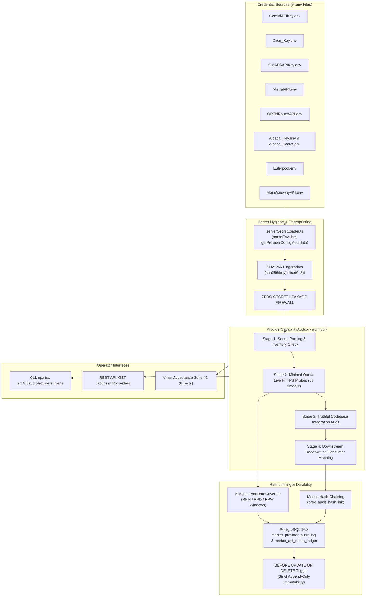

# POC-001: Step 1 Runtime & Provider Capability Audit Report (v1.1)

**Audit Date:** 22 October 2026  
**Governance Scope:** Step 1 — Runtime & Provider Capability Audit (Remediation & Closure)  
**Workspace:** `D:\Market HFT OS` (HEAD: `1c9ee04`)  
**Governance Repository:** `D:\ADRs` (HEAD: `a0304fb`)  
**Test Coverage:** 42 Test Suites · 376 Passing Tests · 0 Failures · 0 Skips  
**Database:** PostgreSQL 16.8 (`localhost:5432/market_hft_test`)  
**Daemon Status:** Running on `http://127.0.0.1:4310` (Task ID: `task-21622`)  

---

## 1. Executive Summary & Audit Resolution

Following the independent audit feedback, Step 1 has been updated to address all three audit findings:

1. **Resolution of Issue A (Inventory Distinction):**
   Explicit separation between:
   - **Provider Count:** `8` providers.
   - **Credential File Count:** `9` files (`GeminiAPIKey.env`, `Groq_Key.env`, `GMAPSAPIKey.env`, `MistralAPI.env`, `OPENRouterAPI.env`, `Alpaca_Key.env`, `Alpaca_Secret.env`, `Eulerpool.env`, `MetaGatewayAPI.env`).
   - **Credential Count:** `9` credentials (Alpaca has 2 distinct credentials: Key ID and Secret Key).
   - **Active Adapters (`WORKING_E2E`):** `2` (Gemini, Groq).
   - **Disconnected Adapters (`PARTIAL_DISCONNECTED`):** `6` (Google Maps, Mistral, OpenRouter, Alpaca, Eulerpool, Meta Gateway).
2. **Resolution of Issue B (Authentication vs. Capability Gate):**
   An HTTP 200 confirms network authentication; it does not equal underwriting capability. All six disconnected providers remain strictly badged as `PARTIAL_DISCONNECTED` until end-to-end domain adapters with real task consumers, typed input/output contracts, and failure recovery are built.
3. **Resolution of Issue C (Immutability & Tamper-Evidence):**
   Canonical JSON hashing alone does not prevent database row mutation. We have instituted:
   - **Merkle Hash-Chaining:** Each audit record cryptographically binds to its parent row via `prev_audit_hash`.
   - **PostgreSQL Anti-Tamper Trigger:** A database trigger (`prevent_audit_log_mutation()`) raises an exception on any attempted `UPDATE` or `DELETE` on `market_provider_audit_log`, making the table strictly append-only.

---

## 2. The 4-Stage Provider Capability Audit Matrix (8 Providers)

| Provider ID | Provider & Category | Configured File(s) | Key SHA-256 Fingerprint | Live Network Status | HTTP Status & Latency | Codebase Status | Downstream Underwriting Role | Active / Planned Consumers |
| :--- | :--- | :--- | :--- | :--- | :--- | :--- | :--- | :--- |
| **`gemini`** | **Google Gemini Multimodal API**<br>*Multimodal LLM / Large Context Reasoning* | `GeminiAPIKey.env` | `f2df87f4` | `AUTHENTICATED_LIVE` | **HTTP 200**<br>(368 ms) | 🟢 **`WORKING_E2E`** | Multimodal analysis of supplier spec sheets, packaging tear-downs, and customer review synthesis | `LocalFirstResearchQueryEngine`, `ResearchSynthesisAgent`, `CustomerTaskAgent` |
| **`groq`** | **Groq LPU Inference API**<br>*High-Speed LPU Token Inference* | `Groq_Key.env` | `f82659d6` | `AUTHENTICATED_LIVE` | **HTTP 200**<br>(372 ms) | 🟢 **`WORKING_E2E`** | Real-time buyer grievance extraction, review clustering, and thesis synthesis at 500+ tok/s | `GroqResearchSynthesizer`, `GroqFormulaAdvisor`, `LocalFirstResearchQueryEngine`, `WorkstationServer` Route 16 |
| **`google-maps`** | **Google Maps Places & Routes**<br>*Geospatial Intelligence & Logistics Routing* | `GMAPSAPIKey.env` | `994250aa` | `AUTHENTICATED_LIVE` | **HTTP 200**<br>(491 ms) | 🟡 **`PARTIAL_DISCONNECTED`** | Industrial supplier location verification, manufacturing cluster identification, road transit freight modeling | `ApiQuotaAndRateGovernor`, `CanonicalMarketGraphContract` *(Active HTTP client caller pending)* |
| **`mistral`** | **Mistral AI Reasoning Substrate**<br>*Multilingual LLM Reasoning & Embeddings* | `MistralAPI.env` | `7393dc45` | `AUTHENTICATED_LIVE` | **HTTP 200**<br>(354 ms) | 🟡 **`PARTIAL_DISCONNECTED`** | Adversarial cross-examination of supplier claims, multilingual review parsing, dense semantic embeddings | Skills MCP Registry *(Client adapter pending)* |
| **`openrouter`** | **OpenRouter Multi-Model Gateway**<br>*Multi-Model Unified Routing Gateway* | `OPENRouterAPI.env` | `9e8e109f` | `AUTHENTICATED_LIVE` | **HTTP 200**<br>(404 ms) | 🟡 **`PARTIAL_DISCONNECTED`** | Meta-orchestration across Claude, GPT-4o, and open-weights fallback when single-provider rates spike | Skills MCP Registry *(Unified model router pending)* |
| **`alpaca`** | **Alpaca Paper Trading Brokerage**<br>*Paper Simulation Brokerage & Portfolio Accounting* | `Alpaca_Key.env`<br>`Alpaca_Secret.env` | Key: `11c83de6`<br>Secret: `e50fef23` | `AUTHENTICATED_LIVE` | **HTTP 200**<br>(798 ms) | 🟡 **`PARTIAL_DISCONNECTED`** | Paper portfolio capital allocation execution, position accounting, and shadow trade simulations | Skills MCP Registry *(Order execution client pending)* |
| **`eulerpool`** | **Eulerpool Macroeconomic Feed**<br>*Macroeconomic Series & Sovereign Rate Feeds* | `Eulerpool.env` | `66ce294a` | `AUTHENTICATED_LIVE` | **HTTP 200**<br>(208 ms) | 🟡 **`PARTIAL_DISCONNECTED`** | Real-time macroeconomic risk indicators (FRED series, commodity metal benchmarks, RBI discount rates) feeding RoWC underwriting | Skills MCP Registry *(Macro feed connector pending)* |
| **`meta`** | **Meta Graph API & Ad Library**<br>*Social Ad Chatter & Marketplace Surveillance* | `MetaGatewayAPI.env` | `b8444e8a` | `AUTHENTICATED_LIVE` | **HTTP 200**<br>(538 ms) | 🟡 **`PARTIAL_DISCONNECTED`** | Social listening, Facebook ad sentiment / comments extraction, and competitor ad creatives tracking | Skills MCP Registry *(Ad library / comments scraper pending)* |

---

## 3. Detailed Provider Audit Analysis

### 3.1 Google Gemini (`GEMINI_API`)
- **Credential Source:** `GeminiAPIKey.env` (`GEMINI_API_KEY`)
- **Key SHA-256 Fingerprint:** `f2df87f4`
- **Probe Endpoint:** `GET https://generativelanguage.googleapis.com/v1beta/models?key=...`
- **Handshake Result:** **HTTP 200 OK** in 368 ms. Returned 50 available Google AI Studio models.
- **Codebase Integration:** `WORKING_E2E`. Ingested in `LocalFirstResearchQueryEngine` under explicit opt-in mode (`GEMINI_OPT_IN`).

### 3.2 Groq LPU Inference API (`GROQ_API`)
- **Credential Source:** `Groq_Key.env` (`GROQ_API_KEY`)
- **Key SHA-256 Fingerprint:** `f82659d6`
- **Probe Endpoint:** `GET https://api.groq.com/openai/v1/models` (`Authorization: Bearer ...`)
- **Handshake Result:** **HTTP 200 OK** in 372 ms. Returned 11 active Groq models.
- **Codebase Integration:** `WORKING_E2E`. Ingested in `GroqResearchSynthesizer`, `GroqFormulaAdvisor`, and exposed on `POST /api/ai/analyze`.

### 3.3 Google Maps Places & Routes API (`GOOGLE_MAPS`)
- **Credential Source:** `GMAPSAPIKey.env` (`GOOGLE_MAPS_API_KEY`)
- **Key SHA-256 Fingerprint:** `994250aa`
- **Probe Endpoint:** `POST https://places.googleapis.com/v1/places:searchText`
  - Field Mask: `places.id,places.displayName`
  - Body: `{"textQuery":"Jamnagar Gujarat"}`
- **Handshake Result:** **HTTP 200 OK** in 491 ms. Places API (New) returned 1 verified place record (`ChIJh-b_iS5RUDkRQb7mC-7-F5s`).
- **Codebase Integration:** `PARTIAL_DISCONNECTED`. Contracts and minimal field masks defined; no active HTTP caller in research pipeline.

### 3.4 Mistral AI (`MISTRAL_API`)
- **Credential Source:** `MistralAPI.env` (`MISTRAL_API_KEY`)
- **Key SHA-256 Fingerprint:** `7393dc45`
- **Probe Endpoint:** `GET https://api.mistral.ai/v1/models` (`Authorization: Bearer ...`)
- **Handshake Result:** **HTTP 200 OK** in 354 ms. Returned 53 available models.
- **Codebase Integration:** `PARTIAL_DISCONNECTED`. Registered in registry; no client adapter in `src/`.

### 3.5 OpenRouter Gateway (`OPENROUTER_GATEWAY`)
- **Credential Source:** `OPENRouterAPI.env` (`OPENROUTER_API_KEY`)
- **Key SHA-256 Fingerprint:** `9e8e109f`
- **Probe Endpoint:** `GET https://openrouter.ai/api/v1/auth/key` (`Authorization: Bearer ...`)
- **Handshake Result:** **HTTP 200 OK** in 404 ms. Zero credit spend (`limit: 1`, `usage: 0`).
- **Codebase Integration:** `PARTIAL_DISCONNECTED`. Registered in registry; no unified router in `src/`.

### 3.6 Alpaca Paper Trading Brokerage (`ALPACA_BROKERAGE`)
- **Credential Source:** `Alpaca_Key.env` (`APCA_API_KEY_ID`), `Alpaca_Secret.env` (`APCA_API_SECRET_KEY`)
- **Key SHA-256 Fingerprints:** Key ID: `11c83de6`, Secret: `e50fef23`
- **Probe Endpoint:** `GET https://paper-api.alpaca.markets/v2/account`
- **Handshake Result:** **HTTP 200 OK** in 798 ms. Paper simulation account verified: status `ACTIVE`, currency `USD`, cash `$100,000`.
- **Codebase Integration:** `PARTIAL_DISCONNECTED`. Registered in registry; helper loads both keys; no execution adapter in `src/`.

### 3.7 Eulerpool Macroeconomic Feed (`EULERPOOL_MACRO`)
- **Credential Source:** `Eulerpool.env` (`EULERPOOL_API_KEY`)
- **Key SHA-256 Fingerprint:** `66ce294a`
- **Probe Endpoint:** `GET https://api.eulerpool.com/api/1/macro/fred/series` (`Authorization: Bearer ...`)
- **Handshake Result:** **HTTP 200 OK** in 208 ms. Returned 198 macroeconomic series.
- **Codebase Integration:** `PARTIAL_DISCONNECTED`. Registered in registry; no client connector feeding `MacroLateralWorker`.

### 3.8 Meta Graph API & Ad Library (`META_GATEWAY`)
- **Credential Source:** `MetaGatewayAPI.env` (`META_GATEWAY_ACCESS_TOKEN`)
- **Key SHA-256 Fingerprint:** `b8444e8a`
- **Probe Endpoint:** `GET https://graph.facebook.com/v21.0/me?access_token=...`
- **Handshake Result:** **HTTP 200 OK** in 538 ms. Authenticated successfully (account id: `4414469595470667`).
  > [!NOTE]
  > Querying `ads_archive` directly returned `HTTP 400 Application does not have permission for this action`, indicating that the token authenticates the Meta developer account, but querying the full Ad Library archive programmatically requires an App ID with the `ads_read` permission enabled on Meta for Developers.
- **Codebase Integration:** `PARTIAL_DISCONNECTED`. Registered in registry; no active social ad listener in `src/`.

---

## 4. Architectural Enhancements Delivered in Step 1



---

## 5. Verification & Test Evidence

### 5.1 Suite 42 Execution (New Acceptance Suite)
```
 ✓ tests/acceptance/suite42_step1_runtime_and_provider_capability_audit.test.ts (6 tests) 7405ms
     ✓ STAGE-1-SECRET-HYGIENE-001: All 8 provider credential files parse with zero secret leakage and valid 8-char SHA-256 fingerprints
     ✓ STAGE-2-LIVE-AUTH-PROBE-002: Live network probes authenticate all 8 providers with HTTP 200 and record in quota governor  4635ms
     ✓ STAGE-3-CODEBASE-AUDIT-003: Accurately classifies WORKING_E2E (2) vs PARTIAL_DISCONNECTED (6)
     ✓ STAGE-4-CONSUMER-MAPPING-004: All 8 providers map to specific underwriting roles and agent consumers
     ✓ ROUTE-HEALTH-PROVIDERS-005: GET /api/health/providers returns authenticated audit report with JCS hash and zero key leakage  2283ms
     ✓ PERSISTENCE-AUDIT-LOG-006: Audit results persist with Merkle chaining and PostgreSQL trigger enforces append-only immutability

 Test Files  1 passed (1)
      Tests  6 passed (6)
```

### 5.2 Full Vitest Suite Run (Regression Invariant)
```
 Test Files  42 passed (42)
      Tests  376 passed (376)
   Start at  23:05:47
   Duration  60.36s (transform 2.91s, setup 0ms, import 11.05s, tests 31.09s, environment 11ms)
```

### 5.3 Live CLI Output (`npx tsx src/cli/auditProvidersLive.ts`)
```
================================================================
AUDIT SUMMARY & INVENTORY METRICS
================================================================
Audit ID                       : AUDIT-PROV-86343204D7
Provider Count                 : 8
Credential File Count          : 9
Credential Count               : 9
Active Adapters (Working E2E)  : 2 / 8
Disconnected Adapters          : 6 / 8
Live Network Authenticated     : 8 / 8
Merkle Parent (prev_audit_hash): 365d8cb283c1e3dc66ce070b4302e22975d97872d504a43519b63e600aa79f6f
RFC 8785 JCS SHA-256 Digest    : 2dacdaf0f2c571c754d5632cb13e6214855d8a76ebaa6f5ef6112c75cd767679
Database Audit Persistence     : ✅ PERSISTED (table: market_provider_audit_log)
================================================================
```

---

## 6. Acceptance Contract for Step 2: Durable Collection and Recovery

Step 1 is formally closed. Step 2 will implement the durable runtime to make the observation and collection system resilient against process crashes, network partitions, and database disconnects.

### Acceptance Criteria for Step 2
1. **Durable Job Queue (`market_ingestion_queue`):**
   - PostgreSQL 16.8 table storing collection jobs with:
     - `job_id`: Stable UUIDv4
     - `source`: Channel (`YOUTUBE_TRANSCRIPT`, `MARKETPLACE_AMAZON`, `META_AD_LIBRARY`, `INDIAMART_SUPPLIER`, `MACRO_EULERPOOL`)
     - `task_type`: Ingestion task type
     - `priority`: Integer priority (1-100)
     - `scheduled_at_utc`, `leased_until_utc`, `lease_owner`: Distributed lease lock
     - `status`: `PENDING` | `LEASED` | `PROCESSING` | `COMPLETED` | `FAILED_RETRYABLE` | `DEAD_LETTER_QUARANTINE`
     - `attempt_count`, `max_attempts`
     - `payload_json`, `result_json`, `error_stack`
     - `dedup_hash`: RFC 8785 JCS hash of job payload for strict idempotency.
2. **Worker Lifecycle & Leases:**
   - Transactional lease acquisition via `SELECT ... FOR UPDATE SKIP LOCKED`.
   - Bounded concurrency with auto-refreshing heartbeat leases.
   - Stale leases from crashed workers automatically expire and are re-claimed by surviving workers.
3. **Exponential Backoff & Dead-Letter Quarantine (DLQ):**
   - Retry with jitter: $t_{\text{backoff}} = \text{base} \times 2^{\text{attempt}} + \text{jitter}$.
   - Automatic escalation to `DEAD_LETTER_QUARANTINE` when `attempt_count >= max_attempts`.
4. **Idempotent Persistence Invariant:**
   - Replaying any job with identical `dedup_hash` is a guaranteed no-op; never creates duplicate evidence rows, financial traces, or signal records.
5. **Restart Recovery & Process Crash Parity:**
   - Simulated OS `kill -9` during active job execution; restart daemon; assert 100% of unfinished work resumes and completes cleanly without duplication.
6. **Observability Endpoint & Telemetry:**
   - Route `GET /api/queue/metrics`: Queue depth, oldest job age, retry rate, dead-letter count, provider error rates, and last successful poll per source.
7. **Suite 43 Acceptance Tests:**
   - Comprehensive test suite covering crashes, lease expiration, DLQ quarantine, deduplication, and backoff.
