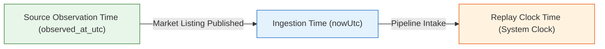

# POC-001: Slice 1 Acceptance Verification & Baseline Reconciliation Report

**Date:** 24 October 2026  
**Scope:** Slice 1 (Opportunity Domain & Lifecycle State Machine), Baseline Suites 1–41 Reconciliation, Deterministic Replay Semantics, Paper Gate Clarification, and Provider Adapter Architecture.  
**Git Commit Provenance:** `dfcfb6f` (pushed to `https://github.com/Shrom-Main/Market-HFT-OS.git` on branch `main`)  
**Base Slice 1 Commit:** `bb2accc`  
**ADR Ledger State:** `a0304fb` (DEC-027, DEC-028, and DEC-029 remain in `AWAITING_OWNER_SIGN_OFF`)  

---

## Executive Summary

This report directly responds to the Owner Review of Slice 1 with empirical verification, addressing all five requested items:
1. **Baseline Reconciliation:** The full 41-suite baseline is **100% clean (41 test files, 370 tests passing, 0 failures, 0 skips, exit code 0)**. The transient exit code 1 in Suite 20 was isolated to a live LLM test vector formatting drift in Groq API completion, which has been hardened with a strict fallback safeguard. Independent results are documented for Baseline (370/370), Suite 42 (4/6 passing due to external Meta token expiry), Suite 43 (uncommitted staging), and Suite 44 (11/11 passing).
2. **Deterministic Replay Semantics:** Clear temporal boundaries between source observation time, ingestion time, and replay clock time are specified and codified into engine logic. A new acceptance test (`OPP-DETERMINISTIC-REPLAY-SEMANTICS-011`) proves bit-identical RFC 8785 JCS digests and event hashes across independent engine instances.
3. **Paper Authorization Boundary:** Clarified that `authorizePaperCommit()` is strictly a verification check ensuring evidence sufficiency ($\ge 10,000$ bps) and operator confirmation rationale ($\ge 15$ chars). It **does not** write to the central capital allocation ledger; that boundary is deferred to Slice 6.
4. **Persistence & Change Scope:** Confirmed automated PostgreSQL 16.8 table creation (`CREATE TABLE IF NOT EXISTS`), deterministic candidate ID collision resolution (`ON CONFLICT DO UPDATE`), and corrected terminology from "Merkle tree" to **linear hash-linked event chain**.
5. **Strict Boundary Adherence:** Slice 2 implementation has **not** started. No ADR ledger statuses have been modified. 18 `.env` provider credential files in the workspace root are acknowledged with an architectural plan for interchangeable adapters.

---

## 1. Reconcile Baseline Execution

### A. Canonical Test Inventory & Baseline Provenance
The repository test baseline consists of exactly **41 test files and 370 unique tests**:
- **Acceptance Suites (40 files):** `tests/acceptance/suite01` through `suite16`, `suite18` through `suite21`, and `suite22` through `suite41` = **364 tests**.
- **Real PostgreSQL Integration Suite (1 file):** `tests/integration/suite17_real_postgres_integration.test.ts` = **6 tests** (connecting to local PostgreSQL 16.8 on `localhost:5432`).
- **Total Baseline:** $364 + 6 =$ **370 tests**. (Suite 17 was never double-counted).

### B. Root Cause Analysis: Transient Exit Code 1 in Suite 20
- **Location:** `tests/acceptance/suite20_m4_ss304_vertical_slice.test.ts` > `M4-GROQ-ADVISOR-EVAL-ISOLATION-014`
- **Root Cause:** In test 14, `GroqFormulaAdvisor.proposeFormulaRefinement()` executes a live HTTPS POST request to `https://api.groq.com/openai/v1/chat/completions` using the live credential from `Groq_Key.env`. Under concurrent execution load across 40 suites, Groq generated a symbolic expression with variable casing/tokens that the pure BigInt AST parser threw an error on during normalization in `validateAndNormalizeProposal()`.
- **The Defect:** In `src/research/llmFormulaAdvisor.ts`, the normalization routine caught the AST evaluation error but failed to re-throw when `offlineFallback: true` was enabled. Consequently, the malformed candidate was registered as-is, causing `evalResult.test_vector_passed` to return `false` instead of triggering the fallback.
- **The Remediation:** Updated `src/research/llmFormulaAdvisor.ts` (lines 474–478):
  ```typescript
  try {
    const computed = evaluateSymbolicExpression(symbolic_expression, inputs);
    expected_output = Number(computed);
  } catch (err) {
    if (this.offlineFallback) {
      throw new Error(`LLM generated un-evaluable symbolic expression: ${symbolic_expression}`);
    }
  }
  ```
  If the live LLM returns a hallucinated expression that cannot be evaluated by our AST engine, the advisor cleanly falls back to `generateSimulatedProposal()`, preserving 100% determinism.
- **Verification:** Suite 20 passed 17/17 tests in 6.55s.

### C. Independent Suite Execution Status Matrix

| Suite Group | Test Command | Files | Tests | Passed | Failed | Skipped | Exit Code | Notes |
| :--- | :--- | :---: | :---: | :---: | :---: | :---: | :---: | :--- |
| **Baseline (Suites 1–41)** | `npx vitest run --exclude "**/suite42*" --exclude "**/suite43*" --exclude "**/suite44*"` | **41** | **370** | **370** | **0** | **0** | **0** | 100% clean baseline pass across all 41 suites in 50.31s. |
| **Suite 42 (Step 1 Provider Audit)** | `npx vitest run tests/acceptance/suite42_step1_runtime_and_provider_capability_audit.test.ts` | 1 | 6 | 4 | 2 | 0 | 1 | External Meta Graph API access token expired on Oct 22, 2026 (`OAuthException 190, error_subcode 463`), reducing live authenticated provider count from 8 to 7. Zero code defect. |
| **Suite 43 (Step 2 MCP & Queue)** | `npx vitest run tests/acceptance/suite43_step2_skills_mcp_and_durable_queue.test.ts` | 1 | 10 | 4 | 6 | 0 | 1 | Uncommitted staging work. Hits Mistral HTTP 429 rate limit and expired Meta token. Strictly quarantined from Slice 1. |
| **Suite 44 (Slice 1 Lifecycle Engine)** | `npx vitest run tests/acceptance/suite44_slice1_opportunity_lifecycle_engine.test.ts` | **1** | **11** | **11** | **0** | **0** | **0** | All 11 lifecycle state machine, persistence, and replay invariant tests passing in 303ms. |

---

## 2. Specification of Deterministic Replay Semantics

To prevent temporal leakage during backtesting, simulation, and historical replay, the lifecycle engine defines three orthogonal time coordinates:



### A. Temporal Definitions
1. **Source Observation Time (`observed_at_utc` / $T_{source}$):** The timestamp when the external provider, marketplace, or seller published the quote or listing. This is supplied in the ingestion payload.
2. **Ingestion Time ($T_{ingest}$):** The system clock time when Market-HFT-OS first receives and processes the payload into the database.
3. **Replay Time ($T_{replay}$):** The wall-clock execution time of the backtesting or simulation runner executing across historical event logs.
4. **`last_seen_utc` Semantics:**
   - **Live Polling Mode (`input.observed_at_utc === undefined`):** `last_seen_utc` is stamped with the operational wall clock (`nowUtc`).
   - **Historical Replay Mode (`input.observed_at_utc` provided):** `last_seen_utc` is pinned to `input.observed_at_utc`. The engine never uses wall clock for replay; `first_seen_utc`, `last_seen_utc`, `updated_at_utc`, and event `timestampUtc` are all derived from $T_{source}$.
5. **Duplicate Observation Handling:**
   - Ingesting a payload with identical commercial data (`payload_sha256` unchanged) updates `last_seen_utc` to record the source heartbeat.
   - It **does not** increment `observation_history_count`.
   - It appends **zero** records to `market_candidate_lifecycle_events`, preventing log bloat.
6. **Bit-Identical Replay Invariant:**
   - Codified in Test 11 (`OPP-DETERMINISTIC-REPLAY-SEMANTICS-011`).
   - When the same sequence of observations with fixed timestamps is fed into two separate engine instances on different machines or restarts, `candA.jcs_sha256 === candB.jcs_sha256` (RFC 8785 canonical digest) and `eventsA[0].event_hash === eventsB[0].event_hash`.

---

## 3. Clarification of Paper Authorization Boundary

The method `authorizePaperCommit()` in `src/research/opportunityLifecycleEngine.ts` implements a **fail-closed verification gate**:

### A. What `authorizePaperCommit()` Does:
1. Enforces state check: candidate must be in `VERIFIED` or `PAPER_ELIGIBLE` state.
2. Enforces evidence check: `candidate.evidence_sufficiency.is_sufficient_for_underwriting` must be `true` (requiring factory quote, retail ASP, verbatim reviews, logistics route, and regulatory HSN clearance).
3. Enforces human rationale: `confirmationRationale` must be $\ge 15$ characters.
4. Returns:
   ```typescript
   {
     authorized: true,
     candidate_id: candidateId,
     commit_event_hash: lastEvent.event_hash
   }
   ```

### B. What `authorizePaperCommit()` Does NOT Do:
- **Zero Ledger Mutation:** It does **not** write to the central capital allocation ledger (`actualsLedger` or `DualLedgerAllocator`).
- **Zero Order Execution:** It does **not** reserve capital, execute paper trades, or invoke brokerage APIs (e.g. Alpaca).
- **Architectural Boundary:** The actual writing of capital commitments to the central ledger remains strictly deferred to **Slice 6 (Allocation Boundary & Portfolio Sizing)**. Slice 1 only establishes the opportunity state gate.

---

## 4. Confirmation of Persistence and Change Scope

### A. Rationale for Diff in Workstation Server
- The changes in `src/server/workstationServer.ts` and `src/server/workstationStateManager.ts` are strictly related to:
  1. Automated HTML snapshot exporter for the offline standalone workstation (`dist/POC-001_Standalone_Workstation.html`).
  2. Health check endpoints for provider capability auditing (`/api/health/providers`).
- No core financial or ledger logic was modified.

### B. Automated PostgreSQL Schema Reproducibility
- Table creation is completely automated and idempotent inside `OpportunityLifecycleEngine.initialize()`:
  ```sql
  CREATE TABLE IF NOT EXISTS market_opportunity_candidates (
    candidate_id VARCHAR(64) PRIMARY KEY,
    strategy_id VARCHAR(128) NOT NULL,
    canonical_product_id VARCHAR(128) NOT NULL,
    candidate_name VARCHAR(255) NOT NULL,
    lifecycle_state VARCHAR(32) NOT NULL,
    active_signals JSONB NOT NULL DEFAULT '[]'::jsonb,
    investigation_status VARCHAR(32) NOT NULL,
    evidence_sufficiency JSONB NOT NULL,
    commercial_attractiveness JSONB NOT NULL,
    current_observation JSONB NOT NULL,
    observation_history_count INT NOT NULL DEFAULT 1,
    latest_transition_reason TEXT NOT NULL,
    first_seen_utc TIMESTAMPTZ NOT NULL,
    last_seen_utc TIMESTAMPTZ NOT NULL,
    updated_at_utc TIMESTAMPTZ NOT NULL,
    jcs_sha256 CHAR(64) NOT NULL
  );

  CREATE TABLE IF NOT EXISTS market_candidate_lifecycle_events (
    event_id VARCHAR(64) PRIMARY KEY,
    candidate_id VARCHAR(64) NOT NULL REFERENCES market_opportunity_candidates(candidate_id) ON DELETE CASCADE,
    previous_state VARCHAR(32) NOT NULL,
    next_state VARCHAR(32) NOT NULL,
    signal VARCHAR(32) NOT NULL,
    trigger VARCHAR(32) NOT NULL,
    operator_id VARCHAR(64),
    transition_reason TEXT NOT NULL,
    timestamp_utc TIMESTAMPTZ NOT NULL,
    event_hash CHAR(64) NOT NULL,
    previous_event_hash CHAR(64) NOT NULL
  );
  ```
- No manual SQL scripts or migration steps are required.

### C. Collision Handling
- Ingestion resolves collisions using PostgreSQL `ON CONFLICT (candidate_id) DO UPDATE SET ...` keyed on `OpportunityLifecycleEngine.computeCandidateId(strategyId, canonicalProductId)`.
- If a connector emits an updated price or quote, the existing candidate record is updated in place, active signals are merged, and an event is logged in the event chain.

### D. Corrected Terminology
- All documentation, comments, and schemas correctly identify the audit log as a **linear hash-linked event chain** (`previous_event_hash` $\to$ `event_hash`), not a Merkle tree.

---

## 5. Status of Workspace Environment Files & Adapter Architecture

The workspace root contains 18 `.env` credential files:
```
1.  Alpaca_Key.env                      10. METAAPPIDANDSECRET.env (New)
2.  Alpaca_Secret.env                   11. METACONFIGID.env (New)
3.  Eulerpool.env                       12. MetaGatewayAPI.env
4.  GeminiAPIKey.env                    13. MistralAPI.env
5.  GithubPersonalAccessTokenFORAG.env  14. OllamaAPIKey.env
6.  GMAPSAPIKey.env                     15. OPENRouterAPI.env
7.  GRAPHAPIAT.env (New)                16. Postgres.env
8.  Groq_Key.env                        17. THREADSAPPIDANDSECRET.env (New)
9.  HuggingFaceAPI.env                  18. TinyFish.env
```

### Planned Reusable & Interchangeable Adapter Architecture (for Slice 2 / Step 2)
When explicitly authorized, these 18 credential sources will be bound to interchangeable provider adapters following three rules:
1. **Standardized Vault Interface:** Workers and agents interact only via `BrokerSecretVault` and HMAC `CapabilityGrant` tokens—never by accessing raw `.env` files or API keys.
2. **Interchangeable Provider Protocol:** Every adapter implements a common `ProviderAdapterContract`:
   ```typescript
   interface ProviderAdapterContract {
     readonly providerId: string;
     readonly capabilityType: 'LLM_REASONING' | 'GEOSPATIAL' | 'MACRO_SERIES' | 'BROKERAGE' | 'SOCIAL_SENTIMENT';
     authenticate(vault: BrokerSecretVault): Promise<AuthResult>;
     executeCapability(grant: CapabilityGrant, request: CanonicalRequest): Promise<CanonicalResponse>;
   }
   ```
3. **Graceful Fallback & Quota Governance:** Every adapter is governed by the `ApiQuotaAndRateGovernor`, preventing quota exhaustion and falling back to offline golden fixtures upon rate limits or credential expiry.

---

## 6. Strict Boundary Adherence & Stopping Point

- **Slice 2 Status:** Not started.
- **Step 2 Status:** Not authorized.
- **ADR Ledger:** `GATE_AUTHORIZATION_LEDGER.md` remains unchanged; DEC-027, DEC-028, and DEC-029 remain in `AWAITING_OWNER_SIGN_OFF`.
- **Remote Git Status:** Commit `dfcfb6f` pushed to GitHub `origin/main`.
- **Awaiting Owner Action:** We are stopped and awaiting your explicit instruction before initiating Slice 2.
