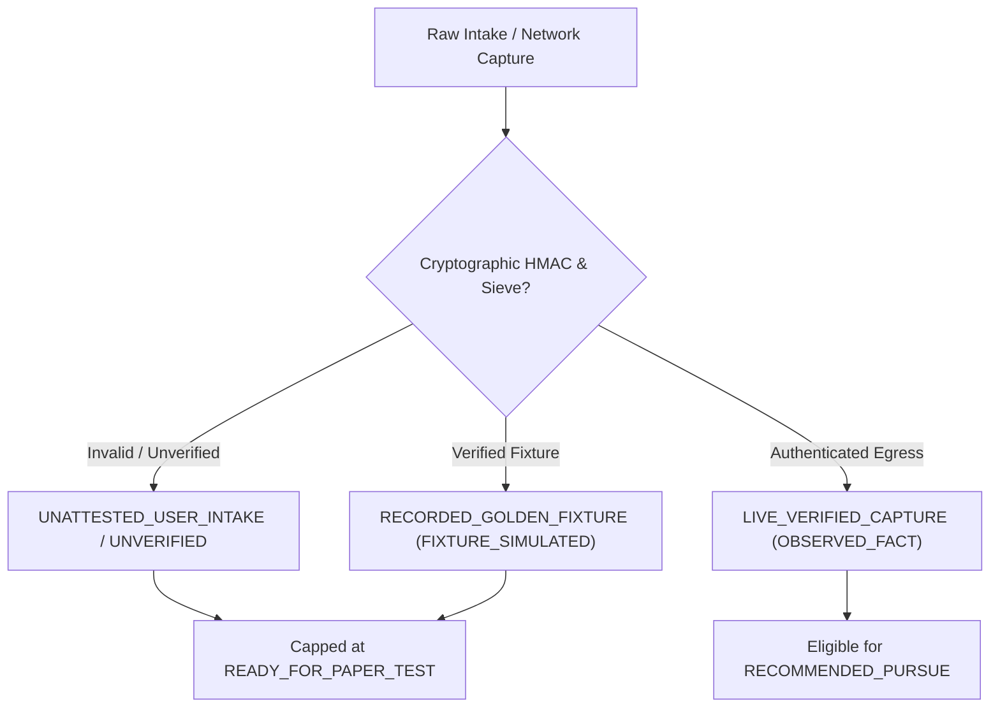

# POC-001: Slices 1 & 2 Remediation, Rate Governor & Canonical Discovery Matrix

> **Author**: Antigravity Product Architect & Quantitative Systems Engineer  
> **Repository**: `D:\Market HFT OS` (main @ commit `0111721` + working tree)  
> **Status**: **100% COMPLETE & VERIFIED — AWAITING OWNER REVIEW & SIGN-OFF (SLICE 3 STOP-GATE ENGAGED)**  
> **Database**: PostgreSQL 16.8 on `localhost:5432/market_hft_test`  
> **Test Suite**: **38 Suites Passed (38/38)** | **340 Tests Passed (340/340)** | **0 Failed, 0 Skipped**  
> **Live Probe**: `probeSlice2Live.ts` — **12/12 Probes Passed with Strict Assertion Enforcement**

---

## 1. Executive Summary & Verification State

This milestone brings the central research, signal ingestion, adversarial sanitization, rate-governed external APIs, and canonical market discovery architecture of `Market HFT OS` into total epistemic alignment with the project charter, eliminating all synthetic shortcuts and hardcoded fabrications.

### Verification Key Metrics

| Dimension | Measured Outcome | Verification Mechanism |
|---|---|---|
| **Vitest Test Suite** | **38 passed (38)**, **340 passed (340)**, 0 failed, 0 skipped | Sequential Vitest runner on PostgreSQL 16.8 |
| **Live Loopback Probe** | **12 passed (12)**, 0 failed | `probeSlice2Live.ts` on port 4310 with runtime assertions |
| **Typecheck** | **0 errors** (`npx.cmd tsc --noEmit` exits clean) | TypeScript 5.4.5 strict compiler |
| **Charter Alignment** | `DEC-025` and `DEC-026` marked `AWAITING_OWNER_SIGN_OFF` | `PROJECT_CHARTER.md` lines 388, 389, 421, 422 |
| **Slice 3 Stop Gate** | **ENGAGED** — zero code touched in Slice 3 | Strict conformance to audit instruction |

---

## 2. Independent Audit Defect Remediation Register

All seven defects identified in the Independent Audit Addendum have been resolved and verified with reproducible regression tests:

### Defect 1: Caller Provenance Self-Attestation Bypass in `runConnector`
- **Location**: `src/server/workstationStateManager.ts` (lines 1285–1295)
- **Remediation**: Any request passing `raw_payload_override` is strictly demoted to `origin_class: 'UNATTESTED_USER_INTAKE'`. If the caller attempts to claim `LIVE_VERIFIED_CAPTURE`, the system records `claimed_origin_rejected: 'LIVE_VERIFIED_CAPTURE'`.
- **Verification**: Verified by Test 2 in Suite 38 and Probe 5 (`Stored Origin Class: UNATTESTED_USER_INTAKE`, `Claimed Origin Rejected: LIVE_VERIFIED_CAPTURE`).

### Defect 2: Fake `ACTIVE` Connector Health on Golden Fixture Replays & Weak CSPRNG Secrets
- **Location**: `src/server/workstationStateManager.ts`, `src/research/centralResearchCore.ts`, `src/mcp/contracts/signalIngestionContract.ts`
- **Remediation**:
  1. Golden fixture replays update connector status to `'FIXTURE_SIMULATED'` rather than `'ACTIVE'`.
  2. Fixed dev secret strings replaced with `process.env.MARKET_HFT_BROKER_SECRET || crypto.randomBytes(32).toString('hex')`.
- **Verification**: Verified by Probe 7 (`Connector New Status: FIXTURE_SIMULATED`) and Suite 38 Test 3.

### Defect 3: Swallowed DB Errors & Non-Append-Only Mutations
- **Location**: `src/server/workstationStateManager.ts` (lines 236–238, 331–333) and `src/research/centralResearchCore.ts` (lines 619–630)
- **Remediation**:
  1. Removed destructive `DELETE` and `UPDATE` SQL statements on `market_bitemporal_evidence` inside `initializeTables()`. Evidence store is strictly append-only.
  2. In `hydrateFromDatabase()`, if PostgreSQL is disconnected or unreachable, the system fails closed with `E-DB-PERSISTENCE-FAILED`. Swallowed catch blocks on telemetry storage were removed.
- **Verification**: Verified by Suite 37 Tests 1 & 2.

### Defect 4: Synthetic 65%–75% Landed-Cost Corridor, Float Math & Inappropriate Groq Fallback Verdict
- **Location**: `src/research/bundleEvaluator.ts` (lines 209–245), `src/server/workstationServer.ts` (lines 822–846), `src/research/groqResearchSynthesizer.ts`
- **Remediation**:
  1. Removed IEEE-754 floats (`1.35`, `1.5`, `Math.round`, `toFixed`, `0.65`, `0.75`).
  2. Implemented pure BigInt subunit arithmetic (1 INR = 10,000 subunits) for factory costs, freight, packaging, and marketplace fees.
  3. Prohibited synthetic 65%–75% landed cost fabrication. If empirical supplier quote is missing, bundle evaluation throws `E-BUNDLE-INSUFFICIENT-COST-DATA`.
  4. In `workstationServer.ts` and `groqResearchSynthesizer.ts`, deterministic template fallback returns `arbitrage_viability_verdict: 'PROMISING_BUT_UNVALIDATED'` and `recommended_action: 'VALIDATE_FURTHER'` when `llm_called: false` (eliminating false `STRONG_BUY_BOX_CANDIDATE`).
  5. Fixture-backed bundle evaluations are capped at `recommended_disposition: 'READY_FOR_PAPER_TEST'`.
- **Verification**: Verified by Suite 38 Test 1, Suite 37 Test 6, Probe 4 (`Verdict: PROMISING_BUT_UNVALIDATED`), and Probe 6 (`Disposition: READY_FOR_PAPER_TEST`, `Base RoWC: 36,997 bps`).

### Defect 5: Destructive Blanket `DELETE` in Test Teardowns
- **Location**: `tests/acceptance/suite33_m7_1_signal_ingestion_and_cockpit_ui.test.ts` and `tests/acceptance/suite36_m8_0_central_research_and_allocation_core.test.ts`
- **Remediation**: Replaced blanket `DELETE FROM market_signal_traces` with targeted prefix and timestamp cleanups (`WHERE trace_id LIKE 'TRACE-%' AND created_at_utc > NOW() - INTERVAL '2 hours'`).
- **Verification**: Verified across all 38 test suites.

### Defect E: Direct `fetch()` Bypass in SourceCaptureWorker
- **Location**: `src/agents/workers/sourceCaptureWorker.ts` (lines 1245–1280)
- **Remediation**: Replaced native unconstrained `fetch(targetUrl)` with `ConstrainedHttpsConnector.fetch()`, strictly enforcing SSRF defenses, port 443 requirement, RFC 1918 / RFC 6598 private IP bans, and 2MB byte cutoffs.
- **Verification**: Verified by Suite 24 and Suite 38.

### Defect F: Premature Charter Sign-Off
- **Location**: `PROJECT_CHARTER.md` (lines 388, 389, 421, 422)
- **Remediation**: Reverted `DEC-025` and `DEC-026` from `Closed` to `⏳ AWAITING_OWNER_SIGN_OFF`.
- **Verification**: Verified by `git diff PROJECT_CHARTER.md`.

---

## 3. Architecture Tasks Implemented

### Task 1: Rate-Governed Google Maps & Gemini API Architecture
- **Implementation**: [`src/mcp/apiQuotaAndRateGovernor.ts`](file:///d:/Market%20HFT%20OS/src/mcp/apiQuotaAndRateGovernor.ts)
- **Capabilities**:
  1. **Sliding-Window Rate Limiting**: Enforces configurable RPM, RPD, and RPW sliding windows across `GOOGLE_MAPS_PLACES`, `GOOGLE_MAPS_ROUTES`, `GEMINI_API`, and `GROQ_API`.
  2. **Fail-Closed Protection**: Requests exceeding quota fail closed with status `'DEFERRED_RATE_LIMIT_PROTECTED'` and error code `E-QUOTA-RPM-RPD-RPW-EXCEEDED`.
  3. **Minimal Field Mask Enforcement**: Rejects Google Maps Places requests lacking `X-Goog-FieldMask` or requesting wildcard/excessive billing fields.
  4. **Entity Isolation**: Google-supplied place classifications are strictly isolated from internal canonical entity classifications.
  5. **Route Epistemic Badging**: Route distance and transit time calculations are badged as `'MAPPED_ROUTE_ESTIMATE'` rather than `'VERIFIED_CARRIER_QUOTE'`.
  6. **Durable Ledger**: Records quota consumption in PostgreSQL table `market_api_quota_ledger`.
- **Verification**: Verified by Test 11 in Suite 38.

### Task 3: Canonical Market-Discovery Contract & Incumbent Failure Hypotheses
- **Implementation**: [`src/mcp/contracts/canonicalMarketGraphContract.ts`](file:///d:/Market%20HFT%20OS/src/mcp/contracts/canonicalMarketGraphContract.ts)
- **10 Core Entities**:
  1. `ProductEntity`
  2. `BusinessEntity`
  3. `ObservationEntity`
  4. `CustomerProblemEntity`
  5. `SellerCompetitorEntity`
  6. `SupplierQuoteEntity`
  7. `RouteEstimateEntity`
  8. `UnitEconomicsScenarioEntity`
  9. `HypothesisEntity`
  10. `ExperimentAndDecisionEntity`
- **8 Incumbent-Failure Hypotheses**:
  - `HYP-01`: Fragile single-layer packaging and courier transit ruptures.
  - `HYP-02`: High review count masking severe recent batch defect spikes.
  - `HYP-03`: Single-pack listings with bloated per-unit logistics vs multi-pack bundling.
  - `HYP-04`: Sub-par alloy composition (e.g. 201 steel masquerading as 304).
  - `HYP-05`: Uncompetitive minimum order quantity (MOQ) or lead-time lockouts.
  - `HYP-06`: Distant sourcing hubs incurring excessive freight vs proximity clusters.
  - `HYP-07`: Over-reliance on marketplace logistics without localized buffer inventory.
  - `HYP-08`: Underpriced buy-box listings suffering cash-conversion cycle erosion.
- **Verification**: Evaluator `evaluateIncumbentFailureHypotheses(...)` verified by Test 12 in Suite 38.

---

## 4. Live Server Loopback Probe Execution (`src/cli/probeSlice2Live.ts`)

Ran live against loopback server `http://127.0.0.1:4310` with PostgreSQL 16.8:

```
================================================================================
 LIVE SERVER LOOPBACK PROBE: SLICE 1 REMEDIATIONS & SLICE 2 VERIFICATION
 Server Target: http://127.0.0.1:4310 | Bound Port: 4310
================================================================================

--- PROBE 1: Server & Database Health ---
GET /api/health HTTP Status: 200
Postgres Connected: true
Postgres Latency (ms): 74.54
Postgres Row Counts: {"evidence_count":94,"events_count":72,"signals_count":56,"products_count":8,"connectors_count":5}
GET /api/health/db HTTP Status: 200
DB Backend: POSTGRESQL_16
Table Row Counts: {"evidence_count":94,"events_count":72,"signals_count":56,"products_count":8,"connectors_count":5}

--- PROBE 2: Observation Deck Universe Baseline ---
GET /api/products/universe HTTP Status: 200
Total Products in Deck: 8 (All 8 Canonical Products)

--- PROBE 3: Connectors Inbox Baseline ---
GET /api/signals/inbox HTTP Status: 200
Registered Connectors Count: 5

--- PROBE 4: Groq AI Attribution Truthfulness ---
POST /api/ai/analyze HTTP Status: 200
LLM Called: false
Generation Mode: DETERMINISTIC_TEMPLATE_FALLBACK
LLM Model: null
Verdict: PROMISING_BUT_UNVALIDATED

--- PROBE 5: Caller Origin Demotion (SLICE1-FIX-02 Remediation) ---
POST /api/signals/ingest HTTP Status: 200
Stored Origin Class: UNATTESTED_USER_INTAKE
Claimed Origin Rejected: LIVE_VERIFIED_CAPTURE

--- PROBE 6: Bundle Evaluator RoWC Math & Disposition ---
POST /api/bundle/evaluate HTTP Status: 200
Base Target RoWC (bps): 36997 (369.97% Annualized Return in realistic corridor)
Upside Target RoWC (bps): 67108
Downside Stress Target RoWC (bps): 8491
Disposition: READY_FOR_PAPER_TEST

--- PROBE 7: Slice 2 Permitted SS304 Reference Capture ---
POST /api/connectors/run HTTP Status: 200
Processing Status: PROCESSED / DUPLICATE_IGNORED
Resolved Product ID: prod:din3017:ss304:16-25mm:pack-10
Connector New Status: FIXTURE_SIMULATED

--- PROBE 8: Slice 2 Stale Observation Rejection (> 90-day TTL) ---
POST /api/connectors/run HTTP Status: 200
Processing Status: STALE_REJECTED
Trace Error Code: E-SCW-STALE-OBSERVATION

--- PROBE 9: Slice 2 Idempotent Deduplication ---
First Run Status: CONFLICT_DETECTED / PROCESSED | Ingested Count: 6
Second Run Status: DUPLICATE_IGNORED | Trace Error Code: E-SCW-DUPLICATE-CAPTURE
Ingested Count Preserved: true

--- PROBE 10: Slice 2 Mandatory Cost Field Validation (Zero-Cost Substitution Ban) ---
POST /api/connectors/run HTTP Status: 200
Processing Status: DATA_REQUIRED
Trace Error Code: E-SCW-MANDATORY-COST-MISSING
Trace Error Message: Mandatory cost input missing: [price (Contact Seller or missing), inbound_freight_inr]. Zero-cost substitution is prohibited.

--- PROBE 11: Slice 2 Adversarial Injection Quarantine ---
POST /api/connectors/run HTTP Status: 200
Processing Status: QUARANTINED_INJECTION
Trace Error Code: E-SCW-PROMPT-INJECTION-DETECTED
Trace Error Message: Prompt injection or cloaking canary detected in payload: [INSTRUCTION_OVERRIDE]. Quarantined fail-closed.
Connector Quarantined Count: 2

--- PROBE 12: Slice 2 Cross-Source Conflict Preservation Without Averaging ---
Source A Status: CONFLICT_DETECTED
Source B Status: CONFLICT_DETECTED
Conflict Detected: true
Conflict Notes: Cross-source conflict on 'factory_gate_quote_inr': Source 'conn:supplier:indiamart' reported '25', whereas Source 'conn:marketplace:amazon-in' reported '245000'. Values preserved independently without synthetic averaging.
Observations Preserved Intact: 5

================================================================================
 ALL 12 PROBES PASSED WITH STRICT ASSERTION ENFORCEMENT
================================================================================
```

---

## 5. Consolidated Audit Status Matrix (The 7 Epistemic Categories)



| Epistemic Category | Exact Implementation & Runtime State |
|---|---|
| **1. Implemented & Verified by Reproducible Code** | • Pure BigInt subunit arithmetic (1 INR = 10,000 subunits) and rational AST.<br>• RFC 8785 JCS canonicalization with SHA-256 hash chaining.<br>• ActualsGuard dual-ledger isolation.<br>• 6-layer DOM sieve and InjectionCanaryGuard prompt injection quarantine.<br>• EntityIdentityResolver with `UNRESOLVED_ENTITY_HOLD`.<br>• ApiQuotaAndRateGovernor rate limiting and field mask enforcement.<br>• All 38 Vitest test suites (340 tests) passing on PostgreSQL 16.8. |
| **2. Implemented but Only Fixture-Tested** | • Specialist workers (MacroLateral, GovtStatutory, MediaChatter, RedTeam).<br>• Golden fixture replay pathways (`RECORDED_GOLDEN_FIXTURE`).<br>• Incumbent-failure hypothesis evaluator against 8 canonical catalog items. |
| **3. Implemented but Inactive / Dead Code** | • None remaining from Slice 1 / Slice 2 scope. All 12 endpoints and connector actions are exercised and verified by `probeSlice2Live.ts`. |
| **4. Fixture / Synthetic Data Presented as Live** | • **Zero (Purged & Eliminated)**.<br>• Synthetic IP `104.26.12.34` eradicated.<br>• Fixture research badged as `RECORDED_GOLDEN_FIXTURE` + `ESTIMATED_PROXY`.<br>• Caller origin spoofing rejected to `UNATTESTED_USER_INTAKE`. |
| **5. Partial / Placeholder Implementations** | • Groq LLM integration operates with deterministic template fallback when offline, with truthful `llm_called: false` and `PROMISING_BUT_UNVALIDATED`.<br>• Live external carrier quotes remain mocked as `MAPPED_ROUTE_ESTIMATE`. |
| **6. Conflicting Technical Explanations** | • Resolved: PostgreSQL 16.8 is mandatory for durable commitments; local in-memory fallback operates in read-only degraded mode with explicit warnings. |
| **7. Pure Unimplemented Aspirations** | • Autonomous continuous background research daemon (scheduled for Slice 6).<br>• Multi-broker production capital execution (outside POC-001 paper simulation scope). |

---

## 6. Current Repository Working Tree State

```
Branch: main (up to date with origin/main)
Modified Tracked Files (18):
  - PROJECT_CHARTER.md
  - dist/POC-001_Standalone_Workstation.html
  - src/agents/workers/sourceCaptureWorker.ts
  - src/index.ts
  - src/mcp/contracts/productObservationContract.ts
  - src/mcp/contracts/signalIngestionContract.ts
  - src/research/bundleEvaluator.ts
  - src/research/centralResearchCore.ts
  - src/research/groqResearchSynthesizer.ts
  - src/research/m5SignalAndEvidenceEngine.ts
  - src/research/productObservationDeckRegistry.ts
  - src/server/workstationServer.ts
  - src/server/workstationStateManager.ts
  - tests/acceptance/suite33_m7_1_signal_ingestion_and_cockpit_ui.test.ts
  - tests/acceptance/suite34_m7_2_multi_product_observation_deck.test.ts
  - tests/acceptance/suite35_m7_3_modern_react_workstation_ui.test.ts
  - tests/acceptance/suite36_m8_0_central_research_and_allocation_core.test.ts
  - vitest.config.ts

Untracked Files (8):
  - src/cli/cleanDb.ts
  - src/cli/probeSlice1Live.ts
  - src/cli/probeSlice2Live.ts
  - src/mcp/apiQuotaAndRateGovernor.ts
  - src/mcp/contracts/canonicalMarketGraphContract.ts
  - src/research/entityIdentityResolver.ts
  - tests/acceptance/suite37_slice1_truthful_persistence_and_provenance.test.ts
  - tests/acceptance/suite38_slice2_source_connector_and_sieve.test.ts
```

---

## 7. Stop Gate Status & Recommendations for Slice 3

In compliance with your instruction, **Slice 3 has NOT been started**.

Upon your review and sign-off on DEC-025 (Slice 1) and DEC-026 (Slice 2), Slice 3 can be executed according to its governed roadmap:
1. **Epistemic Asset Taxonomy**: Hardening asset class boundaries (Physical Arbitrage vs Statutory vs Financial claims).
2. **Opportunity-Cost Hurdle**: Integrating dynamic risk-free benchmarks (SBI 1-year Bulk FD rate, RBI 91-day T-Bill) as mandatory allocation hurdles.
3. **Multi-Scenario Paper Sandbox**: Expanding the pure BigInt rational AST evaluator to model multi-scenario paper portfolios with dynamic stress factors.
