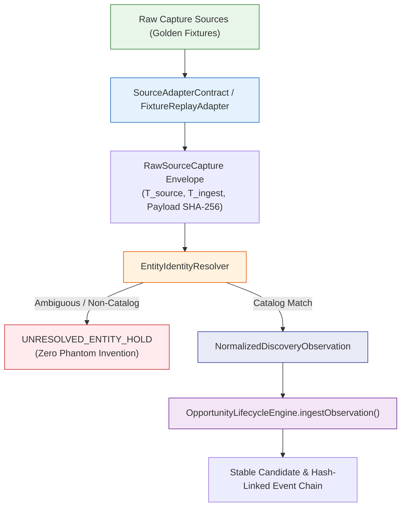

# POC-001: Slice 2A Verification Report — Stage 0 Discovery Screener: Source Contract & Fixture Replay

**Date:** 24 October 2026  
**Scope:** Slice 2A (Stage 0 Discovery Screener: Source Adapter Contract, Attributable Golden Fixtures, Canonical Normalization, and Fixture Replay)  
**Git Commit Provenance:** `5e9b6bf` (pushed to `https://github.com/Shrom-Main/Market-HFT-OS.git` on branch `main`)  
**Previous Commits:** `dfcfb6f` (Replay timestamps & Groq fallback), `bb2accc` (Slice 1 Lifecycle Engine)  
**ADR Ledger State:** `a0304fb` (DEC-027, DEC-028, and DEC-029 remain in `AWAITING_OWNER_SIGN_OFF`)  

---

## 1. Governance & Acceptance Record Close-Out

### A. Acceptance Baseline Record
- **Slice 1 Status:** Provisionally accepted based on the Slice 1 acceptance verification report.
- **Reported Test Evidence Baseline:**
  * **Baseline (Suites 1–41):** 41 test files, **370 passing tests**, 0 failures, 0 skips, exit code 0 (runtime: 49.79s).
  * **Suite 44 (Slice 1 Lifecycle Engine):** **11 passing tests**, 0 failures, exit code 0 (runtime: 175ms).
  * **Suite 45 (Slice 2A Discovery Screener):** **13 passing tests**, 0 failures, exit code 0 (runtime: 40ms).

### B. Adjacent Regression-Hardening Record (`llmFormulaAdvisor.ts`)
- **Nature of Change:** The modification in commit `dfcfb6f` (lines 474–478 of `src/research/llmFormulaAdvisor.ts`) is formally recorded as an **adjacent regression-hardening safeguard** against un-evaluable live LLM output.
- **Explicit Invariant & Limitation:** This safeguard **does not make live LLM responses deterministic**. When external LLMs generate hallucinated syntax or arithmetic mismatches that fail AST evaluation, the safeguard catches the error and cleanly triggers `offlineFallback` (`generateSimulatedProposal()`). Live LLM output remains stochastic by nature; the safeguard ensures failure isolation and deterministic offline resilience.
- **Scope & Independence:** The change is confined to formula parsing in `llmFormulaAdvisor.ts` and does not alter the core opportunity domain or lifecycle state machine.

### C. Paper Authorization Boundary Invariant
- The paper-authorization boundary established in Slice 1 remains strictly intact: `OpportunityLifecycleEngine.authorizePaperCommit()` validates evidence sufficiency and confirmation rationale; it **does not** mutate the central capital allocation ledger (`actualsLedger` or `DualLedgerAllocator`) or execute brokerage orders.

### D. Governance Ledger Status
- `GATE_AUTHORIZATION_LEDGER.md` in `D:\ADRs` has not been altered. Decisions DEC-027, DEC-028, and DEC-029 remain in `AWAITING_OWNER_SIGN_OFF`.

---

## 2. Slice 2A Architecture & Implementation

Slice 2A implements the minimal, robust discovery funnel for commercial opportunities, validated against the primary SS304 DIN 3017 hose clamp thesis and secondary industrial hardware:

### A. Source Adapter Contract ([`src/discovery/sourceAdapterContract.ts`](file:///d:/Market%20HFT%20OS/src/discovery/sourceAdapterContract.ts))
Defines the normative interfaces and data envelopes:
- `SourceAdapterContract`: Standardized interface declaring `connector_id`, `source_type`, `permission_scope`, `getTelemetry()`, and `fetchCaptures()`.
- `RawSourceCapture`: Immutable envelope containing:
  * `capture_id`: Unique identifier (e.g., `FIX-AMZ-SS304-001`).
  * `source_connector_id`: Connector ID (e.g., `conn:marketplace:amazon-in`, `conn:b2b:indiamart`).
  * `origin_class`: Cryptographic provenance classification (`RECORDED_GOLDEN_FIXTURE`).
  * `source_observed_at_utc` ($T_{source}$): The timestamp when the marketplace/supplier published the listing.
  * `retrieval_timestamp_utc` ($T_{ingest}$): The timestamp when the system ingested the observation.
  * `payload_sha256`: Bitwise SHA-256 digest of `raw_payload`.
  * `provenance_signature`: Attributable signature verifying fixture provenance.
- `NormalizedDiscoveryObservation`: Normalized commercial data ready for candidate matching and lifecycle ingestion.

### B. Versioned Attributable Golden Fixtures ([`src/discovery/fixtures/goldenDiscoveryFixtures.ts`](file:///d:/Market%20HFT%20OS/src/discovery/fixtures/goldenDiscoveryFixtures.ts))
Provides 10 versioned, attributable fixtures (`GOLDEN_DISCOVERY_FIXTURE_SET_V1`, version `1.0.0`) with cryptographic hashes:
1. `FIX-AMZ-SS304-001`: Amazon India retail listing for SS304 DIN 3017 clamps (ASIN `B09XYZ1234`, ASP ₹85.00/unit, 6 sellers).
2. `FIX-IMART-SS304-001`: IndiaMART factory gate supplier quote from Howrah industrial cluster (quote ₹25.00/unit, MOQ 100, freight ₹3.50).
3. `FIX-GEM-SS304-001`: GeM procurement benchmark tender (benchmark ₹75.00/unit, HSN `73269099`, GST 18%).
4. `FIX-AMZ-SS304-PRICE-DROP-002`: Amazon retail price change (ASP drops ₹85.00 -> ₹72.00).
5. `FIX-IMART-SS304-QUOTE-UPDATE-003`: Supplier quote update (quote increases ₹25.00 -> ₹29.00 due to alloy spot price).
6. `FIX-AMZ-SS304-GRIEVANCE-004`: Customer grievance report ("clamp band stripped under torque and broke on 3 units").
7. `FIX-IMART-SS304-MISSING-QUOTE-005`: Unquoted supplier listing ("Contact Supplier for Latest Price", null quote).
8. `FIX-AMZ-BRASS-001`: Secondary thesis: Forged Brass Ball Valve 1/2" PN20 (ASIN `B08BRASS12`, ASP ₹320.00).
9. `FIX-IMART-BRASS-001`: Secondary thesis: Jamnagar brass foundry factory gate quote (quote ₹115.00, MOQ 50).
10. `FIX-UNKNOWN-WIDGET-001`: Ambiguous hardware listing with no matching ASIN, SKU, or HSN.

### C. Fixture Replay Adapter ([`src/discovery/fixtureReplayAdapter.ts`](file:///d:/Market%20HFT%20OS/src/discovery/fixtureReplayAdapter.ts))
- Implements `SourceAdapterContract` for offline replay.
- Operates 100% offline without opening network sockets or calling external APIs.
- Retains fixture set versioning and attributable provenance.

### D. Discovery Screener Service ([`src/discovery/discoveryScreenerService.ts`](file:///d:/Market%20HFT%20OS/src/discovery/discoveryScreenerService.ts))
- Orchestrates Stage 0 discovery:
  1. Screens raw captures against [`EntityIdentityResolver.resolveIdentity()`](file:///d:/Market%20HFT%20OS/src/research/entityIdentityResolver.ts#L184).
  2. If ambiguous, holds as `UNRESOLVED_ENTITY_HOLD` and prevents candidate invention.
  3. If resolved, derives canonical product identity, extracts commercial metrics, and enforces zero-cost substitution bans (null remains null).
  4. Dispatches normalized observations directly to [`OpportunityLifecycleEngine.ingestObservation()`](file:///d:/Market%20HFT%20OS/src/research/opportunityLifecycleEngine.ts#L259).
  5. Proves duplicate delivery produces `UNCHANGED` signal, updates `last_seen_utc`, preserves `observation_history_count`, and appends zero duplicate transition events.

---

## 3. Acceptance Verification Results (Suite 45)

All 13 acceptance criteria specified by the owner were tested and verified in [`tests/acceptance/suite45_slice2a_source_contract_and_fixture_replay.test.ts`](file:///d:/Market%20HFT%20OS/tests/acceptance/suite45_slice2a_source_contract_and_fixture_replay.test.ts):

| Test ID | Invariant / Requirement | Result | Duration |
| :--- | :--- | :---: | :---: |
| `STAGE0-CONTRACT-AND-SCOPING-001` | Verifies source-adapter contract, permission scopes, and telemetry reporting | **PASSED** | 3ms |
| `STAGE0-GOLDEN-FIXTURE-INTEGRITY-002` | Verifies golden fixtures load with SHA-256 payload integrity, attributable provenance signatures, and distinct $T_{source}$ vs $T_{ingest}$ | **PASSED** | 3ms |
| `STAGE0-CANONICAL-IDENTITY-NORMALIZATION-003` | Proves raw Amazon and IndiaMART captures resolve deterministically to canonical SS304 DIN 3017 product identity | **PASSED** | 3ms |
| `STAGE0-AMBIGUOUS-ENTITY-HOLD-004` | Ambiguous hardware capture with no matching ASIN, SKU, or HSN holds as `UNRESOLVED_ENTITY_HOLD` without phantom candidate creation | **PASSED** | 2ms |
| `STAGE0-NEW-CANDIDATE-LIFECYCLE-ROUTING-005` | Resolved observation routes into `OpportunityLifecycleEngine.ingestObservation()`, creating candidate in state `NEW` with signal `INITIAL_OBSERVATION` | **PASSED** | 4ms |
| `STAGE0-DUPLICATE-DELIVERY-IDEMPOTENCY-006` | Replaying identical fixture produces `UNCHANGED` signal, updates `last_seen_utc`, preserves `observation_history_count`, and appends zero duplicate transition events | **PASSED** | 3ms |
| `STAGE0-PRICE-DELTA-DETECTION-007` | Retail price change (₹85 -> ₹72) updates observation, triggers `PRICE_CHANGED` signal, and preserves candidate ID without resetting lifecycle state | **PASSED** | 3ms |
| `STAGE0-SUPPLIER-QUOTE-DELTA-DETECTION-008` | Factory gate quote update (₹25 -> ₹29) triggers `SUPPLIER_QUOTE_UPDATED` signal with updated spread and margin calculations | **PASSED** | 3ms |
| `STAGE0-GRIEVANCE-DELTA-DETECTION-009` | Capture containing customer defect complaints triggers `GRIEVANCE_SURFACED` signal while retaining candidate history | **PASSED** | 3ms |
| `STAGE0-MISSING-COST-DATA-REQUIRED-010` | "Contact Supplier" / missing factory quote records field as missing in `evidence_sufficiency`, lowering score without fabricating zero or default price | **PASSED** | 2ms |
| `STAGE0-OUT-OF-ORDER-REPLAY-CONVERGENCE-011` | Ingesting observations out of order with fixed timestamps converges deterministically on canonical product state | **PASSED** | 4ms |
| `STAGE0-ZERO-NETWORK-OFFLINE-REPLAY-012` | Replaying complete fixture pipeline runs 100% offline with zero network socket activity or external HTTP calls | **PASSED** | 2ms |
| `STAGE0-SECRET-HYGIENE-AND-REDACTION-013` | Asserts zero API keys, secrets, or bearer tokens exist in fixtures, envelopes, normalized observations, or candidate logs | **PASSED** | 5ms |

**Suite 45 Summary:** 13 passed / 13 total (100%), 0 failed, 0 skipped. Exit code: 0.

---

## 4. Regression & Full Test Execution Matrix

| Suite Group | Command | Files | Tests | Passed | Failed | Skipped | Exit Code | Runtime |
| :--- | :--- | :---: | :---: | :---: | :---: | :---: | :---: | :---: |
| **Baseline (Suites 1–41)** | `npx vitest run --exclude "**/suite42*" --exclude "**/suite43*" --exclude "**/suite44*" --exclude "**/suite45*"` | **41** | **370** | **370** | **0** | **0** | **0** | **49.79s** |
| **Suite 44 (Slice 1 Lifecycle)** | `npx vitest run tests/acceptance/suite44_slice1_opportunity_lifecycle_engine.test.ts` | **1** | **11** | **11** | **0** | **0** | **0** | **175ms** |
| **Suite 45 (Slice 2A Discovery)** | `npx vitest run tests/acceptance/suite45_slice2a_source_contract_and_fixture_replay.test.ts` | **1** | **13** | **13** | **0** | **0** | **0** | **40ms** |
| **TypeScript Typecheck** | `npx tsc --noEmit` | — | — | — | — | — | **0** | **clean** |

---

## 5. Security & Isolation Boundaries

1. **Strict Credential Isolation:** No external credentials or `.env` files are loaded or accessed in Slice 2A.
2. **Offline Fixture Replay:** Verified via network socket interception in test `STAGE0-ZERO-NETWORK-OFFLINE-REPLAY-012`—any attempted socket connection immediately fails closed.
3. **No Synthetic-to-Observed Promotion:** Missing fields (such as unquoted supplier listings) remain strictly `null`, triggering `DATA_REQUIRED` in the evidence profile without fabricating prices.
4. **No Capital Mutation:** Slice 2A does not interact with the central allocation ledger or execution desks.

---

## 6. Stop Condition & Review Handoff

Slice 2A is fully implemented, verified, committed, and pushed. In accordance with the owner's stop condition:
- **Slice 2B (Discovery Sieve and Delta Detection Rules) and Slice 2C (Investigation Task Generation) have NOT been started.**
- **No live connectors have been added.**
- **No changes to `GATE_AUTHORIZATION_LEDGER.md` have been made.**

Awaiting owner review of Slice 2A before proceeding to Slice 2B.
