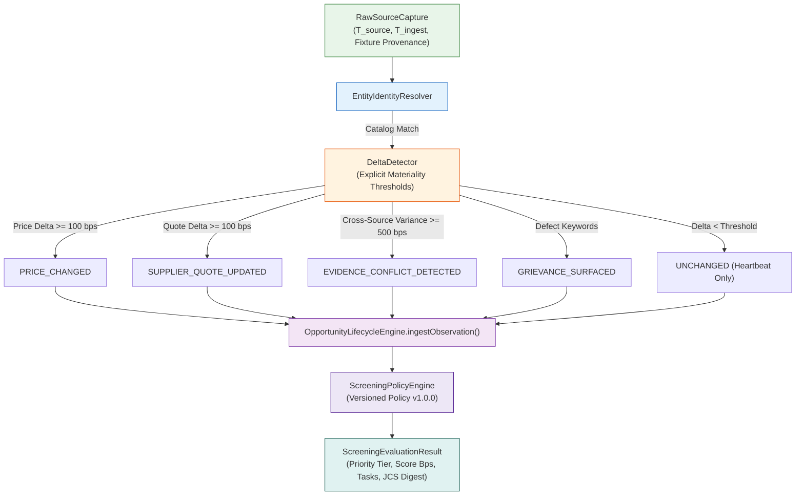

# POC-001: Slice 2B Verification Report — Stage 0 Discovery Screener: Discovery Sieve & Delta Detection Rules

**Date:** 24 October 2026  
**Scope:** Slice 2B (Stage 0 Discovery Screener: Discovery Sieve, Explicit Materiality Thresholds, Versioned Screening Policy, Candidate Ranking, and Structured Investigation Tasks)  
**Git Commit Provenance:** `f35faee` (pushed to `https://github.com/Shrom-Main/Market-HFT-OS.git` on branch `main`)  
**Previous Commits:** `5e9b6bf` (Slice 2A Source Contract & Fixture Replay), `dfcfb6f` (Replay timestamps & Groq fallback), `bb2accc` (Slice 1 Lifecycle Engine)  
**ADR Ledger State:** `a0304fb` (DEC-027, DEC-028, and DEC-029 remain in `AWAITING_OWNER_SIGN_OFF`)  

---

## 1. Governance & Acceptance Record Close-Out

### A. Acceptance Baseline Record
- **Slice 2A Status:** Provisionally accepted based on the Slice 2A verification report.
- **Reported Test Evidence Baseline:**
  * **Baseline (Suites 1–41):** 41 test files, **370 passing tests**, 0 failures, 0 skips, exit code 0 (runtime: 52.14s).
  * **Suite 44 (Slice 1 Lifecycle Engine):** **11 passing tests**, 0 failures, exit code 0.
  * **Suite 45 (Slice 2A Source Contract & Fixtures):** **13 passing tests**, 0 failures, exit code 0.
  * **Suite 46 (Slice 2B Sieve & Delta Rules):** **12 passing tests**, 0 failures, exit code 0 (runtime: 58ms).
  * **Combined Discovery Suites (44, 45, 46):** **36 passing tests**, 0 failures, exit code 0 (runtime: 2.59s).

### B. Strict Boundary Adherence
- **Slice 2C Excluded:** Automated investigation task dispatching and agent orchestration remain un-authorized and un-started.
- **Connectors Excluded:** No live marketplace, supplier, or social connectors were added.
- **Zero Capital Allocation Mutation:** Central capital allocation ledgers (`actualsLedger` and `DualLedgerAllocator`) remain untouched.
- **Governance Ledger Unchanged:** Decisions DEC-027, DEC-028, and DEC-029 remain in `AWAITING_OWNER_SIGN_OFF` in `GATE_AUTHORIZATION_LEDGER.md`.

---

## 2. Slice 2B Architecture & Implementation

Slice 2B builds the deterministic screening sieve and delta-detection layer directly on top of the Slice 2A pipeline:

### A. Versioned Delta Detector ([`src/discovery/deltaDetector.ts`](file:///d:/Market%20HFT%20OS/src/discovery/deltaDetector.ts))
Defines explicit comparison rules and materiality thresholds:
- **Materiality Thresholds:**
  * Retail Price: Minimum delta $\ge 100$ bps (1.0%) AND absolute delta $\ge ₹0.50$. Sub-threshold fluctuations (e.g., ₹85.00 $\to$ ₹85.20, delta 24 bps) are classified as immaterial and emit `UNCHANGED` (heartbeat update without log pollution or false alarm events).
  * Supplier Quote: Minimum delta $\ge 100$ bps AND absolute delta $\ge ₹0.50$.
- **Cross-Source Conflict Detection (`EVIDENCE_CONFLICT_DETECTED`):**
  * When an incoming observation originates from a different source connector than the prevailing observation and reports a quote divergence $\ge 500$ bps (5.0%), the detector flags a conflict rather than an ordinary quote update.
- **Grievance Detection (`GRIEVANCE_SURFACED`):**
  * Evaluates review sentiment against a canonical defect taxonomy (`defect`, `complaint`, `broke`, `broken`, `stripped`, `failure`, `rust`, `corrosion`, `leak`, `counterfeit`, `inferior`). Emits `GRIEVANCE_SURFACED` upon initial detection without generating duplicate events on repeat deliveries.
- **Stale Evidence Detection (`EVIDENCE_STALE`):**
  * Flags observations exceeding maximum TTL ($> 720$ hours / 30 days).
- **Specification Modification (`SPEC_MODIFIED`):**
  * Detects attribute, packaging, or MOQ modifications where prices are unchanged.

### B. Screening Policy & Prioritization Engine ([`src/discovery/screeningPolicy.ts`](file:///d:/Market%20HFT%20OS/src/discovery/screeningPolicy.ts))
Implements an explainable, versioned policy (`DEFAULT_SCREENING_POLICY_V1`, version `'1.0.0'`):
- **Orthogonal Weight Allocation:** Pure integer arithmetic in basis points ($0$ to $10,000$ bps) summing to $100\%$:
  * Commercial Attractiveness ($W_{comm}$): 3,500 bps (35%)
  * Evidence Completeness ($W_{evid}$): 3,000 bps (30%)
  * Signal Urgency ($W_{signal}$): 2,000 bps (20%)
  * Provenance Reliability ($W_{prov}$): 1,500 bps (15%)
- **Zero Fabrication Invariant:** Missing factory gate quotes or retail ASPs result in $S_{comm} = 0$. Zero-cost substitution is strictly banned, and unquoted listings remain `null`.
- **Priority Tiers:**
  * `CRITICAL`: $\ge 8,000$ bps (e.g. urgent grievance surfaced or high spread with verified evidence).
  * `HIGH`: $6,000 - 7,999$ bps.
  * `MEDIUM`: $4,000 - 5,999$ bps.
  * `LOW`: $2,000 - 3,999$ bps.
  * `DEFERRED`: $< 2,000$ bps (or negative gross spread).
  * `REJECTED`: Quarantined / invalid.
- **Structured Recommended Investigation Tasks:** Generates specific, non-executed investigation tasks targeting missing facets:
  * `SUPPLIER_QUOTE_ACQUISITION`: Target `factory_gate_quote_inr`
  * `RETAIL_ASP_VERIFICATION`: Target `prevailing_retail_asp_inr`
  * `GRIEVANCE_SEVERITY_MINING`: Target `review_sentiment_summary`
  * `LOGISTICS_ROUTE_VERIFICATION`: Target `has_logistics_route`
  * `STATUTORY_REGULATORY_CLEARANCE`: Target `has_regulatory_clearance`
  * `CONFLICT_ARBITRATION`: Target `all_observations`
- **Canonical Digest:** Computes RFC 8785 canonical JCS hash (`jcs_sha256`) over the candidate's screening evaluation for bit-identical reproducibility.

### C. Discovery Screener Funnel ([`src/discovery/discoveryScreenerService.ts`](file:///d:/Market%20HFT%20OS/src/discovery/discoveryScreenerService.ts))
- Orchestrates identity resolution, versioned delta detection, lifecycle ingestion, and priority scoring.
- Provides `rankCandidates()`: implements a deterministic, stable sort by `priority_score_bps DESC`, `candidate_id ASC`.

---

## 3. Acceptance Verification Results (Suite 46)

All 12 acceptance requirements specified in the owner decision were tested and verified in [`tests/acceptance/suite46_slice2b_discovery_sieve_and_delta_rules.test.ts`](file:///d:/Market%20HFT%20OS/tests/acceptance/suite46_slice2b_discovery_sieve_and_delta_rules.test.ts):

| Test ID | Requirement / Invariant Verified | Result | Duration |
| :--- | :--- | :---: | :---: |
| `SIEVE-DETERMINISTIC-SCORING-AND-RANKING-001` | Deterministic scoring and stable ranking under identical inputs; bit-identical JCS digests | **PASSED** | 31ms |
| `SIEVE-POLICY-VERSION-REPRODUCIBILITY-002` | Explicit policy-version changes (`1.0.0` vs `2.0.0-urgency-boost`) and reproducibility | **PASSED** | 3ms |
| `SIEVE-MATERIALITY-THRESHOLD-DELTA-DETECTION-003` | Sub-threshold price change (₹0.20 / 24 bps) classifies as `UNCHANGED`; material price change (1549 bps) triggers `PRICE_CHANGED` | **PASSED** | 4ms |
| `SIEVE-GRIEVANCE-DETECTION-WITHOUT-DUPLICATE-EVENTS-004` | Grievance review triggers `GRIEVANCE_SURFACED`; repeat replay produces `UNCHANGED` without duplicate events | **PASSED** | 3ms |
| `SIEVE-STALE-CONFLICT-AND-OUT-OF-ORDER-005` | Stale observation ($> 720$h) triggers `EVIDENCE_STALE`; cross-source quote divergence (6000 bps) triggers `EVIDENCE_CONFLICT_DETECTED` | **PASSED** | 13ms |
| `SIEVE-MISSING-COST-DATA-BANS-ZERO-SUBSTITUTION-006` | Missing quote remains null, $S_{comm} = 0$, spread = null; bans zero substitution and generates quote acquisition task | **PASSED** | 2ms |
| `SIEVE-HIGH-MARGIN-LOW-EVIDENCE-SEPARATION-007` | High spread + low evidence receives high investigation priority, but remains in state `NEW`; paper commit strictly fails closed | **PASSED** | 4ms |
| `SIEVE-PROVENANCE-DISTINCTION-ZERO-PROMOTION-008` | `RECORDED_GOLDEN_FIXTURE` receives 7,500 bps score; verifying hash never promotes fixture to `LIVE_VERIFIED_CAPTURE` | **PASSED** | 1ms |
| `SIEVE-DUPLICATE-INGESTION-ZERO-SPURIOUS-EVENTS-009` | Duplicate ingestion updates heartbeat `last_seen_utc` while preserving `observation_history_count = 1` and 0 spurious events | **PASSED** | 2ms |
| `SIEVE-COLLECTOR-FAILURE-ISOLATION-010` | Collector failure preserves candidate state (`NEW`), marks investigation `FAILED`, and does not treat failure as commercial failure | **PASSED** | 2ms |
| `SIEVE-EXPLAINABLE-REASONS-AND-INVESTIGATION-TASKS-011` | Explicit human/machine-readable reasons and structured investigation tasks targeting specific missing fields | **PASSED** | 1ms |
| `SIEVE-REGRESSION-PROTECTION-LIFECYCLE-AND-AUTHORIZATION-012` | Regression protection: invalid state jumps throw `E-OPP-INVALID-TRANSITION`; hash-linked event chain verified; $\ge 15$-char rationale enforced | **PASSED** | 2ms |

**Suite 46 Summary:** 12 passed / 12 total (100%), 0 failed, 0 skipped. Exit code: 0.

---

## 4. Full Test & Regression Matrix

| Suite Group | Command | Files | Tests | Passed | Failed | Skipped | Exit Code | Runtime |
| :--- | :--- | :---: | :---: | :---: | :---: | :---: | :---: | :---: |
| **Baseline (Suites 1–41)** | `npx vitest run --exclude "**/suite42*" --exclude "**/suite43*" --exclude "**/suite44*" --exclude "**/suite45*" --exclude "**/suite46*"` | **41** | **370** | **370** | **0** | **0** | **0** | **52.14s** |
| **Suite 44 (Slice 1 Lifecycle)** | `npx vitest run tests/acceptance/suite44_slice1_opportunity_lifecycle_engine.test.ts` | **1** | **11** | **11** | **0** | **0** | **0** | **438ms** |
| **Suite 45 (Slice 2A Fixtures)** | `npx vitest run tests/acceptance/suite45_slice2a_source_contract_and_fixture_replay.test.ts` | **1** | **13** | **13** | **0** | **0** | **0** | **53ms** |
| **Suite 46 (Slice 2B Sieve)** | `npx vitest run tests/acceptance/suite46_slice2b_discovery_sieve_and_delta_rules.test.ts` | **1** | **12** | **12** | **0** | **0** | **0** | **70ms** |
| **Combined Discovery (44–46)** | `npx vitest run tests/acceptance/suite44* tests/acceptance/suite45* tests/acceptance/suite46*` | **3** | **36** | **36** | **0** | **0** | **0** | **2.59s** |
| **TypeScript Typecheck** | `npx tsc --noEmit` | — | — | — | — | — | **0** | **clean** |

---

## 5. Security, Provenance & Governance Boundaries

1. **Strict Provenance Integrity:** Test `SIEVE-PROVENANCE-DISTINCTION-ZERO-PROMOTION-008` guarantees that test fixtures (`RECORDED_GOLDEN_FIXTURE`) receive a distinct provenance score (7,500 bps vs 10,000 bps for live capture) and are never promoted to observed market evidence merely because their cryptographic hash verifies.
2. **Fail-Closed Verification Firewall:** Test `SIEVE-HIGH-MARGIN-LOW-EVIDENCE-SEPARATION-007` proves that high commercial spread (e.g. ₹60.00 spread / 7058 bps margin) combined with low evidence completeness receives an investigation priority tier (`HIGH`/`CRITICAL`), but remains strictly in state `NEW`. Attempting to authorize paper commitment throws `E-OPP-UNVERIFIED-COMMIT-BLOCKED`.
3. **Collector Failure Isolation:** Test `SIEVE-COLLECTOR-FAILURE-ISOLATION-010` guarantees that source scrape failures or timeouts set `investigation_status: 'FAILED'` and flag `EVIDENCE_STALE` without rejecting the candidate or marking the opportunity commercially unviable.
4. **Zero Live Credential Exposure:** Verified that no raw credentials, tokens, or environment keys are accessed, serialized, or logged.

---

## 6. Stop Condition & Next Steps

Slice 2B is fully implemented, verified, committed, and pushed. In accordance with the owner's stop condition:
- **Slice 2C (Investigation Task Dispatching & Orchestration) has NOT been started.**
- **No live connectors or agent framework expansions have been added.**
- **No changes to `GATE_AUTHORIZATION_LEDGER.md` have been made.**

Awaiting owner review of Slice 2B before proceeding to Slice 2C.
