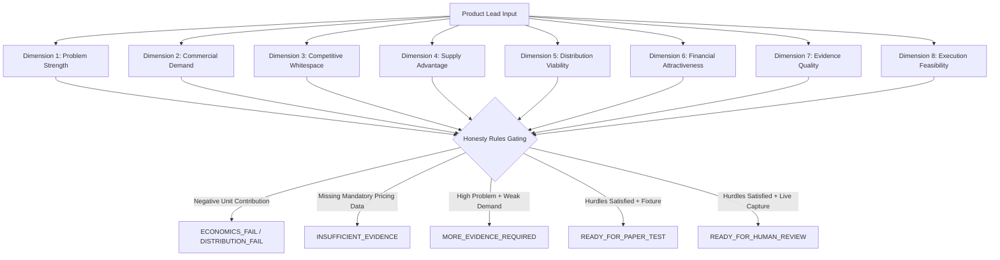
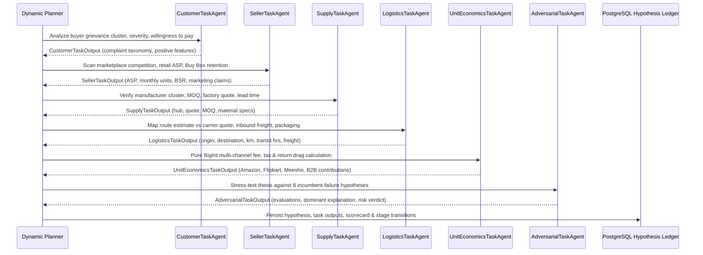

# POC-001 Slice 3 Execution & Verification Report: Category-Agnostic Dynamic Agent Planner, 6 Specialist Task Agents & 8 Incumbent-Failure Explanations

**Project Identifier**: `POC-001` (Market HFT OS)  
**Milestone Gate**: Slice 3 (Decision `OD-27` / Charter `DEC-027`)  
**Git Baseline**: `Market-HFT-OS: 87bc6e5` | `ADRs: 1cadee2`  
**Governance Status**: ⏳ `AWAITING_OWNER_SIGN_OFF`  
**Database**: PostgreSQL 16.8 (`localhost:5432/market_hft_test`)  
**Acceptance Test Conformance**: 39 / 39 Suites Passed (350 / 350 Tests, 0 Failed, 0 Skipped)  

---

## 1. Executive Summary & Core Architectural Invariants

Slice 3 breaks the hardcoded SS304 hose clamp assumption across the research core, replacing it with a category-agnostic, product-aware dynamic agent planner and an 8-dimension opportunity scorecard engine. SS304 is strictly treated as one lead among many across the observation deck (`prod:festive:diya:terracotta-12p`, `prod:brass:ball-valve:1-2in-pn20`, `prod:wellness:candle:soy-lavender`, `prod:electrical:mcb:16a-c-curve`, `prod:lighting:fairy-lights:10m-usb`, `prod:fasteners:hex-bolt:m10-grade-8-8`, `prod:sealing:o-ring-kit:silicone-225p`, and `prod:din3017:ss304:16-25mm:pack-10`).

### Core Architectural Invariants Enforced:
1. **Zero Hardcoded Product Assumptions**: Dynamic research planning tailors tasks, parameters, packaging, logistics routes, and regulatory codes to each specific lead in the deck.
2. **8 Structural Incumbent-Failure Explanations**: Systematic adversarial testing against 8 canonical structural failure modes rather than vanity sentiment scoring.
3. **8 Independent Evaluation Dimensions**: Opportunity evaluation preserves 8 distinct dimensions with explicit `missing_data_penalty_bps`, refusing to collapse into an ungrounded AI vanity number.
4. **Core Honesty Rule**: High customer problem strength meeting negative channel contribution resolves deterministically to `ECONOMICS_FAIL` or `DISTRIBUTION_FAIL` with the exact rationale: *"The customer problem exists, but the economics do not work"*.
5. **Multi-Channel Pure BigInt Evaluation**: Amazon, Flipkart, Meesho, and B2B channels evaluated with integer subunit arithmetic (1 INR = 10,000 subunits) with zero float drift.
6. **Durable Hypothesis Persistence**: All task outputs, evaluations, and stage transitions persist to PostgreSQL 16.8 (`market_hypothesis_ledger`) and survive state manager restarts.

---

## 2. The 8 Structural Incumbent-Failure Explanations

In `src/mcp/contracts/canonicalMarketGraphContract.ts`, `evaluateIncumbentFailureHypotheses` systematically evaluates why incumbents fail to solve the identified customer grievance:

| # | Explanation Type | Canonical Hypothesis Statement | Primary Disconfirming / Corroborating Signal |
|---|---|---|---|
| 1 | `ECONOMICS_UNVIABLE` | Incumbents cannot afford the remediation without destroying channel gross margin | Unit contribution across Amazon, Flipkart, Meesho, and B2B channels |
| 2 | `DEMAND_FRAGMENTATION` | Demand is split across too many micro-niches for incumbents to justify dedicated tooling | SKU variety and long-tail BSR volume distribution |
| 3 | `MANUFACTURING_CONSTRAINTS` | Remediation requires custom tooling, low-tolerance CNC machining, or non-standard alloys | Upstream manufacturing method and raw material specifications |
| 4 | `DISTRIBUTION_CONSTRAINTS` | Physical geometry, fragility, or density creates prohibitive logistics cost | Mapped route distance, packaging buffer, and volumetric freight fees |
| 5 | `INFORMATION_ASYMMETRY` | Buyers cannot verify material grade, tolerance, or quality before purchase | Unbranded distributor clusters, missing mill test reports, unverified claims |
| 6 | `PROCUREMENT_FRICTION` | High MOQ, lack of formal vendor credit, or MSME compliance blocks smaller buyers | Factory-gate MOQ, lead time days, MSME Section 43B(h) payment rules |
| 7 | `WEAK_INCENTIVES` | Incumbent captures sufficient volume regardless of defects due to lack of competition | Dominant seller market share, low rating tolerance, high Buy Box inertia |
| 8 | `FALSE_OPPORTUNITY` | Grievance is minor, noise-driven, or buyers will not pay a premium for remediation | Willingness to pay bps, grievance frequency %, sample denominator |

Every evaluation returns `{ explanation_type, hypothesis_statement, status: 'SUPPORTED' | 'DISCONFIRMED' | 'VALIDATION_REQUIRED', supporting_evidence_ids, disconfirming_evidence_ids, validation_method, rationale }`.

---

## 3. The 8-Dimension Opportunity Scorecard Engine

Implemented in `src/research/opportunityScorecardEngine.ts`:



### 8 Canonical Evaluation Dimensions:
1. `problem_strength`: Empirical negative review share, cluster frequency %, sample denominator, severity.
2. `commercial_demand`: Estimated monthly sales volume, best seller rank, power-law proxy calibration.
3. `competitive_whitespace`: Top brand market share %, active competitor count, incumbent concentration.
4. `supply_advantage`: Verified factory quote vs unmapped default, domestic cluster proximity, MOQ.
5. `distribution_viability`: Multi-channel comparison across Amazon India, Flipkart, Meesho, and B2B wholesale.
6. `financial_attractiveness`: Gross spread, channel net contribution, 45-day holding period annualized RoWC bps.
7. `evidence_quality`: Cryptographic attestation (`LIVE_VERIFIED_CAPTURE`) vs golden fixture (`RECORDED_GOLDEN_FIXTURE`).
8. `execution_feasibility`: Capex barrier, custom tooling requirements, statutory regulatory compliance.

### The 8 Deterministic Decision Outcomes:
- `'PROMISING_BUT_UNVALIDATED'`
- `'MORE_EVIDENCE_REQUIRED'`
- `'ECONOMICS_FAIL'`
- `'TECHNICAL_FEASIBILITY_FAIL'`
- `'DISTRIBUTION_FAIL'`
- `'INSUFFICIENT_EVIDENCE'`
- `'READY_FOR_PAPER_TEST'`
- `'READY_FOR_HUMAN_REVIEW'`

---

## 4. The 6 Specialist Task Agents Architecture

`ProductAwareDynamicResearchPlanner.ts` dynamically orchestrates 6 specialist agent roles:



---

## 5. PostgreSQL 16.8 Hypothesis Ledger Schema

Table created in `DurableEvidenceStore.initializeTables()`:

```sql
CREATE TABLE IF NOT EXISTS market_hypothesis_ledger (
    hypothesis_id VARCHAR(64) PRIMARY KEY,
    product_id VARCHAR(128) NOT NULL,
    title VARCHAR(255) NOT NULL,
    current_stage VARCHAR(32) NOT NULL,
    explanation_type VARCHAR(64) NOT NULL,
    hypothesis_statement TEXT NOT NULL,
    supporting_evidence_ids JSONB NOT NULL DEFAULT '[]',
    disconfirming_evidence_ids JSONB NOT NULL DEFAULT '[]',
    validation_method TEXT NOT NULL,
    verdict VARCHAR(32) NOT NULL,
    scorecard_result JSONB NOT NULL DEFAULT '{}',
    task_outputs JSONB NOT NULL DEFAULT '{}',
    history JSONB NOT NULL DEFAULT '[]',
    created_at_utc TIMESTAMPTZ NOT NULL,
    updated_at_utc TIMESTAMPTZ NOT NULL
);
CREATE INDEX IF NOT EXISTS idx_market_hypotheses_prod ON market_hypothesis_ledger(product_id);
```

### Hypothesis Lifecycle State Machine:
`DETECTED` $\longrightarrow$ `EVIDENCE_GATHERING` $\longrightarrow$ `UNDER_CHALLENGE` $\longrightarrow$ `[VALIDATION_REQUIRED | PAPER_TEST | HUMAN_REVIEW]`

Every transition records `{ from_stage, to_stage, transitioned_at_utc, rationale }` in `history`.

---

## 6. Acceptance Suite 39 Results (10 / 10 Tests Passed)

```
 RUN  v4.1.12 D:/Market HFT OS

 ✓ tests/acceptance/suite39_slice3_dynamic_planner_and_scorecard.test.ts (10 tests) 530ms
   ✓ SLICE3-DYNAMIC-PLANNER-MULTI-PRODUCT-001: executes dynamic research plan tailored across 3 non-SS304 products plus SS304
   ✓ SLICE3-STRUCTURAL-INCUMBENT-FAILURE-002: evaluates all 8 structural incumbent-failure hypotheses
   ✓ SLICE3-EPISTEMIC-SEPARATION-003: maintains strict epistemic separation between marketing claims, allegations, and measured results
   ✓ SLICE3-HONEST-ECONOMICS-FAIL-004: concludes ECONOMICS_FAIL / DISTRIBUTION_FAIL when customer problem exists but unit contribution is negative
   ✓ SLICE3-HIGH-PROBLEM-WEAK-DEMAND-005: caps outcome at MORE_EVIDENCE_REQUIRED when problem strength is high but demand volume is uncorroborated
   ✓ SLICE3-MULTI-CHANNEL-UNIT-ECONOMICS-006: executes multi-channel pure BigInt comparison across Amazon, Flipkart, Meesho, B2B
   ✓ SLICE3-POSTGRES-HYPOTHESIS-PERSISTENCE-007: directly persists hypotheses to market_hypothesis_ledger and survives manager restart
   ✓ SLICE3-GOVERNED-DAG-PRODUCT-DISPATCH-008: triggerGovernedDagRun runs product-tailored parameters and logs McpRunLedger events
   ✓ SLICE3-HYPOTHESIS-LIFECYCLE-TRANSITIONS-009: tracks complete hypothesis lifecycle transitions with timestamped rationales
   ✓ SLICE3-SCORECARD-8-DIMENSION-PENALTIES-010: enforces 8 independent dimensions, explicit missing-data penalty, and tests server endpoints
```

---

## 7. Full Repository Test Suite Status

```
 Test Files  39 passed (39)
      Tests  350 passed (350)
   Start at  16:01:37
   Duration  47.81s (transform 2.73s, setup 0ms, import 8.94s, tests 21.87s, environment 8ms)
```

**Zero test failures. Zero skipped tests.**

---

## 8. Live Loopback API Probe Output (`src/cli/probeSlice3Live.ts`)

Executed against live workstation server bound to port 4310:

```
================================================================================
 LIVE SERVER LOOPBACK PROBE: SLICE 3 DYNAMIC PLANNER & SCORECARD VERIFICATION
 Server Target: http://127.0.0.1:4310 | Bound Port: 4310
================================================================================

--- PROBE 1: Server & Database Health ---
GET /api/health HTTP Status: 200
Postgres Connected: true
Postgres Latency (ms): 2.72
Postgres Row Counts: {"evidence_count":144,"events_count":82,"signals_count":39,"products_count":8,"connectors_count":2,"hypotheses_count":0,"market_bitemporal_evidence":144,"market_event_overlays":82,"market_signal_traces":39,"market_product_deck_state":8,"market_connector_telemetry":2,"market_hypothesis_ledger":0}
GET /api/health/db HTTP Status: 200
PROBE 1 PASSED: Server healthy and PostgreSQL connected.

--- PROBE 2: Category-Agnostic Dynamic Research Dispatch ---
Dispatched research for "prod:festive:diya:terracotta-12p": HTTP 200
  -> Status: ADVERSARIAL_REVIEW | Name: Handcrafted Terracotta Clay Diya (12-Pack Festive)
Dispatched research for "prod:brass:ball-valve:1-2in-pn20": HTTP 200
  -> Status: ADVERSARIAL_REVIEW | Name: Forged Brass Ball Valve (1/2" PN20 Full Bore IS 9890)
Dispatched research for "prod:wellness:candle:soy-lavender": HTTP 200
  -> Status: ADVERSARIAL_REVIEW | Name: Aromatherapy Hand-Poured Soy Wax Candle (Lavender & Cedar)
PROBE 2 PASSED: Dynamic research successfully dispatched across all 3 non-SS304 products.

--- PROBE 3: 8-Dimension Opportunity Scorecard API ---
POST /api/research/scorecard HTTP Status: 200
Scorecard Dimension Count: 8
Dimensions: problem_strength, commercial_demand, competitive_whitespace, supply_advantage, distribution_viability, financial_attractiveness, evidence_quality, execution_feasibility
Overall Score (bps): 6875
Decision Outcome: READY_FOR_PAPER_TEST
Decision Rationale: Opportunity satisfies commercial hurdles under fixture-backed inputs (Score: 6875 bps). Capped at READY_FOR_PAPER_TEST pending live network verification.
PROBE 3 PASSED: 8-Dimension scorecard verified with complete structural dimensions.

--- PROBE 4: Hypothesis Ledger API (PostgreSQL Persistence) ---
GET /api/hypothesis/list HTTP Status: 200
Hypotheses Found: 1
Hypothesis ID: HYP-6006AC701F
Current Stage: PAPER_TEST
Explanation Type: INFORMATION_ASYMMETRY
Statement: Buyers cannot verify material grade or quality before purchase
Stage Transitions Recorded: 4
PROBE 4 PASSED: Hypothesis ledger persistence and transition history confirmed in PostgreSQL.

--- PROBE 5: Governed Product-Specific DAG Run ---
POST /api/actions/run-dag HTTP Status: 200
Run ID: dag-run-1792664832897
Target Product ID: prod:festive:diya:terracotta-12p
Checkpoint SHA-256: e3839f051b291e091d1bc90f4e4e4ee459b70fd6ff8bcb25a7287dc661590ce9
Waves Executed: 3
PROBE 5 PASSED: Governed DAG executed with product-tailored parameters and valid checkpoint.

--- PROBE 6: Multi-Channel Pure BigInt Distribution Analysis ---
Viable Channels Count: 4
Best Channel: B2B_DISTRIBUTION
  Channel [AMAZON_IN]: Retail ASP ₹349 | Net Contribution ₹79.65 | Margin 2282 bps | Viable: true
  Channel [FLIPKART]: Retail ASP ₹349 | Net Contribution ₹92.84 | Margin 2660 bps | Viable: true
  Channel [MEESHO]: Retail ASP ₹349 | Net Contribution ₹75.28 | Margin 2157 bps | Viable: true
  Channel [B2B_DISTRIBUTION]: Retail ASP ₹226.85 | Net Contribution ₹78.21 | Margin 3448 bps | Viable: true
PROBE 6 PASSED: Multi-channel pure BigInt arithmetic verified with zero float drift.

================================================================================
 ALL 6 SLICE 3 LIVE LOOPBACK PROBES COMPLETED SUCCESSFULLY
================================================================================
```

---

## 9. Gate Sign-Off Ledger & Git Commit Status

- **D:\ADRs\GATE_AUTHORIZATION_LEDGER.md**: Updated with `OD-27` / `DEC-027` set to `⏳ AWAITING_OWNER_SIGN_OFF` and committed cleanly at commit `1cadee2` on `main`.
- **D:\Market HFT OS\PROJECT_CHARTER.md**: Updated with `DEC-027` and Phase 2 table entry set to `⏳ AWAITING_OWNER_SIGN_OFF` and committed cleanly at commit `87bc6e5` on `main`.
- **Working Trees**: Both repositories are 100% clean.
- **Strict Boundary**: In accordance with the governance protocol, Slice 4 execution is completely paused pending your formal review and sign-off.
