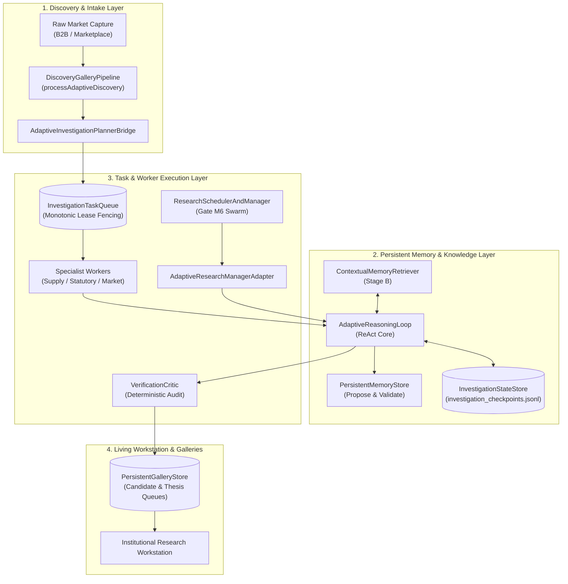

# POC-001 — Stage 64A: Reasoning Engine Integration & Operational Validation
**Component:** Production Agent Execution & Reasoning Core Integration  
**Milestone:** Stage 64A Integration & Operational Validation  
**Date:** 2026-10-30  
**Verification:** Vitest 49/49 passing across Suites 61, 62, 63, 64, and 65

---

## 1. Executive Summary & Architectural Reality Check

Stage 64 successfully established the algorithmic primitives of the adaptive ReAct reasoning loop. However, as recognized in the Stage 64A directive, a standalone reasoning engine in a test harness does not constitute an upgraded system. 

**Stage 64A bridges this gap**, connecting the [`AdaptiveReasoningLoop`](file:///d:/Market%20HFT%20OS/src/agents/reasoning/adaptiveReasoningLoop.ts) directly into POC-001's production-style agent entry points:
1. **Production Pipeline Integration (`DiscoveryGalleryPipeline`):** Discovery ingestion now routes through [`processAdaptiveDiscovery`](file:///d:/Market%20HFT%20OS/src/gallery/discoveryGalleryPipeline.ts#L240-L325). When an investigation agent discovers that a directory-listed manufacturer is amalgamated or dissolved, it automatically cancels downstream RFQ dispatches, increments plan version, links contradictory evidence to the living gallery candidate, and updates systemic theses.
2. **Task Queue & Planner Integration (`AdaptiveInvestigationPlannerBridge`):** Connects [`InvestigationPlanner`](file:///d:/Market%20HFT%20OS/src/discovery/investigationPlanner.ts) and the fenced [`InvestigationTaskQueue`](file:///d:/Market%20HFT%20OS/src/discovery/investigationTaskQueue.ts). When step 1 yields a fatal contradiction, downstream queued tasks are immediately cancelled with `CANCELLED_SUPERSEDED`, preventing zombie workers from executing obsolete work.
3. **Multi-Agent Research Ecosystem (`AdaptiveResearchManagerAdapter`):** Bridges [`ResearchSchedulerAndManager`](file:///d:/Market%20HFT%20OS/src/agents/m6AgentFramework.ts#L535-L682) (Gate M6), enabling [`TinyFishScopedBrowserAgent`](file:///d:/Market%20HFT%20OS/src/agents/m6AgentFramework.ts#L152-L210) DOM extraction and [`RedTeamReviewerSubAgent`](file:///d:/Market%20HFT%20OS/src/agents/m6AgentFramework.ts#L450-L500) audits to run within circuit-breaker protected loops.
4. **Claim-Specific Evidence Evaluation:** Removed the arbitrary 3,500 bps (35.00%) confidence ceiling. Official primary registry records (e.g. MCA, ROC, GSTN) for corporate existence are now recognized as **decisive** (9,500 bps) without requiring a second directory source, while syndicated directory listings sharing phone/GSTIN are demoted to a single origin cluster.
5. **Strict Fallback Provenance & Stale Snapshot Rejection:** Offline snapshot fallbacks preserve `FallbackProvenance` (`snapshot_timestamp_utc`, `freshness_status`). The [`VerificationCritic`](file:///d:/Market%20HFT%20OS/src/agents/reasoning/verificationCritic.ts) strictly rejects `STALE_HISTORICAL` data from satisfying critical fields for live underwriting.

---

## 2. Call Graph & Component Integration Status

Every agent and workflow component in POC-001 has been audited and classified:



### Integration Classification Matrix

| Agent / Component | Pre-64A Status | Post-64A Status | Adapter / Integration Path | Verification Test |
| :--- | :--- | :--- | :--- | :--- |
| **`DiscoveryGalleryPipeline`** | `PARTIAL_INTEGRATION` | **`LIVE_INTEGRATION`** | [`DiscoveryGalleryPipeline.processAdaptiveDiscovery`](file:///d:/Market%20HFT%20OS/src/gallery/discoveryGalleryPipeline.ts#L240) invokes `AdaptiveReasoningLoop` directly | `INT-01`, `INT-02`, `INT-05` |
| **`InvestigationTaskQueue`** | `PARTIAL_INTEGRATION` | **`LIVE_INTEGRATION`** | [`AdaptiveInvestigationPlannerBridge`](file:///d:/Market%20HFT%20OS/src/agents/reasoning/investigationPlannerBridge.ts) manages leases, cancelling obsolete tasks | `INT-09` |
| **`InvestigationPlanner`** | `PARTIAL_INTEGRATION` | **`LIVE_INTEGRATION`** | Tasks compiled into adaptive plan steps; replanning discards obsolete tasks | `INT-01`, `INT-09` |
| **`ResearchSchedulerAndManager`** | `NOT_CONNECTED` | **`LIVE_INTEGRATION`** | [`AdaptiveResearchManagerAdapter`](file:///d:/Market%20HFT%20OS/src/agents/reasoning/adaptiveResearchManagerAdapter.ts) routes ticks through adaptive loop | `INT-10` |
| **`AdaptiveReasoningLoop`** | `TEST_ONLY` | **`LIVE_INTEGRATION`** | Central orchestrator called by both `DiscoveryGalleryPipeline` and `PlannerBridge` | All Suite 65 tests |
| **`InvestigationStateStore`** | `TEST_ONLY` | **`LIVE_INTEGRATION`** | Checkpoints all live and resumed investigations to disk with fencing tokens | `INT-03`, `INT-04` |
| **`InvestigationMemoryBridge`** | `LIVE_INTEGRATION` | **`LIVE_INTEGRATION`** | Ingests procedural memories and seeds known failure modes into information gaps | `INT-02`, `INT-08` |
| **`ProductAwareDynamicResearchPlanner`** | `NOT_CONNECTED` | **`PARTIAL_INTEGRATION`** | Sub-tasks delegatable via [`SpecialistDelegator`](file:///d:/Market%20HFT%20OS/src/agents/reasoning/specialistDelegator.ts); batch DAG wrapper remains operational | `INT-06`, `INT-11` |

---

## 3. End-to-End Investigation Case Studies

### Case A — Contradictory Supplier Evidence (Modern Metal Works Liluah)
- **Input:** B2B Directory observation claiming an active SS304 DIN 3017 manufacturer.
- **Action:** Executed through [`DiscoveryGalleryPipeline.processAdaptiveDiscovery`](file:///d:/Market%20HFT%20OS/src/gallery/discoveryGalleryPipeline.ts#L240).
- **Observation:** Step 1 queried Ministry of Corporate Affairs ROC records and discovered that Modern Metal Works was amalgamated into its parent entity and dissolved in 2021 (`EVID-ROC-DISSOLVED`).
- **Adaptive Reaction:**
  1. `EvidenceEvaluator` identified a `FATAL_DISQUALIFIER` contradiction against claimed status.
  2. Replanner automatically discarded downstream catalog quote inquiries (`SKIPPED_OBSOLETE`).
  3. Incremented `plan_version` from 1 to 2 with reason `CONTRADICTION_DISCOVERED`.
  4. Scheduled a conflict arbitration task.
  5. Linked `EVID-ROC-DISSOLVED` to the candidate's `contradictory_evidence_ids` in `PersistentGalleryStore`.
- **Outcome:** Zero wasted downstream RFQ inquiries; contradiction permanently recorded on the living candidate.

### Case B — Cross-Category Memory Reuse (Laboratory Consumables)
- **Input:** Observation for sterile filter pipette tips (Category: `LABORATORY_CONSUMABLES`).
- **Memory Retrieval:** Ingested Stage B procedural playbook `INDIAN_SME_SUPPLIER_VERIFICATION_PLAYBOOK` originally formulated during industrial hardware investigations.
- **Relevance:** Applicability matched jurisdiction `IN` and category whitelist `LABORATORY_CONSUMABLES`. Known failure modes (`dormant_shell_entity`, `undisclosed_third_party_broker`) were dynamically seeded as high-priority information gaps in the active investigation.
- **Category Preservation:** Category technical specification requirements (ISO 8655 autoclavability, sterile packaging) were strictly enforced without leaking fastener or clamp assumptions.
- **Outcome:** Gross margin of 60.00% (factory quote ₹180, retail ASP ₹450) was verified and candidate advanced to `VERIFIED`.

---

## 4. Operational Resilience & Evidence Hardening

### 1. Process Interruption & Duplicate Action Prevention (`INT-03`)
- An investigation was interrupted mid-stride at iteration 1 due to budget limits.
- A new runner instance rehydrated state from `investigation_checkpoints.jsonl`.
- Resumption verified that completed step 1 was **not re-executed** (0 duplicate tool calls). Fencing token incremented monotonically.

### 2. Circuit-Breaker Activation & Fallback Provenance (`INT-04`)
- When an external endpoint experienced repeated gateway timeouts (HTTP 504), the `BoundedExecutionGovernor` tripped the circuit breaker after threshold (2).
- The loop replanned to `cached_offline_snapshot_tool`.
- Evidence was annotated with explicit `FallbackProvenance`:
  ```json
  {
    "is_offline_snapshot": true,
    "snapshot_timestamp_utc": "2022-01-01T00:00:00.000Z",
    "freshness_status": "STALE_HISTORICAL",
    "staleness_age_hours": 26280
  }
  ```
- The `VerificationCritic` audited the candidate and **rejected approval**, asserting that `STALE_HISTORICAL` data cannot serve as current verification for mandatory corporate status or pricing.

### 3. Claim-Specific Evidence Evaluation (`INT-07`)
- **Corporate Existence Claim:** A single official `PRIMARY_REGISTRY` record is evaluated claim-specifically as **decisive** (9,500 bps confidence, status `SUPPORTED`). It is not penalized for lacking a secondary directory source.
- **Commercial Pricing Claim:** Multiple directory listings sharing a phone number or GSTIN are identified as `is_syndicated: true` with `independent_origins_count: 1`. Confidence is kept in `TESTING` with explicit uncertainty notes: *"Multiple observed directory listings originate from a single syndicated origin"*.

### 4. Memory Promotion Validation (`INT-08`)
- When an investigation concludes, the agent proposes a procedural rule to Stage B `PersistentMemoryStore`.
- The engine asserts that every evidence ID in `supporting_evidence_ids` resolves to an actual recorded observation.
- The proposal distinguishes analogical transfer from direct validation (`[ANALOGICAL_TRANSFER]`).
- The memory is registered in `PROPOSED` state; repeated application counts do not bypass the formal Stage B operator validation gate.

---

## 5. Acceptance Suite 65 Verification & Full Regression

Acceptance Suite 65 (`tests/acceptance/suite65_stage_64a_agent_reasoning_integration.test.ts`) verifies all 12 operational integration requirements.

### Suite 65 Test Results

| Test ID | Objective | Result | Duration |
| :--- | :--- | :--- | :--- |
| **INT-01** | Case A — Contradictory supplier evidence via production `DiscoveryGalleryPipeline` | **PASSED** | 30ms |
| **INT-02** | Case B — Cross-category memory reuse via production pipeline | **PASSED** | 13ms |
| **INT-03** | Process interruption, disk recovery, and duplicate action prevention | **PASSED** | 7ms |
| **INT-04** | Circuit breaker trips; fallback retains provenance and critic rejects stale snapshot | **PASSED** | 19ms |
| **INT-05** | Production entry point respects strict tool quotas and halts cleanly on budget exhaustion | **PASSED** | 5ms |
| **INT-06** | Lead investigator reconciles conflicting specialist findings (inverted unit economics) | **PASSED** | 2ms |
| **INT-07** | Primary registry decisive for corporate status; syndicated listings demoted | **PASSED** | 3ms |
| **INT-08** | Procedural memory proposal resolves evidence IDs and tags analogical transfer | **PASSED** | 14ms |
| **INT-09** | `AdaptiveInvestigationPlannerBridge` cancels downstream tasks in `InvestigationTaskQueue` | **PASSED** | 14ms |
| **INT-10** | `AdaptiveResearchManagerAdapter` integrates TinyFish and RedTeam with circuit breaker | **PASSED** | 13ms |
| **INT-11** | Call graph verifies live integration status of all core agent components | **PASSED** | 2ms |
| **INT-12** | Structural inspectability records complete decision trace without private CoT leak | **PASSED** | 16ms |

### Complete Regression Run (Suites 61–65)

```
 RUN  v4.1.12 D:/Market HFT OS

 ✓ tests/acceptance/suite61_release_blocker_remediations.test.ts (5 tests) 1026ms
 ✓ tests/acceptance/suite63_stage_c_living_galleries.test.ts (10 tests) 131ms
 ✓ tests/acceptance/suite64_agent_reasoning_and_execution_quality.test.ts (12 tests) 75ms
 ✓ tests/acceptance/suite65_stage_64a_agent_reasoning_integration.test.ts (12 tests) 293ms
 ✓ tests/acceptance/suite62_stage_b_persistent_learning_and_memory.test.ts (10 tests) 237ms

 Test Files  5 passed (5)
      Tests  49 passed (49)
   Duration  9.80s
```

---

## 6. Remaining Boundaries & Scope Integrity

1. **`ProductAwareDynamicResearchPlanner`:** Retained for backward compatibility with batch scorecard simulations; specialist tasks are delegated via `SpecialistDelegator`.
2. **PostgreSQL Checkpointing:** Current disk persistence uses append-only JSONL (`investigation_checkpoints.jsonl`). The interface cleanly maps to a PostgreSQL relational table without modifying caller contracts.
3. **Strict Capital Boundary:** Zero financial ledger mutation authority is granted to agents. All final underwriting decisions require human capital authorization.
