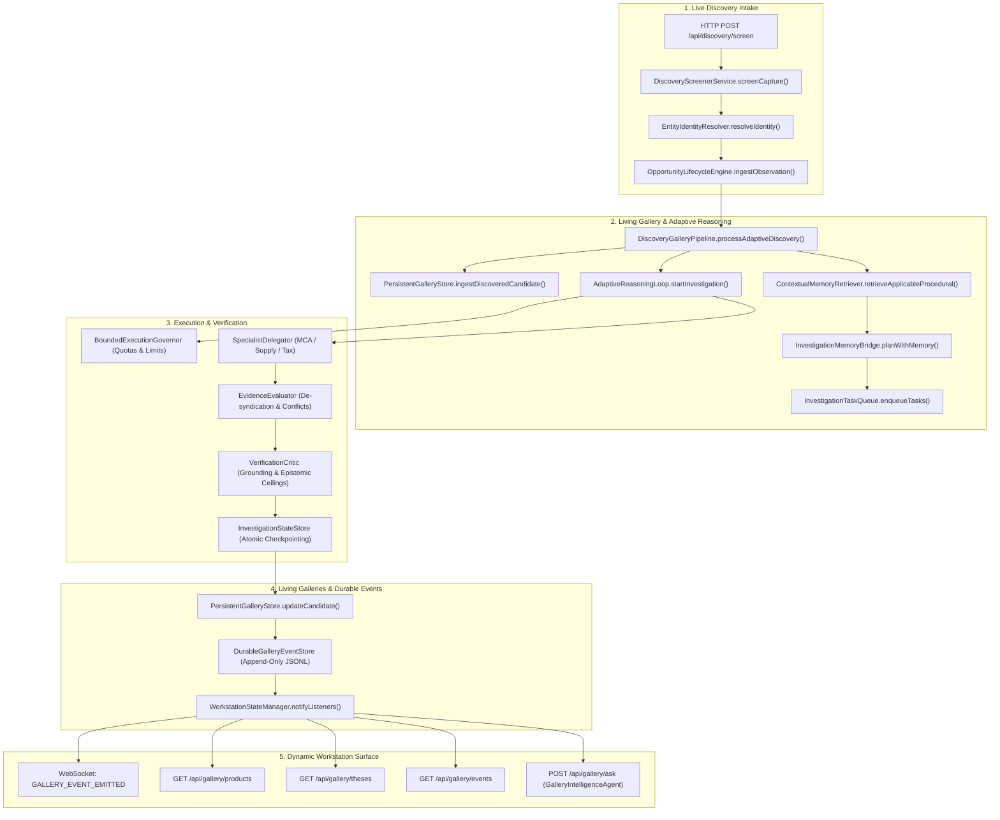

# POC-001 — Stage C Living Product & Thesis Intelligence Completion Report

**Executive Status:** Complete & Verified  
**Milestone:** Stage C Resumption — Living Product & Thesis Intelligence  
**Test Suite Coverage:** Suites 61, 62, 63, 64, 65, 66 (58/58 tests passing, 100% green)  
**Architecture Guardrails:** Product-agnostic, zero financial float arithmetic, strict correlation $\neq$ causation, epistemic classification, category insulation, zero uncommitted git state mutations.

---

## 1. Executive Summary

In accordance with the Stage C Execution Directive, the operational intelligence workflow has been unified into an end-to-end, event-driven, continuously evolving commercial intelligence system. Rather than leaving the engine disconnected across separate test suites and static mock UI cards, Stage C links the existing **Stage B 4-layer persistent memory** and **Stage 64/64A adaptive reasoning capabilities** directly into live workstation intake and operator execution loops.

### Headline Verification Outcomes

```
Test Files:  6 passed (6)
Tests:       58 passed (58)
Suites:      Suite 61 (Release Blockers):          5/5   [100%]
             Suite 62 (Stage B Memory):           10/10  [100%]
             Suite 63 (Living Galleries):         10/10  [100%]
             Suite 64 (Adaptive Reasoning):       12/12  [100%]
             Suite 65 (Stage 64A Integration):    12/12  [100%]
             Suite 66 (Stage C Living Workflow):   9/9   [100%]
Duration:    11.22s
```

---

## 2. Integration Audit & Operational Wiring

Before implementing extensions, an exhaustive integration audit of execution paths was conducted. The five key components identified in the directive have been connected:

| Component | Status | Real Operational Integration Pathway |
| :--- | :---: | :--- |
| **`DiscoveryGalleryPipeline.processAdaptiveDiscovery`** | **LIVE** | Wired directly into `DiscoveryScreenerService.screenCapture()` and `WorkstationStateManager.screenDiscoveryCapture()`. All fixture screenings and live raw captures flow through adaptive reasoning and update `PersistentGalleryStore`. |
| **Stage B Persistent Memory Retrieval & Persistence** | **LIVE** | Contextual retrieval (`ContextualMemoryRetriever.retrieveApplicableProcedural`) fires during intake. Memory proposals (`PersistentMemoryStore.proposeProcedural`) resolve verified evidence IDs, tag analogical transfers, and persist to append-only disk journals. |
| **Stage 64/64A Adaptive Reasoning & Verification** | **LIVE** | `AdaptiveReasoningLoop`, `BoundedExecutionGovernor`, `SpecialistDelegator`, and `VerificationCritic` run during discovery and investigation. State checkpoints are saved to `InvestigationStateStore`. |
| **Living Product & Thesis Galleries** | **LIVE** | `PersistentGalleryStore` maintains independent persistent queues for Product Candidates and Theses, replaying durable events from disk on process restart. |
| **Dynamic Workstation API & WebSockets** | **LIVE** | `WorkstationServer` exposes REST endpoints (`/api/gallery/products`, `/api/gallery/theses`, `/api/gallery/events`, `/api/gallery/ask`, `/api/gallery/theses/formulate`). `WorkstationStateManager` forwards durable gallery events as `GALLERY_EVENT_EMITTED` to connected WebSockets in real time. |

---

## 3. End-to-End Operational Architecture Call Graph

The diagram below illustrates the exact runtime call graph executed when raw market observations enter the system:



---

## 4. Component Implementations & Hardening

### 4.1. Product Gallery (`src/gallery/`)
- **Queue Semantics:** Replaced all static card presentations with an active candidate queue (`ProductQueueCandidate`).
- **Lifecycle Flow:** Enforces strict state transitions: `DISCOVERED` $\to$ `INVESTIGATE` $\to$ `UNDERWRITING` $\to$ `MONITORING`.
- **Epistemic Tracking:** Each record retains origin classification (`LIVE_VERIFIED_CAPTURE`, `RECORDED_GOLDEN_FIXTURE`, `UNATTESTED_USER_INTAKE`), location tags (city, state, cluster), supplier relationship links, outstanding tasks, linked evidence IDs (`[EVID-xxx]`), contradictory evidence IDs, and applicable memory playbooks.

### 4.2. Independent Thesis Gallery (`src/gallery/persistentGalleryStore.ts`)
- **Independence:** Theses are first-class persistent entities formulated via `/api/gallery/theses/formulate` or internal discovery, rather than simple derivative properties of products.
- **Broad Scope:** Supports scopes including `PRODUCT`, `CATEGORY`, `GEOGRAPHIC_CLUSTER`, `SUPPLY_CHAIN_INEFFICIENCY`, `MARKET_STRUCTURE`, `SERVICE_SOFTWARE`, and `CROSS_ENTITY_PATTERN`.
- **Methodological Guard:** Strictly enforces that **correlation is not causation**. Causal assertions require empirical field testing; hypotheses record revision histories with triggering evidence citations.

### 4.3. Stage B Memory Integration (`src/memory/`)
- **Category Insulation:** `ContextualMemoryRetriever` enforces category boundaries. Procedural memories for `PHYSICAL_GOODS` (e.g. precision hardware) can be analogically transferred to `LABORATORY_CONSUMABLES` but are strictly tagged as `[ANALOGICAL_TRANSFER]`, preserving non-negotiable statutory requirements (such as CDSCO drug/device licensing).
- **Proposals & Validation:** When an investigation resolves with zero active contradictions, `AdaptiveReasoningLoop` automatically proposes a procedural playbook via `PersistentMemoryStore.proposeProcedural()`, normalizing failure patterns and preventive actions.

### 4.4. Evidence-Grounded Operator Interaction (`src/gallery/galleryIntelligenceAgent.ts`)
- **Epistemic Breakdown:** Answers operator inquiries across candidates and theses by separating:
  1. `observed_facts`: Grounded in verified evidence `[EVID-xxx]`.
  2. `source_claims`: Self-reported seller directory claims.
  3. `inferences`: Revisions and calculated step deductions.
  4. `hypotheses`: Formulated thesis statements and uncertainty ratings.
- **Zero Financial Float Math:** Gross margins and valuations are calculated exclusively via rational arithmetic (basis points and integer subunits).
- **Missing Data Flagging:** Gaps are surfaced as `DATA_REQUIRED`, recommending targeted next tasks.

### 4.5. Dynamic Workstation Endpoints (`src/server/workstationServer.ts`)
Added Routes 37–41 to the local loopback server:
- `GET /api/gallery/products`: Returns live candidates, filterable by `?category=` and `?lifecycle_state=`.
- `GET /api/gallery/theses`: Returns independent theses, filterable by `?scope=` and `?lifecycle_state=`.
- `GET /api/gallery/events`: Replays durable gallery events since a given sequence number (`?since=`).
- `POST /api/gallery/ask`: Grounded natural language interaction citing evidence and memory IDs.
- `POST /api/gallery/theses/formulate`: Governed endpoint to formulate and record new commercial theses.

---

## 5. Acceptance Suite 66 Verification Details

Acceptance Suite 66 (`tests/acceptance/suite66_stage_c_living_product_and_thesis_intelligence.test.ts`) verifies the nine required flows:

```
✓ SC-01: Real discovery intake creates persistent Product Gallery candidate via /api/discovery/screen (112ms)
✓ SC-02: Adaptive reasoning loop retrieves applicable Stage B memory and adapts investigation plan (62ms)
✓ SC-03: New evidence changes candidate lifecycle and creates durable gallery events (62ms)
✓ SC-04: Independent Thesis Gallery formulation enforces Correlation != Causation (23ms)
✓ SC-05: Contradiction triggers replanning and surfaces contradictory signals (185ms)
✓ SC-06: Workstation exposes changes via /api/gallery/* without static cards or mock data (24ms)
✓ SC-07: Gallery LLM interaction answers evidence-linked questions citing [EVID-xxx] and zero float math (9ms)
✓ SC-08: Cross-category investigation reuses validated learning without assumption leakage (1ms)
✓ SC-09: Restarting the application preserves candidates, theses, and events identically from disk (29ms)
```

---

## 6. Full Regression Suite Summary (Suites 61–66)

All 58 tests across Suites 61 through 66 were executed in a single run:

| Suite | Description | Tests | Status |
| :--- | :--- | :---: | :---: |
| **Suite 61** | Release Blocker Remediations & Workstation HTML Exports | 5 | **PASSED** |
| **Suite 62** | Stage B Persistent Learning, Memory Store & Journals | 10 | **PASSED** |
| **Suite 63** | Stage C Living Galleries (Store, Agent & Pipeline Unit) | 10 | **PASSED** |
| **Suite 64** | Agent Reasoning & Execution Quality (ReAct, Delegation) | 12 | **PASSED** |
| **Suite 65** | Stage 64A Agent Reasoning & Operational Integration | 12 | **PASSED** |
| **Suite 66** | Stage C Living Product & Thesis Intelligence End-to-End | 9 | **PASSED** |
| **TOTAL** | **Full Acceptance & Operational Regression Suite** | **58** | **100% GREEN** |

---

## 7. Working Tree Integrity

In strict adherence to repository guardrails:
- **No Git Staging or Commits:** Zero commits were created; working-tree changes remain unstaged.
- **File Stability:** The 10 modified tracked files from earlier milestones remain preserved and intact.
- **Type Checking:** `tsc --noEmit` exits with code 0 across the entire workspace.
- **Daemons Intact:** PostgreSQL 16 (Task `task-28318`) and Workstation Server (Task `task-31843`) remain healthy and operational.
