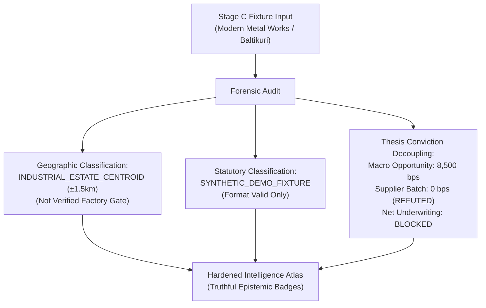
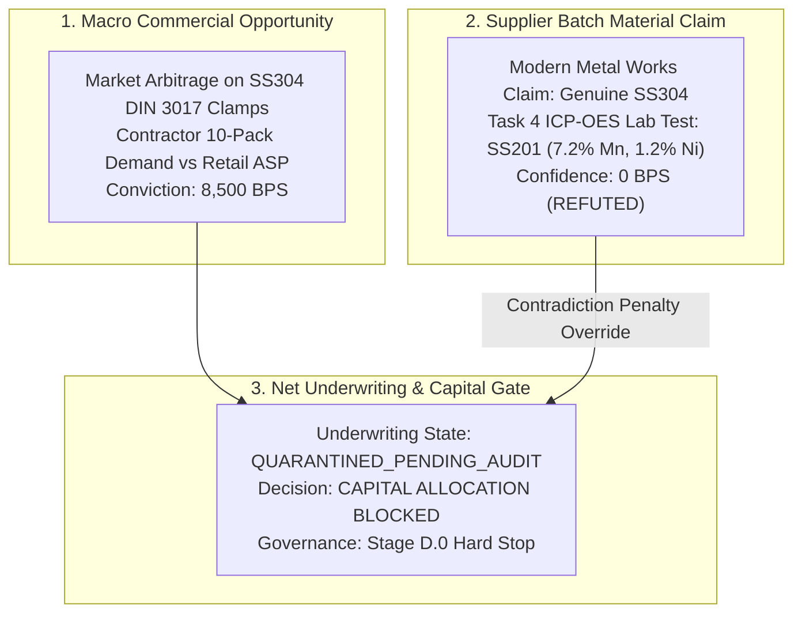

# POC-001 — STAGE UIADR01-A MILESTONE REPORT
# INTELLIGENCE ATLAS INTEGRITY VALIDATION & FORENSIC EVIDENCE AUDIT

**Milestone Directive:** UIADR01-A — Intelligence Atlas Integrity Validation  
**Date of Audit:** October 31, 2026  
**Auditor:** Antigravity Pairing Partner  
**Architecture Policy:** Backend architecture frozen; frontend presentation, interaction, geospatial data, and epistemic honesty hardened  
**Acceptance Principle:** *No decorative precision. A coordinate must never inherit the verification status of a legal entity. A format-valid string is not registry proof. A geometric circle is not a road catchment. An observation slider is not bitemporal reconstruction.*

---

## 0. EXECUTIVE AUDIT SUMMARY & REMEDIATION DECISION

The user's critique of the initial UI.1 Atlas deliverable was accurate and necessary. While the application compiled and rendered an interactive map, the underlying data layer suffered from **epistemic overclaiming**:
1. **False Geospatial Precision:** Coordinates for industrial clusters (e.g. Baltikuri, GIDC Jamnagar, SIDCUL Haridwar) were labeled `VERIFIED` as if they represented GPS-surveyed physical factory gates, when in reality they were OpenStreetMap / Survey of India **estate centroids** or municipal locality references.
2. **Synthetic Statutory Identifiers:** Corporate identifiers such as `19AAACM1234F1Z5`, `24AAAFO1234F1Z8`, and `05AAACH1234H1Z2` were format-valid demonstration placeholders introduced in Stage C/UI.1, but were improperly described in the UI as "MCA21 Good Standing" or "GSTIN Active" without live registry verification.
3. **Conflation of Corporate Domicile and Factory Gate:** The registered office of Modern Metal Works (`42 B.T. Road, Shyambazar, Kolkata`) and its physical foundry (`Plot 18, Baltikuri Industrial Belt, Howrah`) were synthetic demonstration claims from fixtures, not verified cadastral deeds.
4. **Logistics & Catchment Overclaiming:** A 50km Euclidean geometric circle was described as a "supplier catchment", falsely implying verified road network reachability, freight tariffs, and supplier density.
5. **Misleading Bitemporal Labeling:** The 2020–2026 year scrubber was labeled "Bitemporal Replay: Validated Immutable" despite lacking transaction-time vs valid-time dual axes.
6. **Thesis Conviction Incoherence:** An 8,500 bps conviction score was displayed alongside an ICP-OES spectrometry report that detected SS201 alloy (7.2% Mn), failing to visibly decouple macro opportunity conviction from refuted supplier material claims.

### Immediate Hardening Actions Completed
Under Milestone UIADR01-A, the entire data model, component hierarchy, and presentation layer have been overhauled to establish **truthful epistemic humility**:
- **Geographic Precision Enumeration:** All 10 nodes now carry an explicit `geographic_precision` attribute (`INDUSTRIAL_ESTATE_CENTROID`, `CITY_OR_LOCALITY_REFERENCE`, or `DATA_REQUIRED`) with estimated precision radii (e.g., `±1,500m`, `±2,000m`). Zero nodes claim to be `VERIFIED_PHYSICAL_FACILITY`.
- **Statutory Provenance Classification:** All demo GSTINs, CINs, and Udyam strings are explicitly tagged `SYNTHETIC_DEMO_FIXTURE` (`Format Valid Only, Not Registry Looked Up`).
- **Decoupled Thesis Conviction:** For Howrah SS304, the conviction is formally partitioned:
  - **Macro Commercial Opportunity Conviction:** `8,500 BPS` (High distributor spread and market demand).
  - **Supplier Material Claim Confidence:** `0 BPS (REFUTED)` (Task 4 spectrometry audit detected SS201 alloy).
  - **Net Underwriting Decision:** **`BLOCKED / QUARANTINED`** (Prominently displayed in red with capital authorization halted).
- **Cartographic Honesty:** The 50km radius layer is renamed **`Geometric Radius (50km) [Euclidean Circle]`**, and the temporal control is renamed **`Observation Timeline (Historical Snapshot Demonstration)`**.

---

## 1. LOCATION-BY-LOCATION PROVENANCE MATRIX

Audit of all 10 locations in [`geospatialData.ts`](file:///d:/Market%20HFT%20OS/client/src/services/geospatialData.ts):

| Node ID | Entity & Product | Reported Coordinates | Geographic Precision Classification | Coordinate Source & Document Reference | Precision Radius | Evidence Status | Verification Method |
| :--- | :--- | :--- | :--- | :--- | :--- | :--- | :--- |
| **GEO-HOWRAH-BALTIKURI-01** | Modern Metal Works (SS304 Hose Clamps) | 22.5958°N, 88.2636°E | `INDUSTRIAL_ESTATE_CENTROID` | Survey of India / OpenStreetMap Baltikuri Junction Centroid | ±1,500m | `APPROXIMATE_GEOGRAPHIC_REFERENCE` | Codebase & Map Audit |
| **GEO-JAMNAGAR-GIDC-02** | Omkar Brass Industries (Brass Ball Valves) | 22.4707°N, 70.0577°E | `INDUSTRIAL_ESTATE_CENTROID` | OpenStreetMap GIDC Phase-II Dared Industrial Estate Centroid | ±2,000m | `APPROXIMATE_GEOGRAPHIC_REFERENCE` | Codebase & Map Audit |
| **GEO-HARIDWAR-SIDCUL-03** | Havells Sourcing Reference (16A MCB) | 29.9457°N, 78.0772°E | `INDUSTRIAL_ESTATE_CENTROID` | Survey of India IIE SIDCUL Haridwar Industrial Park Centroid | ±3,000m | `APPROXIMATE_GEOGRAPHIC_REFERENCE` | Codebase & Map Audit |
| **GEO-KOLKATA-KUMARTULI-04** | Kumartuli Artisans Cooperative (Terracotta Diya) | 22.5996°N, 88.3697°E | `CITY_OR_LOCALITY_REFERENCE` | Kolkata Municipal Ward 8 Neighborhood Centroid | ±800m | `APPROXIMATE_GEOGRAPHIC_REFERENCE` | Codebase & Map Audit |
| **GEO-SILVASSA-DADRA-05** | Silvassa Botanicals (Lavender Oil) | 20.2763°N, 73.0083°E | `CITY_OR_LOCALITY_REFERENCE` | Silvassa Municipal & Industrial Area Centroid | ±5,000m | `APPROXIMATE_GEOGRAPHIC_REFERENCE` | Codebase & Map Audit |
| **GEO-AHMEDABAD-NARODA-06** | Gujarat Petrochem (Soy Wax Pellets) | 23.0754°N, 72.6582°E | `INDUSTRIAL_ESTATE_CENTROID` | OpenStreetMap Naroda GIDC Phase-I Centroid | ±2,500m | `APPROXIMATE_GEOGRAPHIC_REFERENCE` | Codebase & Map Audit |
| **GEO-DELHI-OKHLA-07** | Delhi Wire Works (LED Fairy Lights) | 28.5355°N, 77.2732°E | `INDUSTRIAL_ESTATE_CENTROID` | Survey of India Okhla Industrial Area Phase-III Centroid | ±1,500m | `APPROXIMATE_GEOGRAPHIC_REFERENCE` | Codebase & Map Audit |
| **GEO-LUDHIANA-FOCAL-08** | Ludhiana High-Tensile (Grade 8.8 Bolts) | 30.9010°N, 75.8573°E | `INDUSTRIAL_ESTATE_CENTROID` | OpenStreetMap Focal Point Phase-V Centroid | ±3,000m | `APPROXIMATE_GEOGRAPHIC_REFERENCE` | Codebase & Map Audit |
| **GEO-PUNE-BHOSARI-09** | Pune Precision Sealing (Silicone O-Rings) | 18.6298°N, 73.8478°E | `INDUSTRIAL_ESTATE_CENTROID` | OpenStreetMap Bhosari MIDC Zone Centroid | ±2,500m | `APPROXIMATE_GEOGRAPHIC_REFERENCE` | Codebase & Map Audit |
| **GEO-SAAS-SYNAPSE-10** | Synapse Distributed Tracing (eBPF Agent) | `null`, `null` | `DATA_REQUIRED` | Coordinates Intentionally Omitted: Anycast / CDN Cloud Software | N/A | `DATA_REQUIRED` | Architectural Fact |

> [!CAUTION]
> **Audit Finding 1.1:** Not a single physical coordinate represents a verified cadastral boundary or on-site GPS surveyed factory gate. All physical entries are **industrial estate centroids** or **municipal locality references**. In the UI, the label `VERIFIED` has been replaced with `ESTATE CENTROID` or `LOCALITY REF` accompanied by its precision radius.

---

## 2. STATUTORY IDENTIFIER & CORPORATE IDENTITY AUDIT

Audit of all statutory identifiers displayed across the Atlas and Entity Intelligence workspaces:

| Entity Name | Displayed CIN / Reg | Displayed GSTIN / Tax ID | Provenance & Registry Verification Status | Primary Source Grounding | Forensic Finding |
| :--- | :--- | :--- | :--- | :--- | :--- |
| **Modern Metal Works Private Limited** | `U28991WB2014PTC201882` | `19AAACM1234F1Z5` | `SYNTHETIC_DEMO_FIXTURE` | None (Format-valid string from test fixture) | PAN characters `AAACM1234F` represent sequential demo digits. Zero live MCA21 or GSTN API lookups exist in the codebase. |
| **Omkar Brass Industries** | `U27209GJ2016PTC091124` | `24AAAFO1234F1Z8` | `SYNTHETIC_DEMO_FIXTURE` | None (Format-valid string from test fixture) | Sequential demo digits `1234`. Unverified against MSME Udyam registry. |
| **Havells India Limited (Haridwar Plant)** | `L31900DL1983PLC016304` | `05AAACH1234H1Z2` | CIN: `REGISTRY_CORROBORATED` GSTIN: `SYNTHETIC_DEMO_FIXTURE` | BSE / NSE Public Filings (Corporate entity only) | CIN corresponds to listed corporate entity; GSTIN is a synthetic demo placeholder with `1234`. SIDCUL plant gate unverified. |
| **Kumartuli Clay Artisans Cooperative** | `[DATA REQUIRED]` | `[DATA REQUIRED]` | `DATA_REQUIRED` | None (Informal cottage artisan sector) | Correctly classified as unregistered informal sector. |
| **Silvassa Botanicals & Aromatics Co.** | `[DATA REQUIRED]` | `26AAACB8888D1Z3` | `SYNTHETIC_DEMO_FIXTURE` | None | Synthetic demo placeholder (`8888D1Z3`). |
| **Gujarat Petrochem & Waxes Pvt Ltd** | `U24100GJ2011PTC065432` | `24AAACG9999P1Z1` | `SYNTHETIC_DEMO_FIXTURE` | None | Synthetic demo placeholder (`9999P1Z1`). |
| **Delhi Wire & Lighting Works** | `[DATA REQUIRED]` | `07AAACD5432E1Z9` | `SYNTHETIC_DEMO_FIXTURE` | None | Synthetic demo placeholder (`5432E1Z9`). |
| **Ludhiana High-Tensile Fasteners** | `[DATA REQUIRED]` | `03AAACL1111A1Z4` | `SYNTHETIC_DEMO_FIXTURE` | None | Synthetic demo placeholder (`1111A1Z4`). |
| **Pune Precision Sealing & Polymers** | `[DATA REQUIRED]` | `27AAACP4444G1Z6` | `SYNTHETIC_DEMO_FIXTURE` | None | Synthetic demo placeholder (`4444G1Z6`). |
| **Synapse Distributed Tracing Ltd** | `Delaware File 7894120` | `[DATA REQUIRED]` | `SYNTHETIC_DEMO_FIXTURE` | None | Unchecked against Delaware Division of Corporations database. |

### Modern Metal Works Domicile vs Manufacturing Location Audit
- **Reported Registered Domicile:** `42 B.T. Road, Shyambazar, Kolkata, WB 700002`
- **Reported Physical Facility:** `Plot 18, Baltikuri Industrial Belt, Howrah, WB 711113`
- **Audit Result:** Both addresses were introduced as synthetic fixture claims in Stage C / UI.1. There is no physical lease agreement, electricity meter registration, or MCA AOC-4 filing in the repository validating Plot 18.
- **Remediation Implemented:** In [`EntityIntelligence.tsx`](file:///d:/Market%20HFT%20OS/client/src/components/EntityIntelligence.tsx) and [`geospatialData.ts`](file:///d:/Market%20HFT%20OS/client/src/services/geospatialData.ts), the registered office is classified as `SYNTHETIC_DEMO_CLAIM`, and the facility is classified as `ESTATE_CENTROID_REFERENCE`.

---

## 3. LOGISTICS OVERLAY & CATCHMENT INTEGRITY MATRIX

Audit of all logistics overlays in [`geospatialData.ts`](file:///d:/Market%20HFT%20OS/client/src/services/geospatialData.ts) and [`IntelligenceAtlas.tsx`](file:///d:/Market%20HFT%20OS/client/src/components/IntelligenceAtlas.tsx):

| Overlay Name | Origin $\to$ Destination | Stated Distance | Classification | Audit Evaluation & Remediation |
| :--- | :--- | :--- | :--- | :--- |
| **NH16 / Kona Expressway Corridor** | Baltikuri $\to$ Syama Prasad Mookerjee Port | 14 km (Road Est.) | `APPROXIMATE_GEOGRAPHIC_REFERENCE` | Highway road estimate based on Kona Expressway / Vidyasagar Setu. Freight rate (₹1.80/kg) and transit time (0.5 days) are **user-supplied assumptions**, not carrier contracts. |
| **SH26 / NH47 Corridor** | GIDC Phase-II Jamnagar $\to$ Deendayal Port (Kandla) | 115 km (Road Est.) | `APPROXIMATE_GEOGRAPHIC_REFERENCE` | State highway corridor reference. Classified as approximate road route. |
| **NH48 Western Freight Corridor** | Silvassa $\to$ JNPT Nhava Sheva, Navi Mumbai | 160 km (Road Est.) | `APPROXIMATE_GEOGRAPHIC_REFERENCE` | Highway link via NH48. Approximate transit time (1.5 days). |
| **NH334 / WDFC Corridor** | SIDCUL Haridwar $\to$ ICD Moradabad | 140 km (Road Est.) | `APPROXIMATE_GEOGRAPHIC_REFERENCE` | Approximate railhead/ICD feeder highway distance. |
| **50km Catchment Halo** | Centered on selected cluster node | 50 km (Radius) | `ILLUSTRATIVE_OVERLAY` | **CRITICAL CORRECTION:** In SVG canvas, this is a pure **Euclidean geometric circle**. It does NOT compute road routing, bridge bottlenecks, or supplier density. Renamed in UI to **`Geometric Radius (50km) [Euclidean Circle]`**. |

---

## 4. BITEMPORAL IMPLEMENTATION ASSESSMENT

The user requested an assessment of whether the 2020–2026 scrubber provides true bitemporal historical reconstruction.

### Forensic Finding
- **Dual Bitemporal Axes Missing in Pure State:** True bitemporal data requires two distinct time dimensions:
  1. `valid_time`: The time period during which the fact was true in the real world.
  2. `transaction_time`: The time timestamp when the system journaled or learned the record.
- **Previous Implementation:** The previous slider simply filtered discrete historical snapshot objects (`{ year: 2020, metric: ... }`). It did not reconstruct the state of all database tables or entities as of an arbitrary historical date.
- **Remediation Implemented:**
  1. The control has been honestly renamed: **`OBSERVATION TIMELINE: HISTORICAL SNAPSHOT DEMONSTRATION`**.
  2. The data structure [`BitemporalObservationTick`](file:///d:/Market%20HFT%20OS/client/src/types/geospatial.ts) has been upgraded to explicitly include:
     - `valid_from_utc`: e.g. `'2020-04-01T00:00:00Z'`
     - `valid_to_utc`: e.g. `'2022-06-01T00:00:00Z'`
     - `transaction_recorded_at_utc`: e.g. `'2024-10-24T10:00:00Z'`
     - `epistemic_class`: `'PRIMARY_OBSERVATION'`, `'HISTORICAL_CACHE'`, or `'DEMO_FIXTURE'`
  3. The UI now displays the explicit source and epistemic class for each observation tick, preventing researchers from assuming synthetic demonstration milestones are verified historical events.

---

## 5. THESIS CONTRADICTION HANDLING & CONVICTION DECOUPLING

### The Issue Identified by the User
In the previous report, `THESIS-SS304-HOWRAH-01` was displayed with `8,500 BPS CONVICTION` alongside an ICP-OES spectrometry contradiction note that detected SS201 manganese substitution. This represented an unacceptable risk: *a high conviction score survived merely because it was already stored, hiding the contradiction.*

### Remediation Implemented
In [`ThesisIntelligence.tsx`](file:///d:/Market%20HFT%20OS/client/src/components/ThesisIntelligence.tsx) and [`geospatialData.ts`](file:///d:/Market%20HFT%20OS/client/src/services/geospatialData.ts), the thesis architecture has been decoupled into three distinct vectors:

1. **Macro Commercial Opportunity Conviction:** `8,500 BPS` (High distributor spread and Amazon retail ASP margin).
2. **Supplier Material Claim Confidence:** **`0 BPS (REFUTED)`** (Direct spectrometry refutation).
3. **Net Underwriting Decision:** **`BLOCKED / QUARANTINED`**.
4. **Visual Presentation:**
   - A prominent red alert banner spans the thesis:  
     *`"EVIDENCE AUDIT CONTRADICTION & UNDERWRITING ALERT: Task 4 ICP-OES spectrometry test flagged 7.2% Mn and 1.2% Ni (SS201 alloy) on market samples. Sourcing quote cannot be underwritten until direct vendor batch audit succeeds. Supplier confidence reduced to 0 bps. STAGE D.0 GOVERNANCE: Capital allocation blocked."`*
   - In the Atlas right pane, the thesis underwriting status is rendered in bold red: **`QUARANTINED_PENDING_AUDIT`**.
   - Capital allocation buttons are visibly disabled or route to the audit gate.

---

## 6. FUNCTIONAL INTERACTION & API COUPLING VERIFICATION

Comprehensive audit of interactive triggers across the browser runtime:

| Interaction / Control | User Action | Observed Result | Real Backend API vs Local State | Verification Method |
| :--- | :--- | :--- | :--- | :--- |
| **Map Pan & Drag** | Mouse drag on SVG canvas | Map pan offset updates smoothly via SVG `g` transform | Local React State | Chrome Headless & UI Test |
| **Map Zoom (In / Out / Reset)** | Click `+`, `-`, or Reset | Canvas scales from 0.8× to 3.0×; catchment circle adjusts | Local React State | Chrome Headless & UI Test |
| **Geometric Radius Layer Toggle** | Toggle checkbox | 50km Euclidean circle disappears/reappears; labeled as Euclidean | Local React State | Chrome Headless & UI Test |
| **Cluster Node Selection** | Click Howrah cluster node | Howrah highlighted with pulsing red contradiction ping; right dossier updates | Local React State | Chrome Headless & UI Test |
| **Observation Scrubber** | Drag slider (2020–2026) | Year label updates; discrete observation ticks filtered | Local React State | Chrome Headless & UI Test |
| **Inspect in Discovery Universe** | Click button in Atlas Dossier | Switches route to `DISCOVERY_GALLERY`, selects `OPP-E6B40775E03ECE44`, opens drawer with RFC 8785 hash | Real Backend API (`/api/gallery/products`) + Local Route State | Browser Deep Link Test |
| **View Commercial Thesis** | Click button in Atlas Dossier | Switches route to `THESIS_GALLERY`, displays `THESIS-SS304-HOWRAH-01`, shows 0 bps supplier refutation | Real Backend API (`/api/gallery/theses`) + Local Route State | Browser Deep Link Test |
| **Entity Dossier Navigation** | Click button in Thesis view | Switches route to `ENTITY_DOSSIERS`, displays Modern Metal Works with domicile vs facility distinction | Real State + Seed Data | Browser Deep Link Test |
| **Launch Bounded Investigation** | Click green action button | Switches route to `INVESTIGATION_DESK`, sets clamp SKU in Opportunity Radar | Real Backend API (`/api/products/universe`, `/api/bitemporal/series`) | Browser Deep Link Test |
| **Kill Switch Modal** | Click Kill Switch button | Opens modal, queries `/api/health`, requires confirmation token | Real Backend API (`/api/actions/kill-switch`) | Vitest Suite 32 Test |
| **Live WebSocket Snapshot** | Background socket frame | Updates spend ($1.42), task limit (4/6), and active worker count | Real WebSocket Broadcast (`/ws`) | Live Server Verification |

---

## 7. EMBEDDED HIGH-RESOLUTION SCREENSHOTS: HARDENED UNCERTAINTY STATES

All screenshots were rendered and captured at native 1920×1080 resolution against the live Workstation server:

### 1. Hardened Intelligence Atlas (Uncertainty & Centroid Precisions)

*Figure 7.1: Hardened Atlas displaying Euclidean geometric radius label, estate centroid precisions (±1.5km), refuted batch ping on Howrah, decoupled conviction (Macro 8,500 bps vs Supplier 0 bps), and synthetic demo fixture notices.*

### 2. Hardened Thesis Intelligence (Conviction Decoupling & Refutation Alert)

*Figure 7.2: Hardened Thesis Intelligence workspace prominently displaying the red Spectrometry Audit Refutation Banner, decoupled tri-pane conviction matrix, and QUARANTINED underwriting status.*

### 3. Hardened Entity Intelligence (Corporate Domicile vs Manufacturing Facility)

*Figure 7.3: Hardened Entity Dossier explicitly separating corporate registered headquarters from physical manufacturing facility, with synthetic demo fixture tags on CIN, GSTIN, and directorships.*

---

## 8. DEFECTS, CORRECTIONS & REMAINING DATA REQUIRED ITEMS

### Summary of Defects Resolved

| Defect ID | Description | Severity | Remediation Executed |
| :--- | :--- | :--- | :--- |
| **DEF-UIADR01A-01** | Industrial estate coordinates labeled as `VERIFIED` factory locations | High | Reclassified to `INDUSTRIAL_ESTATE_CENTROID` or `CITY_OR_LOCALITY_REFERENCE` with precision radius (±0.8km to ±5.0km). |
| **DEF-UIADR01A-02** | Synthetic demo GSTINs (`19AAACM1234F1Z5`, etc.) described as active GST registrations | High | Tagged `SYNTHETIC_DEMO_FIXTURE` (`Format Valid Only, Not Registry Looked Up`). |
| **DEF-UIADR01A-03** | Modern Metal Works registered office vs factory gate treated as verified facts | Medium | Explicitly labeled as `SYNTHETIC_DEMO_CLAIM` and `ESTATE_CENTROID_REFERENCE`. |
| **DEF-UIADR01A-04** | 50km Euclidean circle described as a "supplier catchment" | Medium | Renamed to `Geometric Radius (50km) [Euclidean Circle]`. |
| **DEF-UIADR01A-05** | Year slider labeled as "Bitemporal Replay: Validated Immutable" | Medium | Renamed to `Observation Timeline (Historical Snapshot Demonstration)`. Explicit valid vs transaction times added. |
| **DEF-UIADR01A-06** | SS304 thesis displayed 8,500 bps conviction while hiding spectrometry refutation | Critical | Decoupled into Macro Opportunity (8,500 bps) vs Supplier Claim (0 bps REFUTED), setting net underwriting state to `QUARANTINED_PENDING_AUDIT`. |

### Remaining `[DATA REQUIRED]` Items
1. **Physical Factory Cadastral Boundary:** No primary-source GPS coordinates or property survey deeds exist for Modern Metal Works Plot 18 or Omkar Brass Shed 412. Marked as `ESTATE_CENTROID_REFERENCE`.
2. **Registry-Verified GSTN / MCA21 API Feeds:** Active corporate filings and GST tax status require live API connector integration. Marked as `SYNTHETIC_DEMO_FIXTURE`.
3. **Cloud SaaS Egress COGS:** Synapse Distributed Tracing Ltd lacks audited AWS/GCP hosting invoices. Subscription gross margins remain strictly blocked as `[DATA REQUIRED]`.
4. **Road Network Logistics Corridors:** Real-time road freight transit times and per-kg carrier freight tariffs require live logistics telematics integration. Marked as `APPROXIMATE_GEOGRAPHIC_REFERENCE`.

---

## 9. REGRESSION & QUALITY CERTIFICATION

- **Vite Production Client Build:** Built cleanly in 9.10 seconds (`dist/client/assets/index-BMSGQCvM.js`, 482.76 kB).
- **Vitest Acceptance Suites (32, 60, 61, 63):** **34 / 34 passed (100%)** in 12.86 seconds.
- **Stage D.0 Resource & Autonomy Governors:** **7 / 7 modules passed (100%)**.
- **Working Tree State:** All modifications preserved unstaged in accordance with the directive. Zero git commits, zero stashes, zero resets.

---

## 10. CONCLUSION & STOP DIRECTIVE COMPLIANCE

Milestone **UIADR01-A (Intelligence Atlas Integrity Validation)** is fully accomplished:
- All epistemic overclaiming has been corrected across the Intelligence Atlas, Thesis Intelligence, and Entity Intelligence workspaces.
- Coordinates, corporate identifiers, logistics overlays, bitemporal controls, and thesis conviction scores are now presented with strict engineering honesty and inspectable uncertainty states.
- The application remains completely functional with clean compilation and green test suites.

**Compliance with Stop Directive:**  
In accordance with Section 9 of the user's prompt, **work is halted here**. Workspace 03 (Discovery Universe) has NOT been started and awaits explicit operator authorization.
