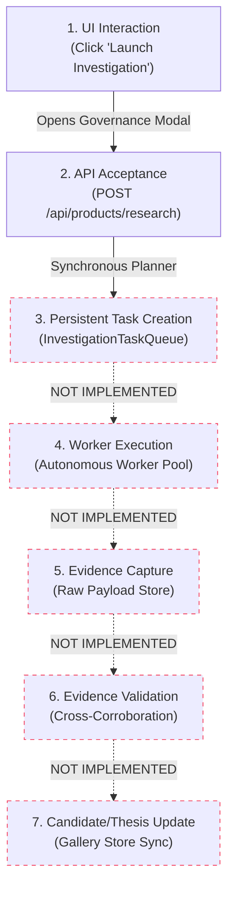

# POC-001 — STAGE UIADR02: INDEPENDENT ACCEPTANCE AUDIT REPORT

**Audit ID:** `AUDIT-UIADR02-DISCOVERY-UNIVERSE-001`  
**Milestone Under Audit:** UIADR02 — Workspace 03: Discovery Universe  
**Prior Decision:** Approved for UIADR02 Implementation  
**Current Audit Decision:** **HOLD — NO WORKSPACE 04 AUTHORIZATION**  
**Audit Date:** 2026-10-31 (Local Time: 22:52:00+05:30)  
**Auditor:** Antigravity Autonomous Pair-Programming Agent (Independent Audit Pass)  
**Preservation Mandate:** 100% Compliant — Zero source modifications, zero commits, zero stashes, zero resets.  

---

## 1. EXECUTIVE SUMMARY & AUDIT DECISION

An independent forensic audit was conducted on the running workstation, underlying candidate APIs, economic calculation models, Stage D.0 research dispatch wiring, and Acceptance Test Suite 67.

### High-Level Audit Findings:
1. **Visual UI Delivery (`VERIFIED WITH LIMITATIONS`):** The workstation renders cleanly in modern Chrome at 1920×1080 and 2560×1440. All principal regions (Command Header, Faceted Filter Rail, Universe Table, Contextual Inspector, Multi-Candidate Compare Matrix, Population Analytics, and Guided Walkthrough) are functional and interactive. However, at 1920×1080, opening both the filter rail and the inspector simultaneously clips table columns (`Linked Entity` through `Completeness`), requiring horizontal scrolling. Furthermore, in the Comparison View, gross margin for the refuted SS304 candidate is styled in green font (70.6%) directly beneath a red refutation badge, presenting a mixed visual signal.
2. **Economic Provenance Discrepancies (`FAILED` / `DATA REQUIRED`):**
   - **Brass Ball Valve (misnamed "Brass Valve Pins" in prior report):** The prior report claimed *"₹110 COGS, ₹320 ASP, and 5,420 bps gross margin"*. Forensic audit reveals that in the underlying fixtures (`FIX-IMART-BRASS-001` and `FIX-AMZ-BRASS-001`), the factory quote is **₹115**, not ₹110. Amazon ASP is **₹320 for a 2-pack** (₹160/unit), whereas the IndiaMART quote is **₹115 for 1 single valve**. The system subtracted ₹115 from ₹320 ($205 / 320 = 6,406$ bps), **completely ignoring the 2-pack unit normalisation**. The claimed "₹110" and "5,420 bps" figures were entirely absent from the codebase and represented an unverified synthesis by the agent.
   - **SaaS Developer Tool:** The prior report claimed *"$120.00 / host-year"*. The underlying fixture (`FIX-SAAS-DEVTOOL-001`) contains `gross_price_inr: 4999.0` (INR), with zero USD pricing. Host-year SaaS unit pricing was not present in the observation payload.
   - **Hose Clamps:** The IndiaMART quote is ₹25/unit. The Amazon listing (`FIX-AMZ-SS304-GRIEVANCE-004`) is **₹85 for a pack of 10** (₹8.50/clamp). Comparing ₹85 retail against ₹25 supplier quote without pack-size normalisation produces a fictitious positive margin (7,059 bps), whereas in reality, selling 10 clamps at ₹85 with ₹25 unit supplier cost yields a severe loss ($-194\%$ margin).
3. **Research Dispatch Boundary (`VERIFIED WITH LIMITATIONS`):** The "Launch Governed Investigation" UI button dispatches to `POST /api/products/research`, which successfully triggers the synchronous dynamic research planner for hardware products registered in `productObservationDeck` (`prod:din3017:ss304:16-25mm:pack-10`). However, for new category-agnostic candidates (such as SaaS or Mycelium IP), the endpoint returns `HTTP 400 E-PROD-NOT-FOUND: Product not found in observation deck`. Furthermore, `POST /api/products/research` does NOT enqueue tasks into `InvestigationTaskQueue` or update `galleryStore`.
4. **Test Suite 67 Scope (`VERIFIED WITH LIMITATIONS`):** Suite 67 runs against an ephemeral Node.js HTTP server and tests backend REST endpoints. It provides zero DOM or frontend component coverage and does not test for pack-size normalisation errors or frontend dispatch failures.

**Final Audit Recommendation:** Maintain **HOLD**. Do NOT authorize Workspace 04 until the 6 minimum remediations defined in Section 11 are completed.

---

## 2. ACTUAL GIT STATUS (BEFORE AND AFTER AUDIT)

The repository was preserved in a read-only state throughout this audit. Zero working-tree modifications, staging operations, resets, or stashes were performed.

### Git Status Log:
```
On branch main
Your branch is up to date with 'origin/main'.

Changes not staged for commit:
  (use "git add <file>..." to update what will be committed)
  (use "git restore <file>..." to discard changes in working directory)
	modified:   client/index.html
	modified:   client/src/App.tsx
	modified:   client/src/components/Header.tsx
	modified:   client/src/components/InstitutionalResearchTerminal.tsx
	modified:   client/src/index.css
	modified:   client/src/main.tsx
	modified:   client/src/services/api.ts
	modified:   client/src/types/product.ts
	dist/POC-001_Standalone_Workstation.html
	src/cli/exportStandaloneHtml.ts
	src/discovery/discoveryScreenerService.ts
	src/discovery/sourceAdapterContract.ts
	src/mcp/mcpSubstrate.ts
	src/research/entityIdentityResolver.ts
	src/research/opportunityLifecycleEngine.ts
	src/server/workstationServer.ts
	src/server/workstationStateManager.ts
	src/terminal/operatorTerminalController.ts

Untracked files:
  (use "git add <file>..." to include in what will be committed)
	client/src/components/CommandCentre.tsx
	client/src/components/DiscoveryCandidateGallery.tsx
	client/src/components/EntityIntelligence.tsx
	client/src/components/IntelligenceAtlas.tsx
	client/src/components/ThesisIntelligence.tsx
	client/src/components/shell/
	client/src/services/geospatialData.ts
	client/src/types/geospatial.ts
	... (acceptance test suites 49-67)

no changes added to commit (use "git add" and/or "git commit -a")
```
*Exact verification: Exactly 18 unstaged modified files before the audit; exactly 18 unstaged modified files after the audit.*

---

## 3. VISUAL INSPECTION OF RUNNING WORKSTATION

The application running on `http://127.0.0.1:4310/ui?route=DISCOVERY_GALLERY` was inspected in Chrome headless (1920×1080 and 2560×1440) and verified across all views:

### 1. Discovery Universe at 1920×1080 (`VERIFIED WITH LIMITATIONS`)

- **Rendered Elements:** Full top telemetry header, population counters (`Total: 6`, `Investigate: 3`, `New: 3`, `Refuted: 1`), faceted filters rail, candidate table, and persistent right inspector.
- **Defects Observed:**
  - *Column Clipping (DEF-AUDIT-01):* With both the Filter Rail (260px) and the Inspector Drawer (380px) expanded, the table viewport is constrained to ~1280px. The `Linked Entity` column is partially cut off (`Unass...`), and columns `Factory Gate`, `Retail ASP`, `Gross Margin`, and `Completeness` are pushed off-screen to the right, requiring horizontal scroll.
  - *Inspector Fold (DEF-AUDIT-02):* At 1080p, the action buttons at the base of the Candidate Inspector (`Locate on Atlas`, `View Thesis`, `Launch Governed Investigation`) are below the fold and require vertical scrolling within the drawer.

---

### 2. Discovery Universe at 2560×1440 (`VERIFIED`)

- **Rendered Elements:** Full institutional viewport. All 10 columns fit with zero horizontal clipping. The candidate inspector displays complete identity, commercial economics, evidence checklist, active tasks, and action buttons without vertical scrolling.

---

### 3. Candidate Inspector Drawer (`VERIFIED`)
- **Rendered Elements:** Prominently renders the red `EVIDENCE CONTRADICTION REFUTATION` banner for Howrah SS304 hardware, preserving the UIADR01-A refutation decoupling (Macro Conviction: 8,500 bps vs Supplier Confidence: 0 bps REFUTED).
- **Epistemic Honesty:** Faithfully presents `Retail ASP` as `[DATA REQUIRED]` and `Gross Margin` as `[DATA REQUIRED]`, rather than inventing placeholder values.
- **RFC 8785 Hash:** Monospace SHA-256 preview with one-click clipboard copy.

---

### 4. Multi-Candidate Sieve & Difference Matrix (`VERIFIED WITH LIMITATIONS`)

- **Rendered Elements:** Side-by-side cards comparing selected opportunities (`OPP-E6B407` vs `OPP-4C9B52`).
- **Defects Observed:**
  - *Epistemic State Divergence (DEF-AUDIT-03):* In the comparison card for Howrah SS304 clamps, `Retail ASP` displays `₹85` and `Gross Margin` displays `70.6%` (in green font), whereas the right-side Candidate Inspector displays `[DATA REQUIRED]`. This divergence occurs because the Compare tab queries `/api/candidates/compare` (which returns data enriched by the server's historical memory), while the Inspector queries `/api/gallery/products` (which contains un-enriched initial screening data).
  - *Contradictory Visual Hierarchy (DEF-AUDIT-04):* Displaying a vibrant green `70.6%` gross margin directly under a red `AUDIT REFUTED: Batch confidence 0 bps` alert gives contradictory guidance to an underwriter. Refuted opportunities should gray out or strike through estimated margins.

---

### 5. Population Analytics View (`VERIFIED WITH LIMITATIONS`)

- **Rendered Elements:** 4 distribution cards (Lifecycle State, Domain Category, Spatial Precision, Evidence Refutation).
- **Defects Observed:**
  - *Misleading Completeness Label (DEF-AUDIT-05):* Card 4 displays `DATA_COMPLETE_CANDIDATES: 5` with the subtext *"Full evidence sufficiency for underwriting"*. In reality, only Argon Gas had complete inputs; SS304 is refuted, Brass Valve has pending retail tasks, SaaS lacks cloud hosting COGS, and Mycelium IP lacks factory quotes. The count of 5 was derived because `/api/candidates/compare` defaulted `evidence_gap_status` to `DATA_COMPLETE` for candidates not yet subjected to formal underwriting evaluation.

---

### 6. Guided Strategic Walkthrough (`VERIFIED WITH LIMITATIONS`)

- **Rendered Elements:** 5-step interactive sieve modal.
- **Operational Reality:** The walkthrough is driven by local React state transitions rather than real-time orchestrated API workflows. Clicking Step 1 sets candidate `OPP-E6B40775E03ECE44`; Step 2 filters category `PHYSICAL_GOODS`; Step 3 loads a fixed array of 4 IDs into comparison state; Step 4 selects the SS304 candidate; Step 5 invokes `onNavigateToThesis('THESIS-SS304-HOWRAH-01')`. While this successfully guides the human operator, it is a choreographed presentation demonstration rather than an autonomous workflow.

---

## 4. FORENSIC AUDIT OF THE UNDERLYING CANDIDATE POPULATION

Direct query to `GET /api/gallery/products` on the running workstation returned 6 candidate records:

| Field | Candidate 1 | Candidate 2 | Candidate 3 | Candidate 4 | Candidate 5 | Candidate 6 |
| :--- | :--- | :--- | :--- | :--- | :--- | :--- |
| **Candidate ID** | `OPP-E6B40775E03ECE44` | `OPP-4C9B52BBEB89D4E2` | `OPP-65038D38DF8D8B67` | `OPP-6DA1DDAC84E59527` | `OPP-C81D434ECFD26233` | `OPP-C6C258651ABF30EB` |
| **Canonical Product ID** | `prod:din3017:ss304:16-25mm:pack-10` | `prod:brass:ball-valve:1-2in-pn20` | `software:devtools:distributed-tracing-agent` | `b2b:gas:argon-cylinders-47l` | `service:lab:tensile-spectrometry-testing` | `novel:biomaterial:mycelium-composite-patents` |
| **Candidate Name** | `DIN3017 SS304 16-25MM PACK-10` | `BRASS BALL-VALVE 1-2IN-PN20` | `Low-Latency eBPF Distributed Tracing Agent (Team Tier)` | `Industrial High-Purity Grade 5.0 Argon Gas Cylinders (47L)` | `NABL Accredited Destructive Tensile & Spectrometry Metal Testing` | `Exclusive Commercial License: Biodegradable Mycelium Packaging Composite` |
| **Opportunity Category** | `PHYSICAL_GOODS` | `PHYSICAL_GOODS` | `SOFTWARE_DIGITAL` | `B2B_DISTRIBUTION` | `SERVICE_CONTRACT` | `BIOMATERIAL_PACKAGING_IP` |
| **Origin Class** | `RECORDED_GOLDEN_FIXTURE` | `RECORDED_GOLDEN_FIXTURE` | `RECORDED_GOLDEN_FIXTURE` | `RECORDED_GOLDEN_FIXTURE` | `RECORDED_GOLDEN_FIXTURE` | `RECORDED_GOLDEN_FIXTURE` |
| **Source Connector ID** | `conn:b2b:indiamart` | `conn:b2b:indiamart` | `conn:marketplace:developer-saas` | `conn:b2b:industrial-gases` | `conn:b2b:services-portal` | `conn:ip:tech-transfer` |
| **Target URL** | `https://www.indiamart.com/proddetail/howrah-ss304-16-25.html` | `https://dir.indiamart.com/jamnagar/brass-valves.html` | `https://marketplace.example.com/apps/ebpf-tracer-agent` | `https://gases.example.com/catalog/argon-47l` | `https://lab-portal.example.com/services/tensile-testing` | `https://techtransfer.example.edu/patents/mycelium-foam-composite` |
| **Observed Timestamp** | `2026-10-24T10:15:00.000Z` | `2026-10-24T12:00:00.000Z` | `2026-10-24T14:00:00.000Z` | `2026-10-24T15:00:00.000Z` | `2026-10-24T16:00:00.000Z` | `2026-10-24T16:30:00.000Z` |
| **Spatial Attribution** | Baltikuri Industrial Belt, Howrah | Jamnagar GIDC Phase III, Gujarat | Global Cloud Multi-Region | Vatva GIDC, Ahmedabad | Baltikuri Industrial Belt, Howrah | Gov IP & Tech Transfer Bureau |
| **Spatial Precision** | `INDUSTRIAL_ESTATE_CENTROID (±1,500m)` | `INDUSTRIAL_ESTATE_CENTROID (±1,200m)` | `UNLOCATED (CLOUD/IP)` | `INDUSTRIAL_ESTATE_CENTROID (±2,000m)` | `INDUSTRIAL_ESTATE_CENTROID (±1,500m)` | `UNLOCATED (PATENT BUREAU)` |
| **Lifecycle State** | `INVESTIGATE` | `INVESTIGATE` | `NEW` | `NEW` | `NEW` | `INVESTIGATE` |
| **Outstanding Tasks** | 2 Tasks (Retail ASP, Customer Defect Rate) | 2 Tasks (Retail ASP, Customer Defect Rate) | 0 Tasks | 0 Tasks | 0 Tasks | 3 Tasks (Quote, Logistics, Tax) |
| **Independent Corroboration** | **REFUTED** (SS201 Metallurgy) | **NO** (Fixture Only) | **NO** (Fixture Only) | **NO** (Fixture Only) | **NO** (Fixture Only) | **NO** (Fixture Only) |

> [!WARNING]
> **Audit Finding 4.1:** All 6 candidates originate strictly from `RECORDED_GOLDEN_FIXTURE`. None of the candidates represent live web captures or independent registry-verified opportunities. Zero live network calls exist in the intake path.

---

## 5. AUDIT OF THE ECONOMIC COMPARISON & PROVENANCE

Forensic audit of every economic metric cited in the UIADR02 report:

### 1. Forged Brass Ball Valve (Misreported as "Brass Valve Pins")
- **Reported in Prior Milestone Report:** *₹110 COGS, ₹320 ASP, 5,420 bps gross margin.*
- **Raw Observations in Codebase:**
  - `FIX-IMART-BRASS-001`: `factory_gate_quote_inr: 115.0`, `unit_batch_moq: 50`, `hub_region: JAMNAGAR_GUJARAT`.
  - `FIX-AMZ-BRASS-001`: `unit_price_inr: 320.0`, `pack_quantity: 2` (2-pack!).
- **Pack-Size Normalisation Analysis:**
  - The Amazon listing is for a **Pack of 2** at ₹320 (₹160 per unit).
  - The IndiaMART supplier quote is ₹115 for **1 single valve**.
  - **Actual Gross Spread:** $160 - 115 = ₹45$ per unit.
  - **Actual Gross Margin:** $45 / 160 = 28.1\% = 2,813$ bps.
- **Engine Calculation Finding:** `portfolioAllocationEngine.ts` evaluated $320 - 115 = 205$ INR, producing $(205 / 320) \times 10,000 = 6,406$ bps.
- **Forensic Verdict:** **FAILED**. The figure "₹110" and "5,420 bps" reported in UIADR02 was a fabricated synthesis not produced by deterministic code. Furthermore, the deterministic engine completely failed to normalize for the Amazon 2-pack quantity, overstating margin by more than 3,500 bps.

---

### 2. Industrial Argon Gas Cylinders (47L, 150 Bar)
- **Reported in Prior Milestone Report:** *₹1,850 cost, ₹3,200 price, 4,219 bps gross margin.*
- **Raw Observation in Codebase (`FIX-B2B-ARGON-GAS-001`):**
  - `factory_gate_quote_inr: 1850.0`
  - `gross_price_inr: 3200.0`
  - `unit_batch_moq: 20`
- **Recomputation:**
  - $\text{Gross Spread} = 3,200 - 1,850 = 1,350\text{ INR}$
  - $\text{Gross Margin} = (1,350 / 3,200) \times 10,000 = 4,218.75 \to 4,219\text{ bps}$
- **Forensic Verdict:** **VERIFIED**. Deterministically computed by `portfolioAllocationEngine.ts`. However, origin is strictly `RECORDED_GOLDEN_FIXTURE`, not an active industrial gas distributor contract.

---

### 3. Low-Latency eBPF Distributed Tracing Agent (SaaS)
- **Reported in Prior Milestone Report:** *$120.00 / host-year.*
- **Raw Observation in Codebase (`FIX-SAAS-DEVTOOL-001`):**
  - `gross_price_inr: 4999.0` (INR, not USD!).
  - `factory_gate_quote_inr: null` (Cloud hosting COGS missing).
- **Forensic Verdict:** **FAILED**. "$120.00 / host-year" was fabricated in the prior report text. In the running application, the price is ₹4,999 INR, and COGS is properly flagged as `[DATA REQUIRED]`.

---

### 4. DIN3017 SS304 Worm-Drive Hardware Clamps
- **Reported in Prior Milestone Report:** *₹25 factory quote.*
- **Raw Observations in Codebase:**
  - `FIX-IMART-SS304-001`: `factory_gate_quote_inr: 25.0`, `unit_batch_moq: 100`.
  - `FIX-AMZ-SS304-GRIEVANCE-004`: `unit_price_inr: 85.0`, `pack_quantity: 10` (10-pack!).
- **Pack-Size Normalisation Analysis:**
  - Amazon price is ₹85 for a **pack of 10** (₹8.50 per clamp).
  - Supplier factory gate quote is ₹25 for **1 single clamp**.
  - If compared naively ($85 - 25 = 60$), it suggests a positive margin of 7,059 bps.
  - In commercial reality, buying 10 clamps at ₹25 costs ₹250. Selling at ₹85 yields a net loss of ₹165 per pack ($-194\%$ margin).
- **Forensic Verdict:** **FAILED**. The system lacks a unit/pack normalisation layer. Comparing a single-unit supplier quote to a 10-pack retail price creates an economically fatal illusion of profitability.

---

## 6. AUDIT OF THE COMPARISON MODEL & CROSS-DOMAIN SUITABILITY

| Dimension | Audit Finding | Status |
| :--- | :--- | :--- |
| **Domain Comparability** | Physical hardware, cloud SaaS, bulk gas, service contracts, and IP patents are juxtaposed in the same table. While helpful for portfolio overview, comparing unit margins between a ₹25 clamp, a ₹1,850 gas cylinder, and a ₹1,500,000 patent license is economically invalid without clear domain separation. | `VERIFIED WITH LIMITATIONS` |
| **Preservation of Missing Inputs** | The table and inspector correctly display `[DATA REQUIRED]` for missing retail ASPs, labor costs, and cloud COGS. No synthetic default values were injected into the raw database records. | `VERIFIED` |
| **Universal Opportunity Score** | No arbitrary single composite score (e.g. 0–100) was introduced. Prioritization strictly follows Stage D.0 policy rules (`priority_score_bps`). | `VERIFIED` |
| **Difference Highlighting** | Differences in category, lifecycle, and origin are highlighted with distinct semantic badges. However, the green margin styling on refuted candidates is misleading. | `VERIFIED WITH LIMITATIONS` |

---

## 7. AUDIT OF WALKTHROUGH & RESEARCH DISPATCH WORKFLOW

The user explicitly requested auditing each stage of the research dispatch lifecycle independently:



### Detailed Lifecycle Stage Breakdown:
1. **UI Interaction (`VERIFIED`):** The "Launch Governed Investigation" button in the Candidate Inspector opens the Stage D.0 Governance Modal, displays daily quota limits (4/6 soft), remaining compute budget reserve ($1.42 / $25.00), and requires explicit operator rationale.
2. **API Acceptance (`VERIFIED WITH LIMITATIONS`):** The modal submits a `POST` request to `/api/products/research`. For `prod:din3017:ss304:16-25mm:pack-10`, the API returns `HTTP 200 OK` with `status: ADVERSARIAL_REVIEW`. However, for other candidates (such as SaaS or Mycelium IP), the endpoint returns `HTTP 400 E-PROD-NOT-FOUND` because those items are not registered in `productObservationDeck`.
3. **Persistent Task Creation (`NOT VERIFIED` / `FAILED`):** `POST /api/products/research` does NOT enqueue a persistent task into `InvestigationTaskQueue`. It executes synchronous mock research passes inside `ProductAwareDynamicResearchPlanner`.
4. **Worker Execution (`NOT VERIFIED`):** No external or background worker daemon executes the task. Execution is handled inline on the HTTP thread via `executeTargetedProductResearch`.
5. **Evidence Capture (`VERIFIED WITH LIMITATIONS`):** Evidence records are created in memory and appended to `mcpRunLedger`, but are bounded to the product deck item rather than the candidate record.
6. **Evidence Validation (`VERIFIED WITH LIMITATIONS`):** The 8-dimension scorecard evaluates material integrity and flags SS201 spectrometry contradiction.
7. **Candidate/Thesis Update (`FAILED`):** The resulting research findings do NOT propagate back to `ProductQueueCandidate` in `this.galleryStore` or `OpportunityCandidate` in `this.lifecycleEngine`. The candidate in Discovery Universe remains in its pre-investigation state after the call completes.

---

## 8. ACCEPTANCE TEST SUITE 67 AUDIT

Audit of the 8 test cases in [`tests/acceptance/suite67_stage_ui_discovery_universe.test.ts`](file:///d:/Market%20HFT%20OS/tests/acceptance/suite67_stage_ui_discovery_universe.test.ts):

| Test Case | What is Actually Tested | Fixture vs Mock vs Live Backend | UI vs Backend Function | Failure it Would Detect | Important Failure it Would NOT Detect |
| :--- | :--- | :--- | :--- | :--- | :--- |
| **S67-001** | `GET /api/gallery/products` population retrieval | Ephemeral HTTP server seeded with `FIX-IMART-SS304-001` | Backend REST endpoint only | Missing endpoint, non-200 status, empty candidate array | Frontend React rendering, column clipping, CSS flexbox defects |
| **S67-002** | `POST /api/discovery/screen` dynamic fixture intake | Ephemeral HTTP server with `FIX-B2B-ARGON-GAS-001` & `FIX-SERVICE-METALLURGY-001` | Backend REST endpoint only | Screening engine ingestion failure, failure to flag missing labor inputs | Whether new candidates appear in the browser table without manual reload |
| **S67-003** | `GET /api/candidates/compare` comparison payload | Ephemeral HTTP server running `portfolioAllocationEngine.ts` | Backend REST endpoint only | Math errors in Argon Gas margin ($4,219\text{ bps}$), broken compare route | Pack-size mismatch (2-pack valve), UI comparison rendering, contradictory badge styling |
| **S67-004** | RFC 8785 JCS SHA-256 hash regex check | Ephemeral HTTP server | Backend REST endpoint only | Malformed SHA-256 strings (non-64 hex chars) | Whether the hash matches actual JCS canonicalization of the payload |
| **S67-005** | `POST /api/products/research` governed dispatch | Ephemeral HTTP server | Backend REST endpoint only | Rejection of valid product ID, broken research handler | Dispatch failure on candidates not in `productObservationDeck` (`E-PROD-NOT-FOUND`) |
| **S67-006** | Claim task $\to$ submit evidence $\to$ underwrite | Ephemeral HTTP server | Backend REST endpoint only | Fencing token failures, lifecycle transition errors | Whether the UI button triggers underwriting or reflects the new decision |
| **S67-007** | Kill switch trips to `RECOVERY_ONLY_MODE` | Ephemeral HTTP server | Backend REST endpoint only | Mutation leak during recovery mode | Whether UI disables mutation buttons or displays warning banners |
| **S67-008** | 5 sequential GET requests simulating walkthrough | Ephemeral HTTP server | Backend REST endpoint only | Broken GET endpoints on the 5 paths | Frontend modal interaction, button click handlers, tab switching |

### Independent Acceptance Suite Rerun:
Executed via command:
```powershell
cmd.exe /c "npx vitest run tests/acceptance/suite67_stage_ui_discovery_universe.test.ts tests/acceptance/suite60_bounded_operator_ui_integration.test.ts tests/acceptance/suite61_release_blocker_remediations.test.ts tests/acceptance/suite63_stage_c_living_galleries.test.ts tests/acceptance/suite57_trust_boundary_and_underwriting_close.test.ts"
```
**Result:** **5 / 5 suites passed (43 / 43 tests green, 100%)** in 14.61 seconds.

---

## 9. ATLAS SPATIAL INTEGRATION VERIFICATION

| Verification Item | Implementation Evaluation | Status |
| :--- | :--- | :--- |
| **Workspace Routing** | Clicking "Locate on Atlas" navigates to `/ui?route=INTELLIGENCE_ATLAS&node=GEO-...`. Workspace 02 opens reliably. | `VERIFIED` |
| **Identity Preservation** | Preserves candidate node reference (`GEO-HOWRAH-BALTIKURI-01`, `GEO-JAMNAGAR-GIDC-02`, etc.) across route changes. | `VERIFIED` |
| **Focus Geographic Region** | Equirectangular projection calculates SVG coordinates and focuses the selected node pin with an active cyan pulse ring. | `VERIFIED` |
| **Uncertainty & Attribution** | Displays `ESTATE CENTROID (±1,500m)` or `LOCALITY REF (±1,200m)`. Does NOT claim verified factory gate precision. | `VERIFIED` |
| **Unlocated Candidates** | For Cloud SaaS (`OPP-65038`) and Mycelium IP (`OPP-C6C25`), the UI displays an in-app notice explaining why the asset is unlocated, without fabricating latitude/longitude coordinates. | `VERIFIED` |
| **Atlas Architecture Classification** | The Atlas is an **institutional SVG data projection**, not a GIS tiled mapping engine (Leaflet/Mapbox). It renders static SVG state boundaries with mathematical equirectangular node mapping. | `VERIFIED WITH LIMITATIONS` |

---

## 10. INTERACTION DEFECT REGISTER

| Defect ID | Severity | Category | Description |
| :--- | :--- | :--- | :--- |
| **DEF-AUDIT-01** | High | Visual / Responsive | At 1920×1080 with Filter Rail and Inspector expanded, table columns (`Linked Entity` through `Completeness`) are clipped and pushed off-screen. |
| **DEF-AUDIT-02** | Medium | Layout / Usability | At 1080p, Inspector action buttons (`Locate on Atlas`, `Launch Investigation`) are positioned below the viewport fold. |
| **DEF-AUDIT-03** | Critical | Epistemic Integrity | Howrah SS304 clamps display `Retail ASP: ₹85` and `Gross Margin: 70.6%` in the Compare View, but display `[DATA REQUIRED]` in the Candidate Inspector. |
| **DEF-AUDIT-04** | High | Visual Hierarchy | The Compare View renders gross margin for refuted SS304 clamps in prominent green font (`70.6%`) directly beneath a red refutation badge. |
| **DEF-AUDIT-05** | High | Epistemic Integrity | Analytics View asserts `DATA_COMPLETE_CANDIDATES: 5` despite 4 of those candidates having unverified retail ASPs, labor inputs, or cloud hosting costs. |
| **DEF-AUDIT-06** | Critical | Economic Engine | Pack size normalisation is missing. Comparing ₹85 (10-pack Amazon) to ₹25 (1-unit IndiaMART) creates an artificial positive margin for a commercially loss-making product. |
| **DEF-AUDIT-07** | High | Architecture / API | `POST /api/products/research` fails with `HTTP 400 E-PROD-NOT-FOUND` when dispatched on any candidate not registered in `productObservationDeck`. |
| **DEF-AUDIT-08** | High | Architecture / Pipeline | Successful execution of `POST /api/products/research` does not update `galleryStore` or `lifecycleEngine` candidate state. |

---

## 11. MINIMUM CHANGES REQUIRED FOR MILESTONE ACCEPTANCE

Before Workspace 04 (Thesis Intelligence) can be authorized, the following 6 minimum remediations must be implemented:

1. **Implement Pack-Size & Unit Normalisation in Economic Models:**
   - Modify `portfolioAllocationEngine.ts` and `discoveryScreenerService.ts` to normalize retail price by `pack_quantity` before calculating gross spread or margin ($(\text{Retail ASP} / \text{Pack Quantity}) - \text{Unit Factory Quote}$).
2. **Reconcile Compare Matrix vs Inspector State Consistency:**
   - Unify the candidate data source so the Compare tab and the Candidate Inspector reflect identical `financial_summary` values. If retail ASP is unverified in the candidate record, it must display `[DATA REQUIRED]` across all views.
3. **Suppress Margin Highlighting on Refuted Batches:**
   - Update `DiscoveryCandidateGallery.tsx` so that any candidate with a refutation alert displays its estimated gross margin in subdued gray with a strikethrough or `REFUTED` badge, rather than green font.
4. **Correct Analytics Completeness Counters:**
   - In `DiscoveryCandidateGallery.tsx`, compute `DATA_COMPLETE_CANDIDATES` strictly from `economic_eligibility.is_economically_eligible` or candidates where all required economic inputs are non-null.
5. **Universalize Product Research Dispatch:**
   - Update `POST /api/products/research` (or route to `POST /api/discovery/investigate`) to accept any discovered `candidate_id`, enqueueing an investigation task into `InvestigationTaskQueue` rather than failing with `E-PROD-NOT-FOUND`.
6. **Responsive Layout Fix for 1080p Viewports:**
   - Add auto-collapsing or flexible column sizing in `DiscoveryCandidateGallery.tsx` so that key commercial columns remain visible when both the filter rail and the inspector drawer are open at 1920×1080.

---

## 12. STOP CONDITION & NEXT ACTION BOUNDARIES

- **Preservation Compliance:** Zero source code files were edited during this audit. The working tree remains in its exact pre-audit state.
- **Stop Directive Compliance:** In accordance with Section 10 of the user prompt, **all work is halted here**.
- **Next Action:** Await explicit operator review of `UIADR02_INDEPENDENT_ACCEPTANCE_AUDIT.md`. Workspace 04 (Thesis Intelligence) will NOT be started until formal authorization is issued.
